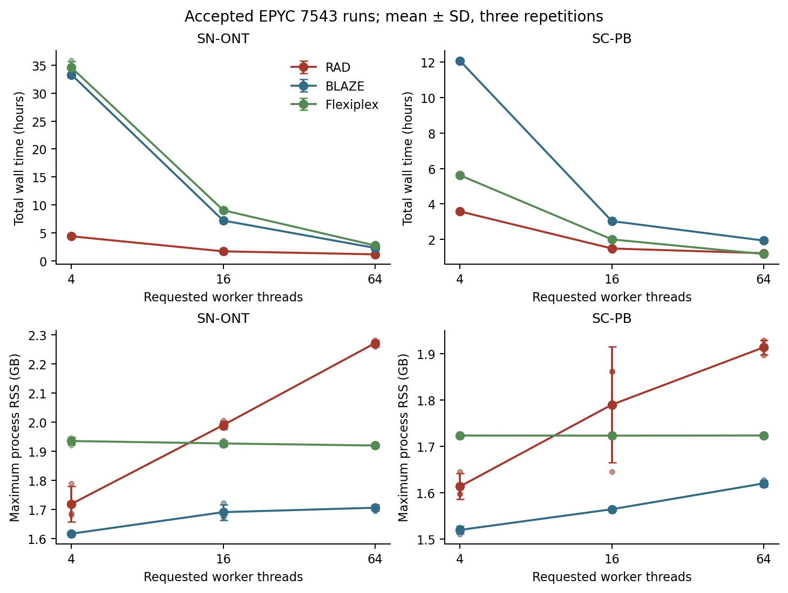
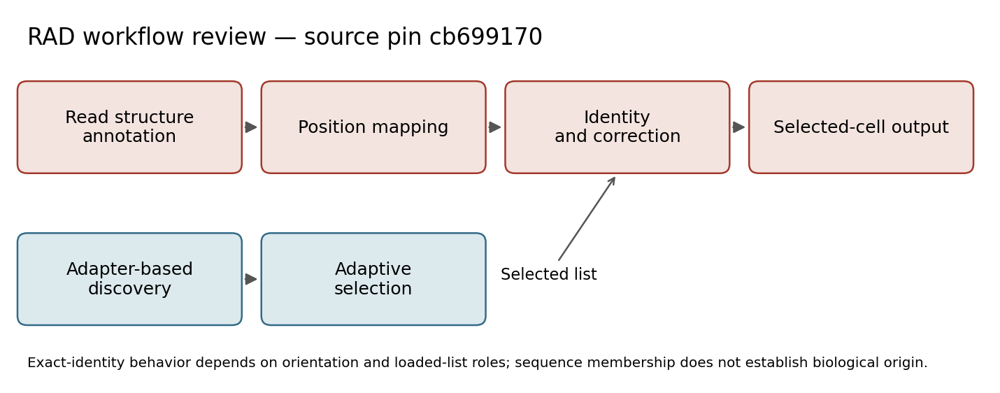

# Figure 1 — workflow, timing, and the HD provenance gap

## Versions and parameters that produced these data

The workflow describes the audited RAD main source at `cb6991705ac0e9c93a108fd439aa0357834cc701`. The timing data were produced by the distinct binaries below. The HD count table's exact producing RAD build/argv and full barcode-to-bin creation code are **unrecovered**; its detection-count stage is now supported by the source definition and exact totals.

| Timing producer | Exact identity | Recorded parameters |
|---|---|---|
| RAD 1.0.2 | commit `4acbe004ba11b150d6832395452632f367a6e6c1`; binary SHA256 `01ae4700f329593487e1b0a3528da009d7e47c82bf213a5f53ba98acad6fda0e` | Detection: adapter `CTACACGACGCTCTTCCGATCT`, barcode16, max-error0.1, 3v3 bitlist, chunk10000. Demux: 3v3 layout, global design + its detected whitelist, offensive correction, whitelist/generated mutation2, minimum length85, chunk5000. |
| BLAZE 2.5.0 | commit `11994f9c12a6664dfe1679576aaca19b6bfd35c1`; launcher SHA256 `64ff267867accdbf9db19ad112fb42c4a9a35054243efcfc7971228942158be8` | Detection: SN-ONT `--force-cells 10000`; SC-PB `--expect-cells 5000`; both `--10x-kit-version 3v3 --minQ 15 --max-edit-distance 2 --batch-size 1000 --no-demultiplexing`. Demux: `--no-whitelisting --known-bc-list` its selected whitelist, ED2, batch1000; SC-PB uses the saved FIFO launcher. `PYTHONHASHSEED=0`. |
| Flexiplex 1.02.6 | commit `d84c8ae4f3865052f2b5ecec816949b94682f302`; pristine binary SHA256 `62a41db2407e2675b8d1bc4201839c9d47b8d102116a0f1d504346ecfc753e10` | Discovery: `-f 0 -p T` plus pinned global3v3 filter. Demux: `-d 10x3v3 -e 2 -f 8 -k SELECTED -p T`; one pigz transport thread. T is4/16/64; exact paths are in saved commands. Filter SHA256 `1711d42b94ece67723f18e9c1b6abcd30cdcbc5e12ecc4adb803eac2efe9f4e6`. |

All timing groups use 4, 16, or 64 tool threads and three repetitions on AMD EPYC 7543. No explicit random tool seed appears; BLAZE explicitly sets `PYTHONHASHSEED=0`. Auxiliary compression/OpenMP settings are part of each command. [The run registry](../manifests/figures_124_tool_parameters.tsv) has one row per producing run, including **all 108 exact accepted command strings**, command hashes, selected whitelist hashes, layout, and threads. [Software/resources](../source_data/figure_01/software_and_resources.tsv) records the full whitelist/layout hashes. These pins are run-specific, not versions inferred from today's README.

## Start with actual measured records

The [example directory](../data/examples/figure_01/) contains real GNU-time records, command files, statuses, and zero-byte COMPLETE markers for SN-ONT/RAD/4 threads/repetition1. The [provenance file](../data/examples/figure_01/provenance.json) identifies each full source SHA256 and byte-identical copy. No controlled FASTQ reads are included.

For example, the actual detection log records 1,143.86 seconds, maxRSS371,452KiB, and exit0. Read the two logs with the small [GNU-time parser](../scripts/revision/figures_124_steps/read_gnu_time.py):

```bash
python3 scripts/revision/figures_124_steps/read_gnu_time.py \
  data/examples/figure_01/raw_timing/whitelist_detection/metrics.tsv \
  data/examples/figure_01/raw_timing/demultiplexing/metrics.tsv \
  --output /tmp/figure1_parsed_time.tsv
```

The checked result is [parsed_gnu_time.tsv](../data/examples/figure_01/parsed_gnu_time.tsv). The script reads measurements; it does not benchmark programs again.

## Recover accepted runs, then combine phases

The preserved timing directory contains nonempty output, while zero-byte completion markers and some stderr files remain at their original scratch paths. Running the original collector on only the preserved directory falsely yields no accepted runs. The reconstruction forms a temporary read-only symlink union of the two locations, rejects conflicting duplicate content, preserves original ACCEPTED pointers and COMPLETE markers, then runs the unchanged [collector](../scripts/revision/figures_124_collect_timing.py). It manufactures neither completion markers nor successful statuses. [Every contributing file](../source_data/figure_01/timing_raw_source_registry.tsv) has an original path and SHA256.

Of 184 attempted phase records, 108 are accepted, giving 54 paired repetitions. For each dataset/tool/thread/repetition key:

- Total wall seconds = detection seconds + demultiplexing seconds.
- Wall hours = total seconds / 3,600.
- Peak process memory in decimal GB = max(two GNU-time maxRSS values in KiB) × 1,024 / 1,000,000,000. This is process maxRSS, not summed process-tree memory.

Run the readable [phase combiner](../scripts/revision/figures_124_steps/combine_timing.py) first on the 12-row excerpt, then on the complete deposited table:

```bash
python3 scripts/revision/figures_124_steps/combine_timing.py \
  data/examples/figure_01/accepted_phase_example.tsv /tmp/figure1_six_totals.tsv
python3 scripts/revision/figures_124_steps/combine_timing.py \
  source_data/figure_01/accepted_phase_records.tsv /tmp/figure1_all54_totals.tsv
```

The example's six results are [combined_example.tsv](../data/examples/figure_01/combined_example.tsv); complete outputs are [combined_replicates.tsv](../source_data/figure_01/combined_replicates.tsv) and [timing_summary.tsv](../source_data/figure_01/timing_summary.tsv). At16threads, mean hours are SN-ONT RAD1.75/BLAZE7.24/Flexiplex9.08 and SC-PB RAD1.49/BLAZE3.04/Flexiplex2.01. Means and sample SD use three repetitions. SN-ONT contains 119,016,231 reads; SC-PB 195,242,483. The old RAD parser reported one fewer SC-PB record; the input manifest retains that discrepancy.



[Editable SVG](../figures/figure_01/timing_descriptive.svg) · [PDF](../figures/figure_01/timing_descriptive.pdf) · [table schemas/units](../source_data/figure_01/schemas.json)

## Workflow source and HD panel

[The algorithm crosswalk](../source_data/figure_01/algorithm_crosswalk.tsv) links the selected conceptual stages to audited source. The [review schematic](../figures/figure_01/workflow_schematic_review.svg) is editable, and represents those stages; it is a scripted review drawing.



For the intended 16µm HD panel, [actual bin examples](../data/examples/figure_01/hd_stage_example.tsv) differ in 165,898 shared bins because these files describe different processing stages. The [original selected input definition](../source_data/figure_01/producing_evidence/HD_selected_count_definition.json) calls the wide table **whitelist-detection output**; the other table labels its column `rad_demux`. PBC44593 detection counts sum 45,979,761, whereas retained demultiplexing counts sum 67,872,744. Requiring these two arrays to be identical was an invalid validation assumption; no scientific values were changed. [Full stage-difference table](../source_data/figure_01/hd_stage_differences.tsv) · [plot contract](../source_data/figure_01/hd_plot_contract.json). The selected wide source is archive-relative `checkpoints/figure_01/sample_bin_matrix_16um.csv.gz` (large checkpoint, not a GitHub text preview); its full source identity is in [the build source registry](../validation/figures_124_build.json).

A fresh complete scan of all four original valid-pair count tables reproduces every wide-table total exactly: PBC44593 45,979,761; PBC44760 39,268,207; PBC49262 41,679,323; PBC52788 47,990,983. [Stage/totals table](../source_data/figure_01/hd_stage_counts.tsv) · [audit](../validation/figures_124_hd_lineage.json). Run `python3 scripts/revision/figures_124_hd_lineage.py --project-root /path/to/rad_data --output-root .` to repeat this count-table scan. Total equality does not establish every barcode-to-bin mapping, so the missing creation provenance is still explicit.

The named Seurat object `visium_hd_mouse_brain_016um_seurat.rds` and `tissue_positions_16um.csv` were not found in a broader metadata-only filename search of all project rad_data, node-local scratch, and preserved scratch. [Search scope/results](../validation/figures_124_hd_asset_search.json) record 3,147 matching candidates and no exact named assets; this is not proof of universal absence or inspection of arbitrary renamed objects. The plotting-required grid columns have now been recovered losslessly from the selected wide-derived table: all 175,561 bins form a complete 419×419 grid, and all 123,658 in-tissue IDs exactly match the independent saved filtered Space Ranger barcode list. Both full bin-ID sets also match the saved raw reference. The original named tissue-position file is still unavailable; no pixel coordinates are inferred. [Grid reconstruction receipt](../validation/figures_124_hd_grid_reconstruction.json) and [reference source hashes](../source_data/figure_01/hd_grid_reference_sources.json) document that scope.

The [eight actual grid rows](../data/examples/figure_01/hd_grid_example.tsv) include four in-tissue and four outside-tissue examples with exact source row lineage. Run the small [grid extractor/checker](../scripts/revision/figures_124_steps/recover_hd_grid.py) using only deposited current data:

```bash
python3 scripts/revision/figures_124_steps/recover_hd_grid.py \
  --input source_data/figure_01/hd_RAD_bins.tsv \
  --raw-barcodes source_data/figure_01/hd_16um_raw_barcodes.tsv.gz \
  --filtered-barcodes source_data/figure_01/hd_16um_filtered_barcodes.tsv.gz \
  --output /tmp/tissue_positions_16um_reconstructed.csv \
  --report /tmp/figure1_grid_receipt.json
```

A targeted inspection also verified the official checksum of the externally recovered public Zenodo `figure_4_workspace.RData` and inventoried its 51 saved objects without running saved functions. It contains Swedish Visium/ScMixology/Split-seq objects, with no top-level HD Seurat, HD grid, or `nCount_Spatial` metadata object; the mixed workspace remains outside this repository. Selected Seurat `nCount_Spatial` values and their creation provenance are still missing. There is no defensible triptych or common color scale yet. No missing bins were filled, no pseudocount was added, and no clustering was invented. Space Ranger here derives from converted Nanopore data; it is not an independent Illumina reference.

## Complete verification

The [build evidence](../validation/figures_124_build.json) and [portable validation](../validation/figures_124_portable.json) retain exact comparisons and tolerances. To redraw the deposited tables, use `python3 scripts/revision/figures_124.py render --output-root .`; this shared renderer also draws Figures2 and4 and does not rerun raw tools. The source reconstruction command is `python3 scripts/revision/figures_124.py build --project-root /path/to/rad_data --output-root .`. Source acquisition is still required for complete raw tool reruns; this reconstruction is not labeled a raw rerun.
