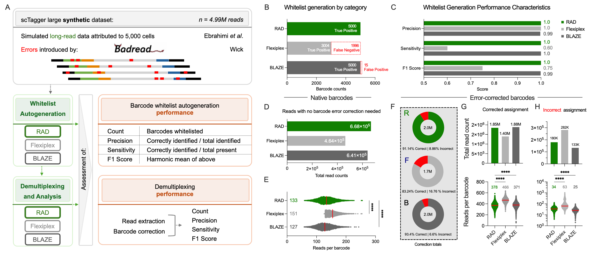

# Figure 2 — synthetic barcode discovery and read assignment

Figure 2 compares barcode discovery and assignment on 4,993,805 ScTagger-L reads from 5,000 known source barcodes. Each read header identifies its source barcode.



[Figure legend](current_figure_legends.md#figure-2) · [Source tables](../source_data/figure_02/) · [Worked examples](../data/examples/figure_02/) · [Nanopore2023 quality sweep](../source_data/figure_02/full_read_quality/) · [Nanopore2018 quality sweep](../source_data/figure_02/full_read_quality_2018/)

## Discovery software and parameters

| Tool | Version and source | Discovery settings |
|---|---|---|
| RAD | 1.0.2; `920addacdbf40b815e13a146226e8f4b14a58aaf` | `scan-wl -p CTACACGACGCTCTTCCGATCT -n 16 -e 0.3 -w 10x_3v3 -t 8 -k 10000 -v` |
| BLAZE | 2.6.0a0 | Expected cells 5,000, 3v3, minimum Q15, eight threads, `--no-emtpy-drops --no-demultiplexing`. |
| Flexiplex | 1.02.6 | `-d 10x3v3 -e 2 -p 8`; separate flank-distance-0 and flank-distance-8 tracks, followed by the global 3v3 filter. |

## Synthetic sequences and base qualities

The discovery input uses ScTagger nucleotide sequences and simulated errors with base qualities assigned from the Badread Nanopore2023 model. Quality generation uses Badread 0.4.1, Python 3.9.16, NumPy 1.23.5, and edlib 1.3.9. The ScTagger-L input contains 8,394,808,882 bases. Its uniform-Q20 and Nanopore2023 files have the same ordered headers and sequences, with sequence-identity SHA-256 `ca3073f0a44d03b40a5919e01e59a8df89ceceafa086ee7580fae2daa3bf2f61`.

All read positions first receive scores sampled from the model's overall distribution. The observed barcode is aligned to its known source sequence. Scores within a located 16-base barcode are then replaced with samples conditioned on the local alignment's matching bases and sequence errors. Reads without a located barcode retain the initial background scores.

The Nanopore2023 generator uses nominal seed `20260731`, adapter edit distance 7, boundary slop 8, a 16,777,216-score sampling tape, and four compression threads. The [environment and commands](../source_data/figure_02/generation_environment.tsv) and [generation contract](../source_data/figure_02/quality_generation_contract.json) define the random streams. Use the [recorded-seed adapter](../scripts/figure_02/generate_with_recorded_seed.py) when relocating model files so that the sampling tape retains its original seed.

The unshifted Nanopore2023 input has a mean base quality of Q31.67 across all reads and Q22.23 within located barcodes.

The [paired FASTQ example](../data/examples/figure_02/) shows the same two read sequences with uniform-Q20 and sampled qualities:

```bash
mkdir -p results
python3 scripts/revision/figures_124_steps/compare_fastq_sequences.py \
  data/examples/figure_02/L_flatQ20_first2.fastq \
  data/examples/figure_02/L_native2023_first2.fastq results/figure2_two_reads.tsv
```

## Barcode discovery in panels B and C

Discovery uses the full chemistry catalog and each tool's barcode-selection procedure. The displayed condition is native Nanopore2023. Selected barcode sequences are compared exactly with the 5,000 source barcodes. True positives are selected source barcodes, false positives are selected barcodes outside the source set, and false negatives are source barcodes absent from the selected set.

```text
precision = TP / (TP + FP)
recall    = TP / (TP + FN)
F1        = 2TP / (2TP + FP + FN)
```

For each Nanopore2023 quality shift, BLAZE recalculated how many extracted barcodes passed Q15 and repeated barcode selection. RAD and Flexiplex use the same sequence-based barcode lists across these shifts. [Discovery metrics](../source_data/figure_02/discovery_metrics.tsv) · [Selected lists](../source_data/figure_02/discovery_callset_manifest.tsv) · [Barcode identities](../source_data/figure_02/discovery_barcode_identities.tsv.gz)

## Assignment runs and plotted barcode sets

| Plotted data | Tool and version | Input and assignment settings |
|---|---|---|
| RAD assignment panels | RAD 1.0.2; `24d5ce47e172222c96cd7dd19e94758d32aa5009` | Uniform Q20; 3v3 layout with a 12-base UMI; the same 5,000 truth barcodes supplied as both the global and custom lists; offensive correction, mutation limits 2/2, chunks of 5,000, 64 threads. |
| BLAZE assignment panels | BLAZE 2.6.0a0 | Previously extracted Nanopore2023 barcodes were matched with barcode distance 2, minimum Q0 and 5,015 selected targets. New candidates were appended in lexical order to the seed-0 candidate order. |
| Flexiplex detected-list totals, correction pie, and panel H distribution | Flexiplex 1.02.6 with raw-barcode diagnostic output | Uniform Q20; 3v3, flank distance 8, barcode distance 2, 16 tool threads; 3,004 discovered targets and four compression threads. |
| Flexiplex per-barcode distributions in panels E and G | Flexiplex 1.02.6 with raw-barcode diagnostic output | Uniform Q20; `-d 10x3v3 -f 8 -e 2 -k TRUTH5000 -p 28`; all 5,000 source barcodes supplied, with four decompression and four compression threads. |

[RAD command](../source_data/figure_02/plotted_assignment/producing_evidence/RAD_command.sh) · [RAD layout](../source_data/figure_02/plotted_assignment/producing_evidence/RAD_input_layout.csv) · [RAD and Flexiplex runs](../source_data/figure_02/plotted_assignment/producing_evidence/) · [Flexiplex diagnostic build](../vendor/flexiplex-audit/) · [BLAZE assignment record](../source_data/figure_02/producing_evidence/assignment_BLAZE_provenance.json)

Panel D reports native-correct reads from the assignment runs listed above. The red Flexiplex increment is the additional native-correct recovery when the complete truth list is supplied. Panels E and G display per-barcode counts for the 5,000 truth targets. Their Flexiplex distributions use the supplied-truth-list run. Panel H uses the discovered Flexiplex list and the truth-supported BLAZE targets. The [per-panel tables](../source_data/figure_02/plotted_assignment/) identify each graph's assignment condition and barcode identities.

## Read classification

Original read identifiers link emitted assignments to the ScTagger source barcode. RAD provides the final barcode in `CB` and the extracted sequence in `CR`; an empty CR identifies native assignments. BLAZE raw extractions come from `putative_bc.csv`. Flexiplex's diagnostic table provides the raw and final barcodes, flank and barcode edit distances, and UMI.

An original read contributes to assignment counts when it has exactly one emitted record. This excludes all reads with multiple records, even when the target is the same. A corrected assignment changes the raw barcode. A correct assignment matches the known source barcode.

| Assignment state | RAD | BLAZE | Flexiplex detected list |
|---|---:|---:|---:|
| Native correct | 667,965 | 640,957 | 463,613 |
| Corrected correct | 1,944,306 | 1,881,358 | 1,398,700 |
| Corrected incorrect | 191,519 | 133,074 | 281,696 |
| Native incorrect | 571 | 764 | 381 |
| Multiple outputs excluded | 9,048 | 0 | 364 |
| Unassigned | 2,180,396 | 2,337,652 | 2,849,051 |

Each column partitions all 4,993,805 input reads. The [full-catalog RAD run](../source_data/figure_02/producing_evidence/assignment_RAD_run.json) used the 3v3 catalog as the global list and the source barcodes as the custom list. Its counts are reported in a [separate assignment summary](../source_data/figure_02/assignment_RAD_summary.json). Panel F's correction-only pies use corrected-correct plus corrected-incorrect assignments as their denominator. The total bars in panels G and H use the corresponding corrected category. Per-barcode distributions retain zero counts for selected targets and blank entries for targets absent from a detected list. BLAZE's panel H distribution covers its 5,000 truth targets; assignments to its fifteen additional selected targets contribute to the total bar separately.

## Reproduce the RAD assignment table

The fixed-5,000 RAD run supplies a `record_audit.tsv.gz` table with the original read ID, known source barcode, observed barcode and assigned barcode. Recalculate the strict assignment states and all 5,000 target rows with:

```bash
python3 scripts/figure_02/summarize_plotted_rad_audit.py \
  --audit external_data/figure_02/RAD_record_audit.tsv.gz \
  --truth source_data/figure_02/plotted_assignment/L_truth_5000_barcodes.txt \
  --output-dir results/figure_02/RAD_assignment
```

[RAD summary](../source_data/figure_02/plotted_assignment/RAD_assignment_summary.json) · [State counts](../source_data/figure_02/plotted_assignment/RAD_assignment_states.tsv) · [Per-target counts](../source_data/figure_02/plotted_assignment/RAD_assignment_per_target.tsv)

Extract the plotted tables from the Prism project.

```bash
python3 scripts/figure_02/extract_plotted_prism.py \
  --prism "external_data/prism/Figure 2.prism" \
  --output-dir results/figure_02/plotted_assignment
```

Rebuild and check the deposited source tables with:

```bash
python3 scripts/revision/figures_124.py build --project-root /path/to/rad_data --output-root .
python3 scripts/revision/figures_124.py validate --output-root .
```

[Table schemas](../source_data/figure_02/schemas.json)
