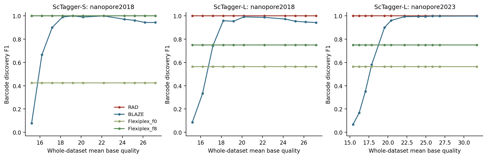
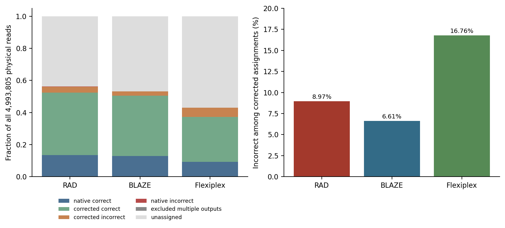

# Figure 2 — quality, barcode discovery, and physical-read assignment

## Versions and parameters that produced these data

These are distinct experiments with distinct pins. Discovery curves do not use the assignment RAD build.

| Experiment/tool | Producing version/build and identity | Parameters, truth, and resources |
|---|---|---|
| Discovery RAD | 1.0.2, build `920adda_edlibfix`; SHA256 `b2feda73a4ae3acf705b724013665af35dff2534f42a568db3f168ca958a2c9e`; commit `920addacdbf40b815e13a146226e8f4b14a58aaf` plus `empty_stream_guard_plus_edlib_null_guard`, linked by exact executable hash | `scan-wl -p CTACACGACGCTCTTCCGATCT -n 16 -e 0.3 -w 10x_3v3 -t 8 -k 10000 -v`; native discovered whitelist. |
| Discovery BLAZE | 2.6.0a0; package-tree SHA256 `d70d28d9d965f6310c850e65f1c76ded552fe61179c6eb5b52a87159b0897aee` | `--expect-cells 50`(S)/`5000`(L), `--10x-kit-version 3v3 --minQ 15 --threads 8 --no-emtpy-drops --no-demultiplexing`. 2023 conditions replay the native extraction cache through the selected pinned selector. |
| Discovery Flexiplex | 1.02.6; binary SHA256 `6eee3a7113044d45e106dc74a541b9a53475311449bf49bd91cc912ba911c40e`; filter source `672ab65cc2fe6fe9f48319a632d72e73c75a1d699b04d6b0f4ec887f5e6bfca0` | `-d 10x3v3 -f 0` or `-f 8`, `-e 2 -p 8`; filter against global3v3. These two flank tracks remain separate. |
| Assignment RAD | 1.0.2, commit `24d5ce47e172222c96cd7dd19e94758d32aa5009`; binary `83145cdd59fcd829e3cef0565787ba16c11c335a329e49692e5c942a3cf306cf` | flatQ20;3v3 layout/12ntUMI; exacttruth5000 supplied as global AND custom whitelist; `-R offensive -M 2 -m 2 -z 5000 -t 64`. |
| Assignment Flexiplex | 1.02.6, upstream `d84c8ae4f3865052f2b5ecec816949b94682f302`; diagnostic binary `38dccd37f1747e5105b62eacde572b7e4c5206fb925dc1fdbe8210ffe8b1e8c4` | flatQ20; `-d 10x3v3 -p 16 -k` its native selected3004; pinned defaults f8/e2; pigz4. The diagnostic adds raw barcode output. |
| Assignment BLAZE | Stock2.6.0a0 matcher; source `dc474d91f0fde73539e4ee13d1449300d4dfe2a801d8703c32f6674bb1730f11` | Native2023 extraction; edit distance2, minQ0; retained seed0 candidate order, newly added candidates appended lexically;5015selected targets. Exact entrypoint argv/worker count remain unrecovered. |

[Machine-readable producing-run registry](../manifests/figures_124_tool_parameters.tsv) · [exact commands, executable identities, layouts, and selector replay source](../source_data/figure_02/producing_evidence/) · [source evidence hashes](../manifests/figures_124_parameter_evidence.tsv). The registry distinguishes copied native runs from selector replays and quality-invariant callset reuse. Expanded argv that were not saved are explicitly marked; an executed shell template is not misrepresented as an expanded command.

Quality generation uses BadRead0.4.1, Python3.9.16, NumPy1.23.5, edlib1.3.9, and the deposited nanopore2018/2023 model bytes. Seeds: S2018=`20260727`; L2018/L2023=`20260731`. [Exact native generation argv](../source_data/figure_02/generation_environment.tsv) specifies adapter-max-ed7, boundary-slop8, tape-size16,777,216, and pigz4. [The complete generation contract](../source_data/figure_02/quality_generation_contract.json) retains literal model paths: the effective BLAKE2b seed includes `seed + NUL + "quality-tape" + NUL + lexical_model_path`. Copying a model to another path without preserving that seed string changes the draw. Both original model paths and hashes were checked on HPC.

## Actual root inputs you can inspect

The [example directory](../data/examples/figure_02/) contains two actual public synthetic FASTQ records from each paired L source, complete 50-barcode S truth and four complete S/shift+1 callsets, plus bounded actual assignment rows. [Provenance](../data/examples/figure_02/provenance.json) gives full-source hashes, row/record lineage, and preview hashes. No controlled raw reads are sampled.

Inspect the paired first two FASTQ records and run the tiny [sequence/quality comparison](../scripts/revision/figures_124_steps/compare_fastq_sequences.py):

```bash
python3 scripts/revision/figures_124_steps/compare_fastq_sequences.py \
  data/examples/figure_02/L_flatQ20_first2.fastq \
  data/examples/figure_02/L_native2023_first2.fastq /tmp/figure2_two_reads.tsv
```

[The result](../data/examples/figure_02/two_read_quality_comparison.tsv) retains identical ordered headers/sequences; qualities differ. Read 1 is 1,164 bases with mean Q20 versus31.5979; read 2 is 712 bases with mean Q20 versus31.2093. This preview demonstrates the transformation; the scientific evidence uses the complete files.

The full scheduled audit checked gzip CRC, unique IDs, all sequence/quality lengths and counts: S 98,873 reads / 320,489,068 bases / 50 truth barcodes; both L sources 4,993,805reads/8,394,808,882bases/5000truth. Both L files share ordered header+sequence SHA256 `ca3073f0a44d03b40a5919e01e59a8df89ceceafa086ee7580fae2daa3bf2f61`. [Audit](../validation/figures_124_fastq_identity.json) · [CPU-only completed job9976816](../validation/figures_124_fastq_scheduler.tsv). This verifies retained inputs; it is not fresh simulation.

## Discovery: sets of cell barcodes

The [small scoring script](../scripts/revision/figures_124_steps/score_whitelists.py) normalizes actual16-base barcode lines, then computes TP=call∩truth, FP=call−truth, FN=truth−call. Precision=TP/(TP+FP), recall=TP/(TP+FN), F1=2TP/(2TP+FP+FN). Score a complete small case:

```bash
python3 scripts/revision/figures_124_steps/score_whitelists.py \
  --truth data/examples/figure_02/S_truth_barcodes.txt \
  --output /tmp/figure2_S_shift1.tsv \
  RAD=data/examples/figure_02/S_shift_p01_RAD.txt \
  BLAZE=data/examples/figure_02/S_shift_p01_BLAZE.txt \
  Flexiplex_f0=data/examples/figure_02/S_shift_p01_Flexiplex_f0.txt \
  Flexiplex_f8=data/examples/figure_02/S_shift_p01_Flexiplex_f8.txt
```

[Actual output](../data/examples/figure_02/S_shift_p01_metrics.tsv): RAD50/0/0, BLAZE2/0/48, Flexiplexf0 50/136/0, Flexiplexf8 50/0/0 (TP/FP/FN). This example shows why discovery performance and assignment correctness answer different questions.

The [full discovery table](../source_data/figure_02/discovery_metrics.tsv) has 144 rows: S/L2018 grids 96 + L2023 grid 48. The shared L2018 data are counted once. Every selected callset was independently rescored, with [source paths/hashes](../source_data/figure_02/discovery_callset_manifest.tsv) and [barcode identities](../source_data/figure_02/discovery_barcode_identities.tsv.gz). For2023 shifts, RAD/Flex callsets are reused because their selected settings are quality-invariant for identical sequences; BLAZE is replayed from native extracted barcodes with shifted qualities.

The quality panel uses [50,000 paired per-read barcode-Q observations](../source_data/figure_02/paired_50000_barcode_mean_Q.csv.gz), [whole-read/barcode histograms](../source_data/figure_02/reconstructed_full_quality_histograms.tsv), [quality summaries](../source_data/figure_02/quality_summary.tsv), and [matched levels](../source_data/figure_02/matched_quality_levels.tsv). Q denotes Phred score, not an error-rate percentage. Means/sampleSD were independently recomputed. The 11 matched whole-read means differ by less than 0.374 Q. Barcode-window counts sum 4,976,160; whole-read histogram counts sum 8,394,808,882 bases. No individual-base quality replay is claimed: the original `sample_replay_evidence.jsonl.gz` is missing, and per-read means cannot reconstruct clipping at individual bases.



[SVG](../figures/figure_02/quality_discovery_sweeps.svg) · [PDF](../figures/figure_02/quality_discovery_sweeps.pdf)

## Assignment: one outcome per physical read

Start from the actual [RAD](../data/examples/figure_02/RAD_assignment_records_example.tsv), [Flexiplex](../data/examples/figure_02/Flexiplex_assignment_records_example.tsv), and [BLAZE](../data/examples/figure_02/BLAZE_assignment_records_example.tsv) row previews. A physical ID determines truth; compare raw barcode to selected target and truth to distinguish native/corrected and correct/incorrect. An unmatched read is unassigned. A repeated physical ID is treated according to the producer's documented output contract:

- RAD: exclude every ID with multiple physical outputs.
- Flexiplex: collapse repeated same-target outputs using the retained first raw observation; exclude conflicting targets.
- BLAZE: classify each of 4,993,805 unique physical IDs from the exact replay records.

Classify the actual excerpt with the [small record classifier](../scripts/revision/figures_124_steps/classify_assignment_preview.py):

```bash
python3 scripts/revision/figures_124_steps/classify_assignment_preview.py --tool RAD \
  data/examples/figure_02/RAD_assignment_records_example.tsv /tmp/figure2_RAD_records.tsv
```

[The classified records](../data/examples/figure_02/RAD_assignment_classified_example.tsv) show raw/target/truth together. Use `--tool Flexiplex` or `--tool BLAZE` with the corresponding input to inspect those contracts. A bounded preview cannot establish whether the same ID occurs later in the full file, so this step deliberately leaves physical-ID duplicate accounting unresolved.

[The independent full rescorer](../scripts/revision/figures_124_assignment_audit.py) makes these branches explicit and tests their edge cases. Run `python3 scripts/revision/figures_124_assignment_audit.py --fixtures-only` for small contract checks; omit the option when the full source paths are mounted. The [complete audit result](../validation/figures_124_assignment_resume.json) records full-source hashes and checks, not estimates from previews.

| State | RAD | Flexiplex | BLAZE |
|---|---:|---:|---:|
| Native correct |667,965|463,613|640,957|
| Corrected correct |1,944,306|1,398,700|1,881,358|
| Corrected incorrect |191,519|281,696|133,074|
| Native incorrect |571|381|764|
| Excluded multiple outputs |9,048|364|0|
| Unassigned |2,180,396|2,849,051|2,337,652|

Each column totals 4,993,805. [Six-state output](../source_data/figure_02/assignment_six_states.tsv) · [per-target output](../source_data/figure_02/assignment_per_target.tsv) · [correction-only output](../source_data/figure_02/correction_only.tsv). All 52,076 selected target/category values match retained canonical arrays. Flexiplex's 1,996 unselected truth targets are blank rather than zero. The 15 BLAZE extras carry908corrected-incorrect and183native-incorrect reads. Correction-only denominators are RAD2,135,825, Flexiplex1,680,396, BLAZE2,014,432; native/excluded/unassigned states are outside them.



[SVG](../figures/figure_02/assignment_descriptive.svg) · [PDF](../figures/figure_02/assignment_descriptive.pdf) · [schemas/units](../source_data/figure_02/schemas.json)

## Preserve the native analysis; record what has not been verified

The author instructed that existing statistics/annotations remain unchanged. No inferential tests or significance labels were added or altered. Scripted proofs are descriptive and do not reproduce native significance annotations. The external selected corrected Prism source was verified without editing it; all 45,000 checked selected-truth CSV cells/blanks match current tables. [Value audit](../validation/figures_124_prism_values.json).

The whole native file includes unrelated and superseded sheets, so it is excluded from this selected-only repository. A clean native project containing current charts/tables still requires licensed Prism authoring. Native Prism load/save/export remains untested on HPC. Both unchanged original and selected copy trigger repeated layout fenIDs134/135 in the general structural verifier; JSON/ZIP/table checks otherwise pass. [Structural report](../validation/figures_124_prism_structure.json) and [native review instructions](../source_data/figure_02/desktop_QA.md) retain the issue without silently editing the file. Existing statistical settings need a native provenance export, not replacement tests.

To redraw all selected F1/2/4 tables: `python3 scripts/revision/figures_124.py render --output-root .`. To reconstruct source tables when project files are mounted: `python3 scripts/revision/figures_124.py build --project-root /path/to/rad_data --output-root .`. Neither command restarts raw demultiplexing.
