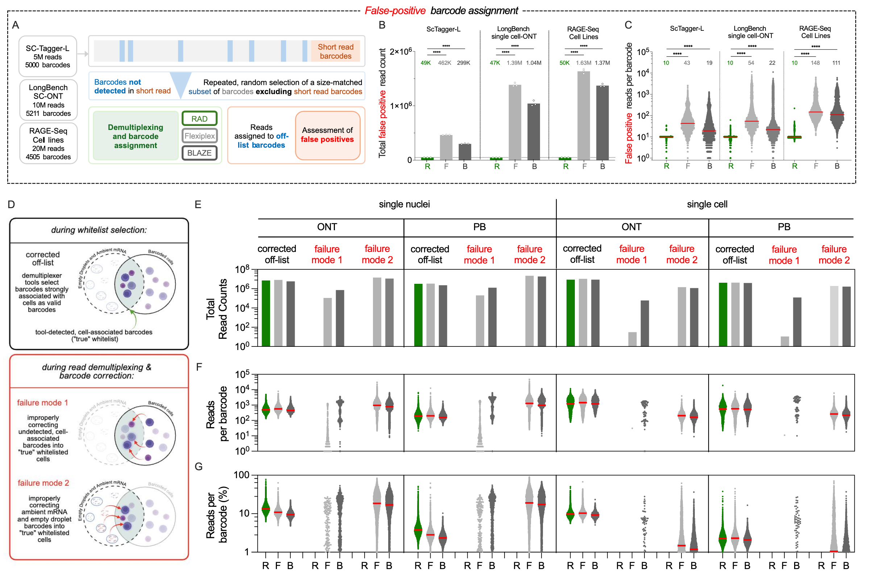

# Figure 3 — off-list assignments and barcode correction

Figure 3 measures assignments to supplied barcode lists that exclude the reference cells, then examines source-to-target barcode changes in the four LongBench datasets.

[Figure legend](current_figure_legends.md#figure-3) · [Source tables](../source_data/figure_03/) · [Worked read examples](../data/examples/figure_03/)



The November artwork uses different RAGE-seq results in panels B–C and different LongBench counts in several E–G series. The linked tables and commands describe the deposited runs.

## Supplied-list challenges

ScTagger-L, LongBench SC-ONT and RAGE-seq used the same procedure.

1. Remove the matched reference barcodes from the chemistry catalog.
2. Independently sample three target lists, each equal in size to the reference.
3. Give RAD, BLAZE and Flexiplex the same input reads and target list within each replicate, using supplied-list demultiplexing.
4. Count original physical reads with exactly one assignment record. Exclude every identifier with multiple records, including repeated assignments to one target. Include supplied targets with zero reads in the per-target table.

The three list draws are technical replicates.

| Input | Reads | Chemistry catalog | Excluded reference | Target-list size | List seeds |
|---|---:|---|---|---:|---|
| ScTagger-L, uniform Q20 | 4,993,805 | 6,794,880 3v3 barcodes | 5,000 source barcodes | 5,000 | 20260813, 20260814, 20260815 |
| LongBench SC-ONT | 10,000,000 | 6,794,880 3v3 barcodes | 5,211 filtered Cell Ranger barcodes | 5,211 | 2026081301, 2026081302, 2026081303 |
| RAGE-seq cell-line mixture, ERR3268991 | 20,346,396 | 737,280 3v2 barcodes | 4,505 filtered Cell Ranger barcodes | 4,505 | 2026102301, 2026102302, 2026102303 |

The LongBench subsample used SeqKit 2.8.2 with seed `2026081326`. List sampling used Python 3.9.16 `random.Random`.

## Software and parameters

### Off-list demultiplexing

| Tool | Version and source commit | Shared command settings |
|---|---|---|
| RAD | 1.0.2, `cd0582b2440cde0f35725dc557fa47307d74d374` | `demux`; supplied custom list and complete chemistry catalog; `-R offensive -M 2 -m 2 -z 5000` |
| BLAZE | 2.6.0a0, `af8d2cc9f6374caf4d1006d5f8a0e99097211646` | `--no-whitelisting --known-bc-list LIST --minQ 15 --max-edit-distance 2 --no-emtpy-drops` |
| Flexiplex | 1.02.6, `d84c8ae4f3865052f2b5ecec816949b94682f302`, with pre-correction barcode output | `-f 8 -e 2 -k LIST` |

| Dataset | Chemistry and UMI layout | RAD / BLAZE / Flexiplex threads | Compression threads |
|---|---|---|---:|
| ScTagger-L and LongBench SC-ONT | 3v3; 12-base UMI | 32 / 32 / 28 | 4 |
| RAGE-seq | 3v2; 10-base UMI | 16 / 16 / 16 | 2 |

The RAGE-seq runs used `PYTHONHASHSEED=20261023` and left `FLEXIPLEX_AUDIT_SOURCE_FILE` unset. [RAGE-seq commands](../scripts/revision/figure_3_rage_run.py) · [BLAZE dependencies](../environments/figure_3_blaze_2.6.0a0.txt) · [Flexiplex source, binary and build instructions](../vendor/flexiplex-audit/)

### LongBench correction analysis

| Tool | Version and source commit | Settings |
|---|---|---|
| RAD | 1.0.2, `4acbe004ba11b150d6832395452632f367a6e6c1` | Offensive correction; mutation limits 2/2; minimum read length 85; chunks of 5,000; 24 / 60 / 28 / 60 workers for SC-ONT / SN-ONT / SC-PB / SN-PB and 4 compression threads; concatemer records included |
| BLAZE | 2.5.0, `11994f9c12a6664dfe1679576aaca19b6bfd35c1` | Expected cells 5,000 for single cells; forced cells 10,000 for nuclei; 48 threads; 3v3 defaults; `PYTHONHASHSEED` unset |
| Flexiplex | 1.02.6, the diagnostic build above | Discovery with flank distance 0; supplied-list demultiplexing with flank distance 8, barcode distance 2 and 16 threads |

## Follow a read to its count

Remove tool-added orientation, concatemer or barcode annotations from output IDs to recover the original read IDs. RAD reports target and source barcodes in `CB:Z:` and `CR:Z:`, respectively. Reverse-complement RAD source barcodes from reverse-oriented records once. Use the target as the source for a native RAD assignment with an explicit empty CR. Read BLAZE sources from its putative-barcode CSV and Flexiplex sources from `RawCellBarcode` in its diagnostic table. [Assignment examples](../data/examples/figure_03/selection_manifest.json)

Run a complete target-level counting example with:

```bash
mkdir -p results
python3 scripts/revision/figure_3_example_count.py \
  data/examples/figure_03/sctagger_rad_rep1_assignments.tsv \
  data/examples/figure_03/sctagger_rad_rep1_targets.txt results/sc_counts.tsv
```

The [expected output](../data/examples/figure_03/sctagger_rad_rep1_counts.tsv) contains ten reads for `AAACCCACACAGTGAG`. The example includes all assignments to that target and every other record sharing one of those original identifiers. The [duplicate example](../data/examples/figure_03/actual_duplicate_assignments.tsv) contains two records for one original read; both are excluded.

Flexiplex counts use its diagnostic stream. The [diagnostic example](../data/examples/figure_03/longbench_flexiplex_rep1_diagnostic.tsv) contains `Read`, `CellBarcode`, `RawCellBarcode`, `FlankEditDist`, `BarcodeEditDist`, and `UMI`.

Each read falls into one of three groups.

```text
input reads = strict assigned reads + excluded ambiguous reads + unassigned reads
```

## Off-list results

The total-count comparison uses all three target lists and reports assigned reads as counts and fractions of the input. The per-target distribution uses replicate 1. [Off-list totals](../source_data/figure_03/offlist_totals.tsv) · [Per-target counts](../source_data/figure_03/offlist_per_target.tsv.gz)

## LongBench correction categories

The chemistry catalog defines valid barcode sequences. The matched Cell Ranger filtered set defines the reference cells or nuclei. All three categories require a change from the observed source barcode.

| Category | Source-to-target change |
|---|---|
| Corrected off-list | Source outside the chemistry catalog → tool-selected target |
| Failure Mode 1 | Source in the matched filtered reference → a different target in that reference and selected by the tool |
| Failure Mode 2 | Catalog-valid source outside the matched filtered reference → tool-selected target |

Counts use unique `(original_id, target_barcode)` pairs within each category, including RAD concatemer records. Repeated records for the same pair are collapsed within a category. A read assigned to two targets can contribute to both, and a pair with different observed sources can contribute to multiple categories. The denominator `O` comprises all unique assignments to the target, including native assignments and assignments with unavailable source barcodes.

Tool-selected targets are joined by barcode sequence within each dataset. An unselected tool–target combination has count zero and a null percentage. A selected target with `O=0` also has a null percentage. Otherwise, the percentage for each category is `100 × category count / O`.

```bash
python3 scripts/revision/figure_3_example_percent.py \
  data/examples/figure_03/correction_C5_input.tsv results/correction_percent.tsv
```

For the example BLAZE target, 1,861 Failure Mode 1 pairs among 13,809 total pairs give 13.4767%. [Expected output](../data/examples/figure_03/correction_C6_output.tsv) · [Per-target counts and percentages](../source_data/figure_03/correction_per_target.tsv.gz) · [Correction totals](../source_data/figure_03/correction_totals.tsv)

## Reproduce the RAGE-seq experiment

Use the ordered ERR3268991 FASTQ, Python 3.9.16, `pigz`, and the pinned tools. RAD calibrates its layout from the first reads, so restore the benchmark order before demultiplexing. Preflight checks the ordered read IDs, sequences and qualities. [Public input guide](rage_public_input_order.md) · [4,505-barcode reference](../data/figure_03/rage_matched_reference_4505.txt) · [3v2 catalog](../data/figure_03/chemistry_3v2_catalog.txt.gz) · [Input hashes](../data/figure_03/source_manifest.tsv)

<details>
<summary>Build the tools and run all nine RAGE-seq combinations</summary>

Build the pinned RAD source and install BLAZE:

```bash
cmake -S /path/to/rad_cd0582_source -B /path/to/rad_build \
  -DCMAKE_BUILD_TYPE=Release -DBUILD_TESTING=OFF
cmake --build /path/to/rad_build -j4
python3.9 -m venv /path/to/blaze_env
/path/to/blaze_env/bin/pip install -r environments/figure_3_blaze_2.6.0a0.txt
/path/to/blaze_env/bin/pip install --no-deps \
  'git+https://github.com/shimlab/BLAZE.git@af8d2cc9f6374caf4d1006d5f8a0e99097211646'
```

The RAD build used GCC 8.5, Boost 1.74, zlib 1.2.11, and `-O3 -DNDEBUG -std=gnu++17 -fopenmp`. Prepare and verify the experiment:

```bash
python3 scripts/revision/figure_3_rage_prepare.py \
  --input /path/to/rageseq.fq.gz \
  --reference data/figure_03/rage_matched_reference_4505.txt \
  --catalog data/figure_03/chemistry_3v2_catalog.txt.gz \
  --rad-source /path/to/rad_cd0582_source --build-rad \
  --blaze-python /path/to/blaze_env/bin/python --blaze-entrypoint /path/to/blaze_env/bin/blaze \
  --flex-binary vendor/flexiplex-audit/bin/flexiplex_v1.02.6_raw_to_assigned_audit
python3 scripts/revision/figure_3_rage_preflight.py
```

Run all three tools with each of the three list replicates, then count:

```bash
python3 scripts/revision/figure_3_rage_run.py RAD 1
python3 scripts/revision/figure_3_rage_run.py BLAZE 1
python3 scripts/revision/figure_3_rage_run.py Flexiplex 1
# Repeat with replicate numbers 2 and 3.
python3 scripts/revision/figure_3_rage_count.py
```

The [scheduler array](../scripts/revision/figure_3_rage_array.sbatch) runs these nine combinations. Complete assignment ledgers and input identifiers are stored under `checkpoints/figure_03/rage_matched/`. Count the ScTagger-L and LongBench SC-ONT outputs with `python3 scripts/revision/figure_3_count.py offlist`.

</details>

## Validate the source tables

From the repository root:

```bash
python3 scripts/revision/figure_3.py validate
```

The validator checks the deposited counts and their denominators. [Table schema](../source_data/figure_03/schema.json) · [Checksums](../source_data/figure_03/checksums.json)
