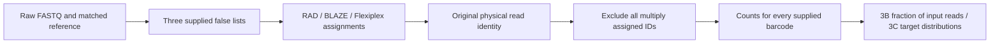
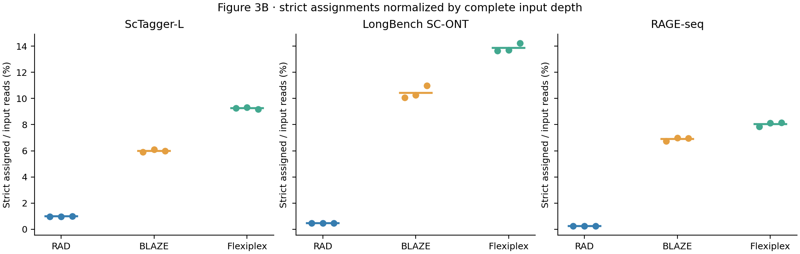
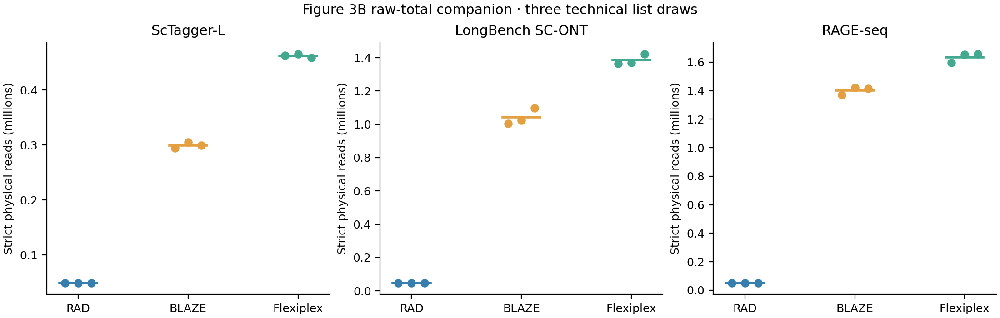
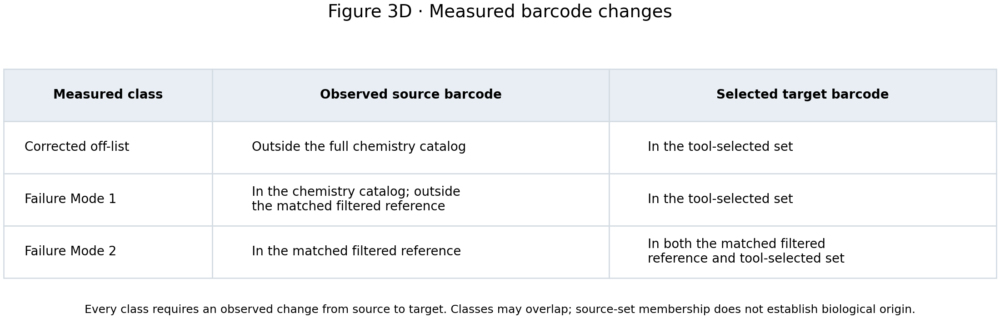
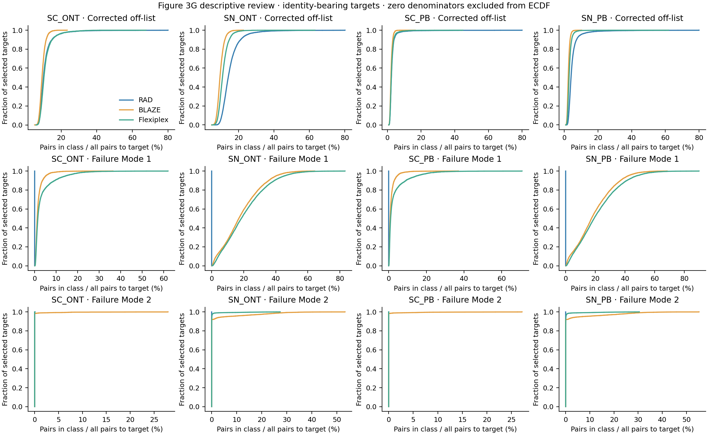

# Figure 3: from a barcode assignment to the plotted count

Figure 3 uses three supplied-list challenges (B–C), followed by four complete LongBench correction comparisons (D–G). The selected RAGE challenge is a new matched replication on all 20,346,396 ERR3268991 reads. Every tool receives identical input bytes and the identical false target list within each replicate. All nine full RAGE producer/count validations passed, including complete input identity, source hashes and physical-read conservation ([receipt](../validation/figure_3_rage_complete.json)). The three list draws are technical randomizations.

**Versions and parameters depend on the analysis.** These are the actual selected runs; there is no global software default. The [complete arm manifest](../manifests/figure_3_tool_parameters.tsv) gives each replicate's exact command, executable/source/patch hashes, input/catalog/reference/list hashes, threads and seed, linked to its [producer receipt](../manifests/figure_3_producers/).

| Analysis | RAD | BLAZE | Flexiplex |
|---|---|---|---|
| RAGE B–C, matched raw replay | 1.0.2, source `cd0582b2440cde0f35725dc557fa47307d74d374`; rebuilt without a patch; offensive correction, `-M 2 -m 2 -z 5000`; 16 workers, 2 compression threads | 2.6.0a0, `af8d2cc9f6374caf4d1006d5f8a0e99097211646`; supplied-list demultiplexing, Q15, edit distance2, no EmptyDrops; 16 threads; `PYTHONHASHSEED=20261023` | 1.02.6, `d84c8ae4f3865052f2b5ecec816949b94682f302` plus raw-barcode diagnostic patch; `-d 10x3v2 -f 8 -e 2 -k LIST -p 16`; 2-thread input/output compression; source filter explicitly unset |
| ScTagger-L and LongBench SC-ONT B–C, retained C2 outputs independently recounted | 1.0.2, `cd0582b…`; original binary `80a573fe…`; offensive, `-M 2 -m 2 -z 5000`; 32 threads; 3v3/UMI12 layout | 2.6.0a0, `af8d2cc…`; supplied-list mode, Q15, edit distance2, no EmptyDrops; 32 threads; hash seed not captured in receipt | Same 1.02.6 diagnostic source/patch/binary; `-d 10x3v3 -f 8 -e 2 -k LIST -p 28`; 4-thread input/output compression |
| LongBench SC-ONT, SN-ONT, SC-PB, SN-PB D–G, retained complete C5 tables | 1.0.2, `4acbe004ba11b150d6832395452632f367a6e6c1`; binary `01ae4700…`; offensive, mutation2/2, minimum read length85, chunk5000; 24/60/28/60 workers for SC-ONT/SN-ONT/SC-PB/SN-PB respectively, plus 4 compression threads; all emitted CT records included | 2.5.0; SC `--expect-cells 5000`, SN `--force-cells 10000`; 48 threads; 3v3 defaults; `PYTHONHASHSEED=UNSET`. The producer receipt does not pin the executable; recovered source pin is `11994f9c12a6664dfe1679576aaca19b6bfd35c1` | Same 1.02.6 diagnostic binary; native discovery flank0, selected-list demultiplexing `-f 8 -e 2 -p 16`; actual tool-specific selected lists |

The Flexiplex binary SHA-256 is `38dccd37f1747e5105b62eacde572b7e4c5206fb925dc1fdbe8210ffe8b1e8c4`; patch SHA-256 is `88dc9cbad139d8ac416803c19c1d4291ebb7e3159f5a1a49205aff59319f86cb`. [Vendored source, patch, pinned binary and build check](../vendor/flexiplex-audit/) make the diagnostic reproducible. `RawCellBarcode` is the extracted sequence before correction. `FLEXIPLEX_AUDIT_SOURCE_FILE` must remain **unset** for the current replication: the matched reference excludes targets during list generation and is never supplied as barcode truth to a demultiplexer. The retained off-list receipts do not capture that environment variable; the current replay explicitly records it.

The RAGE RAD binary SHA-256 is `fc424779c1aba3f112930b4ec8c0dc874b421a217bd53ce6f227e719489a2b2d`. [Build identity](../validation/figure_3_rage_build_identity.json) distinguishes its rebuilt executable from the same source commit used for the retained off-list runs. All nine installed BLAZE2.6.0a0 source modules match the pinned source snapshot ([comparison](../validation/figure_3_blaze_source_identity.json)); [dependency lock](../environments/figure_3_blaze_2.6.0a0.txt) and [source archive hashes](../manifests/figure_3_software_archives.tsv) identify the selected environment.

## The actual data flow



| Input | Reads | Chemistry catalog | Excluded matched reference | List size / seeds |
|---|---:|---:|---:|---|
| ScTagger-L flatQ20 | 4,993,805 | 6,794,880 3v3 sequences | 5,000 truth barcodes | 5,000; 20260813/14/15 |
| LongBench SC-ONT | 10,000,000, Seqkit2.8.2 sample seed2026081326 | 6,794,880 3v3 sequences | 5,211 filtered Cell Ranger barcodes | 5,211; 2026081301/02/03 |
| RAGE-seq ERR3268991 cell-line mixture | 20,346,396 | 737,280 3v2 sequences | 4,505 filtered Cell Ranger barcodes | 4,505; 2026102301/02/03 |

RAGE input SHA-256 is `cfdba50a497dd4f6b24c2a4e730e297a09498ad5fe006f65eee01fa202bcdcec`; the normalized reference hash is `93f7551ec70c57d5f9e6d8e77f4041d19c99acc9b771e16ce1acf26dfac5ba54`; the plain chemistry catalog hash is `b0dda4b114d8fc7ea8def94fb472e6205c1831a72e3ac245ed13cc332d9f20d1`. [Full input validation](../validation/figure_3_rage_input.json) checks compressed bytes, complete FASTQ structure and sequence/quality lengths. [Experiment manifest](../manifests/figure_3_rage_experiment.json) fixes all three list hashes. A reference-excluded barcode is a reference-supported negative proxy; absence from this reference is not proof of biological absence.

## Inspect actual reads and count one target

The examples are bounded actual data, not simulated measurements. [Selection manifest](../data/examples/figure_03/selection_manifest.json) records source hashes and the exact selection. The [RAGE raw FASTQ excerpt](../data/examples/figure_03/rage_raw_reads.fastq), [RAD output FASTQ](../data/examples/figure_03/rage_rad_assigned.fastq), and [parsed assignment rows](../data/examples/figure_03/rage_raw_to_rad_assignments.tsv) expose the extraction step directly. They select the first three single-assignment physical IDs in the **full RAD replicate 1 output** whose raw reads occur in the verified first 10,000 input reads. The bounded input slice only retrieves those reads; assignments come from the complete run. [Their complete per-target C5 counts](../data/examples/figure_03/rage_raw_to_rad_C5_targets.tsv) connect these examples to the full table. The three excerpts themselves are not estimates of full-data totals.

For example, the complete run emits this actual assignment:

```text
physical read: e7985c56-3434-4733-83c7-41fd5ab8249c
RAD record:   e7985c56-3434-4733-83c7-41fd5ab8249c-F
CR source:    TACCCATAGAAACCGC
CB target:    TACTCATAGAAACCGC
```

This physical ID has exactly one assignment row in the full output, so it contributes one strict read. Its target's complete C5 count is10, including nine other physical reads. That target contributes10 to RAD replicate1's total50,349, which is divided by20,346,396 for the normalized B point. This makes the raw record, assignment identity, target count and plotted denominator independently inspectable.

For a complete retained target, open the [ScTagger RAD assigned FASTQ](../data/examples/figure_03/sctagger_rad_rep1_assigned.fastq) and its [parsed rows](../data/examples/figure_03/sctagger_rad_rep1_assignments.tsv). A row begins:

```text
original_id              record_id                  target            source            orientation
AAGAACACACACATTG-307      AAGAACACACACATTG-307-R     AAACCCACACAGTGAG  CAATGTGTGGGTTCTT  reverse_raw
```

`-R` is a RAD orientation suffix; removing it recovers the original physical ID. `target` comes from the `CB:Z:` tag, and `source` from `CR:Z:`. For source classification, a reverse RAD source is reverse-complemented once. An empty RAD CR is explicitly native and uses the target as source. Missing BLAZE/Flex source evidence remains unknown.

The C2 assignment ledger is UTF-8 TSV with a header. One row is one emitted assignment record, not necessarily one physical read:

| Field | Meaning and missing-value rule |
|---|---|
| `original_id` | Required physical read identity after removing only the documented tool suffix/prefix; never a barcode or UMI key |
| `record_id` | Original emitted record identifier; the Flex diagnostic table supplies its `Read` identifier |
| `target` | Required supplied/selected nucleotide barcode; a target outside the supplied list fails validation |
| `source` | Observed extracted nucleotide string; empty is unknown except explicit RAD native evidence |
| `source_evidence` | `RAD_CR`, `BLAZE_putative_csv`, `Flexiplex_RawCellBarcode`, or `missing` |
| `source_kind` | `observed` or `rad_empty_CR_native`; the latter resolves an empty source to the target |
| `orientation` | `reverse_raw` requires one reverse complement for classification; other values preserve the tool-reported orientation |
| `ct` | Integer0/1 for a RAD CT suffix; CT records are retained before grouping/counting |
| `emitted_fastq` | Current RAGE:0/1 when pair multiplicities determine emission, otherwise `undetermined_within_repeated_pair`; retained ledgers say `not_checked` and have a separate complete parity report |
| `assignment_row` | One-based FASTQ record or diagnostic data-row ordinal, preserving repeated rows |

The assigned-read fate table has `original_id`, integer `assignment_rows`, and `state` (`strict_assigned` for exactly one row, `ambiguous_excluded` for more than one). For RAGE, the complete raw ID archive supplies the remaining IDs: **unassigned IDs = input IDs minus IDs in the assigned-read fate table**. This retains every identity without duplicating the entire20-million-ID universe nine times. Grouping spans the complete stream, so a read that reappears later is still ambiguous.

Run the [26-line counting example](../scripts/revision/figure_3_example_count.py):

```bash
python3 scripts/revision/figure_3_example_count.py \
  data/examples/figure_03/sctagger_rad_rep1_assignments.tsv \
  data/examples/figure_03/sctagger_rad_rep1_targets.txt /tmp/sc_counts.tsv
cat /tmp/sc_counts.tsv
```

```text
barcode           strict_physical_reads
AAACCCACACAGTGAG  10
```

The [saved output](../data/examples/figure_03/sctagger_rad_rep1_counts.tsv) is the exact `ScTagger-L / RAD / replicate 1 / AAACCCACACAGTGAG` row in [offlist_per_target.tsv.gz](../source_data/figure_03/offlist_per_target.tsv.gz). It contributes 10 to the replicate total in [offlist_totals.tsv](../source_data/figure_03/offlist_totals.tsv) and one observation of value10 in panel C. That summary also deposits `assignment_fraction = strict assigned / complete input reads` and `mean_assigned_per_target = strict assigned / supplied target count` for every run. Use the assignment fraction to compare datasets with different read depths; raw totals alone do not normalize20.3M,10M and5M inputs. The excerpt includes every assignment to that target, then every other row sharing one of those physical IDs. A row limit would break this guarantee.

Count the [actual duplicate example](../data/examples/figure_03/actual_duplicate_assignments.tsv) in exactly the same way:

```bash
python3 scripts/revision/figure_3_example_count.py \
  data/examples/figure_03/actual_duplicate_assignments.tsv \
  data/examples/figure_03/actual_duplicate_targets.txt /tmp/duplicate_counts.tsv
```

Its two rows share `AACAACCGTGGGTATG-737` and assign different targets; the physical read contributes **zero**. The strict rule also excludes two identical rows to one target. It counts assignment-row multiplicity, not the number of distinct target strings. [Small hand-computable fixtures](../validation/figure_3_counting_fixtures.json) exercise both cases, read re-entry, zero targets, CT records, missing sources and overlapping correction categories.

## Why the diagnostic sidecar matters

Open the [actual Flexiplex diagnostic excerpt](../data/examples/figure_03/longbench_flexiplex_rep1_diagnostic.tsv). Its source schema is `Read, CellBarcode, RawCellBarcode, FlankEditDist, BarcodeEditDist, UMI`, tab separated. The complete target example [parsed rows](../data/examples/figure_03/longbench_flexiplex_rep1_assignments.tsv) retains all identity-sharing rows, including assignments to another target that make a read ambiguous.

```bash
python3 scripts/revision/figure_3_example_count.py \
  data/examples/figure_03/longbench_flexiplex_rep1_assignments.tsv \
  data/examples/figure_03/longbench_flexiplex_rep1_targets.txt /tmp/flex_counts.tsv
cat /tmp/flex_counts.tsv
```

```text
barcode           strict_physical_reads
CCACTTGTCTTTCTTC  43
```

The read `abb4d68b-0846-4910-8c8e-fea3a4153076` is a valid single diagnostic assignment to that target with no emitted FASTQ assignment. [Exact evidence](../data/examples/figure_03/longbench_flexiplex_rep1_sidecar_only.json) includes both source hashes. The complete retained comparison finds 4/1/0 such sidecar-only rows in LongBench replicates 1/2/3 and zero in ScTagger; all shared read–target multiplicities agree and there are no FASTQ-only assignments ([validation](../validation/figure_3_flexparity.json)). Counting the diagnostic stream preserves these assignments. The retained parsed ledger's `emitted_fastq=not_checked` is an explicit unknown; this separate parity evidence establishes the example's status.

## From correction pairs to percentages

D–G use a different counting unit: **unique `(original_id, target_barcode)` pairs within each category**, including all RAD CT records. For each target, `O` is every assigned read–target pair, including native and source-unavailable pairs. A pair can belong to multiple correction categories if its emitted records have different observed sources. Never sum category counts to obtain `O`, and never infer pair intersections from marginal totals.

| Category | Required observed change |
|---|---|
| Corrected off-list | source outside the complete chemistry catalog → selected target |
| Failure Mode 1 | source in catalog but outside matched filtered reference → selected target |
| Failure Mode 2 | source in matched filtered reference → different target also in that reference and selected by the tool |

Every category requires an observed source different from the target. These definitions describe sequence membership, not biological cell origin. Actual tool-selected targets are outer-joined by barcode within each dataset. An unselected tool–target row has `selected_by_tool=0`, count0 and a null percentage; a selected target with no assignments also has a null percentage because `O=0`.

The [actual three C5 input rows](../data/examples/figure_03/correction_C5_input.tsv) select SC-ONT target `GTATTGGAGACGATAT`; [selection/source hashes](../data/examples/figure_03/correction_selection.json) explain the choice. This is retained per-target evidence: the complete source-bearing D–G assignment streams are unavailable at their recorded paths, so the example cannot establish individual full-data pair overlaps.

```bash
python3 scripts/revision/figure_3_example_percent.py \
  data/examples/figure_03/correction_C5_input.tsv /tmp/correction_percent.tsv
cat /tmp/correction_percent.tsv
```

For BLAZE, the observed Failure Mode2 count is1,861 and `O=13,809`, giving `100 × 1861 / 13809 = 13.476718082410022%`. [Nine output rows](../data/examples/figure_03/correction_C6_output.tsv) match the corresponding keys in [correction_per_target.tsv.gz](../source_data/figure_03/correction_per_target.tsv.gz). That table feeds F (count) and G (percentage); [correction_totals.tsv](../source_data/figure_03/correction_totals.tsv) feeds E. All twelve complete C5 arms reproduce their selected totals, and all twelve selected target lists match exactly ([identity validation](../validation/figure_3_reference_identity.json)).

## Reproduce the complete matched RAGE run

The small examples above work from Git alone. Complete replay needs the correctly ordered accession FASTQ, pinned demultiplexers, Python3.9.16 and `pigz`. The complete [4,505-barcode reference](../data/figure_03/rage_matched_reference_4505.txt) and [737,280-barcode catalog](../data/figure_03/chemistry_3v2_catalog.txt.gz) are deposited with [source hashes](../data/figure_03/source_manifest.tsv); preparation accepts plain text or gzip for either file. Large current execution sources are release/checkpoint artifacts listed in the [software archive manifest](../manifests/figure_3_software_archives.tsv); they are excluded from Git. Obtain RAD source at `cd0582b2440cde0f35725dc557fa47307d74d374` from [indianewok/rad](https://github.com/indianewok/rad), and BLAZE at `af8d2cc9f6374caf4d1006d5f8a0e99097211646` from [shimlab/BLAZE](https://github.com/shimlab/BLAZE). The executed RAD build uses CMake Release, GCC8.5, Boost1.74, zlib1.2.11 and `-O3 -DNDEBUG -std=gnu++17 -fopenmp`; it has no source patch. Flexiplex build instructions are [vendored here](../vendor/flexiplex-audit/).

The selected read order is part of the experiment because RAD calibrates its layout from the beginning of the input. Public ENA files can contain the same reads in another order. The [reordering script](../scripts/figure_03/reorder_public_fastq.py) takes the public submitted FASTQ, the selected ordered-ID checkpoint and the [full selected identity receipt](../validation/figure_3_rage_input_identity.json); it requires every ID exactly once and verifies every ordered ID/sequence/quality payload before publishing its output. The selected order archive is `checkpoints/figure_03/rage_matched/counts/input_original_ids.txt.gz`, SHA-256 `e4831a95828b65f21253c9f1058f1af9ef2fa7abe286321d88aaffba12ab2952`, a large release artifact excluded from Git. The [public input acquisition and order guide](rage_public_input_order.md) records the reconstruction status and exact commands; full public reconstruction is being validated separately.

The required canonical ordered-record SHA-256 is `a5f866d6180b46e0acbd3aa2526364060c152380714b00ec0ed74b8c1e8c24af`. Future preflight accepts different gzip bytes only when this complete canonical hash, all 20,346,396 unique IDs and 16,466,857,803 sequence bases match. It records the actual compressed hash. A matching record count or accession alone is insufficient. The canonical encoding and [small identity fixtures](../validation/figure_3_fastq_identity_fixtures.json) make order/quality sensitivity explicit.

```bash
cmake -S /path/to/rad_cd0582_source -B /path/to/rad_build \
  -DCMAKE_BUILD_TYPE=Release -DBUILD_TESTING=OFF
cmake --build /path/to/rad_build -j4
python3.9 -m venv /path/to/blaze_env
/path/to/blaze_env/bin/pip install -r environments/figure_3_blaze_2.6.0a0.txt
/path/to/blaze_env/bin/pip install --no-deps \
  'git+https://github.com/shimlab/BLAZE.git@af8d2cc9f6374caf4d1006d5f8a0e99097211646'

python3 scripts/revision/figure_3_rage_prepare.py \
  --input /path/to/rageseq.fq.gz \
  --reference data/figure_03/rage_matched_reference_4505.txt \
  --catalog data/figure_03/chemistry_3v2_catalog.txt.gz \
  --rad-source /path/to/rad_cd0582_source --build-rad \
  --blaze-python /path/to/blaze_env/bin/python --blaze-entrypoint /path/to/blaze_env/bin/blaze \
  --flex-binary vendor/flexiplex-audit/bin/flexiplex_v1.02.6_raw_to_assigned_audit
python3 scripts/revision/figure_3_rage_preflight.py
```

Preparation first checks all 119 RAD source hashes, the nine pinned BLAZE modules and Python/entrypoint, and the exact diagnostic Flex binary. By default RAD must match the selected executable hash; `--build-rad` builds a new executable from verified source, saves its build receipt, and labels its new hash. Every future producer invocation rechecks all frozen software/list hashes. Preparation then normalizes reference suffixes, verifies exact catalog/reference identities, samples from sorted catalog-minus-reference with Python MT19937, writes the three 4,505-target lists, and freezes user-supplied tool paths. Run each tool with each list on allocated CPU compute:

```bash
python3 scripts/revision/figure_3_rage_run.py RAD 1
python3 scripts/revision/figure_3_rage_run.py BLAZE 1
python3 scripts/revision/figure_3_rage_run.py Flexiplex 1
# Repeat the three commands with replicate2 and replicate3.
python3 scripts/revision/figure_3_rage_count.py
```

The [array script](../scripts/revision/figure_3_rage_array.sbatch) enumerates these nine commands; it is only a scheduler convenience. On Discovery the executed placement is verified CPU-only `standard`, account `lsonglab`,20 allocated CPUs,32GB,8hours, `--gres=gpu:0`,16 tool workers plus2 compression threads; no explicit QoS override. [Run code](../scripts/revision/figure_3_rage_run.py) saves argv and hashes before execution and validates nonempty expected outputs after exit0. The [counting script](../scripts/revision/figure_3_rage_count.py) independently parses the entire raw ID universe, rejects duplicate input IDs or assignment IDs absent from input, compares Flex streams, writes identity-bearing ledgers, and checks for each run:

```text
20,346,396 = strict_assigned + ambiguous_physical_IDs + unassigned
```

The complete ledgers and raw-derived checkpoints live under ignored `checkpoints/figure_03/rage_matched/`; small source tables and validation receipts are deposited. The complete retained ScTagger/LongBench recount is separately executable with `figure_3_count.py offlist`; its18-arm exact comparison passed ([receipt](../validation/figure_3_c2_recount.json)).

The current RAGE strict totals for replicates 1/2/3 are RAD **50,349 / 50,901 / 50,280**, BLAZE **1,369,920 / 1,419,257 / 1,415,786**, and Flexiplex **1,594,697 / 1,652,917 / 1,656,957**. Flexiplex's authoritative diagnostic stream includes 119/149/156 assignment rows absent from its FASTQ; there are no FASTQ-only rows. Every assigned ID belongs to the unique input universe. Ambiguous physical IDs are excluded in full: RAD158/133/155, BLAZE0/0/0, Flexiplex6,200/6,630/6,537.

## Compare the same metric across datasets

Panel B displays **100 × strict assigned physical reads / all input physical reads**, including unassigned and ambiguous reads in the denominator. This normalizes read depth; it does not equate the datasets' chemistry catalogs, target-list sizes or sequence quality. The supplied lists are reference-excluded negative proxies, not independently established biological negatives. Each point is one list draw; the horizontal line is its three-draw arithmetic mean.

| Dataset | RAD mean % [range] | BLAZE mean % [range] | Flexiplex mean % [range] |
|---|---:|---:|---:|
| ScTagger-L, 4,993,805 reads | 0.983171 [0.981156–0.987063] | 5.995482 [5.890799–6.101580] | 9.257056 [9.186842–9.319046] |
| LongBench SC-ONT, 10,000,000 reads | 0.466720 [0.464870–0.469610] | 10.425167 [10.053930–10.975940] | 13.857530 [13.643640–14.225650] |
| RAGE-seq, 20,346,396 reads | 0.248250 [0.247120–0.250172] | 6.888956 [6.732986–6.975471] | 8.035118 [7.837737–8.143737] |

Ranges are minima and maxima over three technical list draws, not confidence intervals. RAD has the smallest assignment fraction in every draw for all three datasets. [Exact descriptive results](../validation/figure_3_offlist_metric_summary.tsv) also give raw totals, each replicate and mean assignments per supplied target. Recreate them with `python3 scripts/revision/figure_3_summary.py`; this computes arithmetic summaries and no hypothesis tests. The raw-total plot is a diagnostic companion to the normalized B plot.

## Draw the selected tables

```bash
python3 scripts/revision/figure_3.py build --project-root /path/to/reviewer_comment_data
python3 scripts/revision/figure_3.py validate
python3 scripts/revision/figure_3.py render
```

`build` requires the complete RAGE validator to pass and reads the selected retained correction checkpoints; `render` reads only deposited source tables and needs NumPy/Matplotlib. [Panel bindings](../source_data/figure_03/panel_data_manifest.tsv) identify the input table, row key, metric and units. Panel C retains the existing replicate 1 binding. Existing statistical choices and annotations are preserved; this scripted data proof introduces no hypothesis test. Native Prism recalculation/export and inspection of the final annotated artwork remain explicit pending steps.






The source-data [schema](../source_data/figure_03/schema.json), [hashes](../source_data/figure_03/checksums.json), [validation](../validation/figure_3_resume.json), and [task evidence](../manifests/figure_3_tasks.json) distinguish completed stages from the remaining full D–G pair-ledger recovery and native artwork QA.
