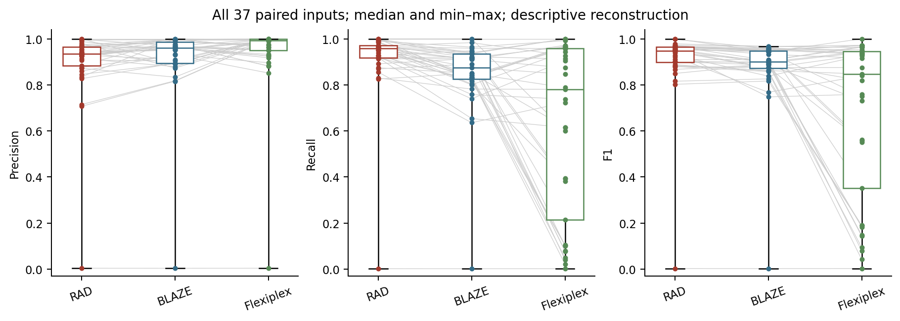
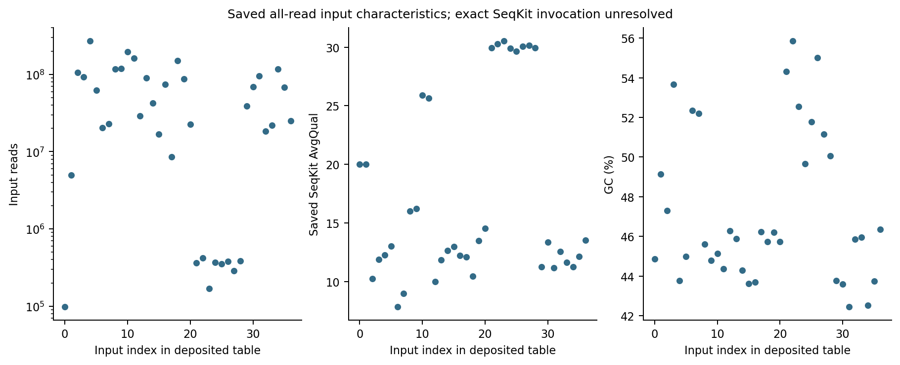

# Figure 4 — barcode discovery across 37 matched inputs

## Versions and parameters that produced these data

Figure 4 is a collection of input-specific producing runs. A single RAD/BLAZE/Flexiplex version would misdescribe it. [The producing-run registry](../manifests/figures_124_tool_parameters.tsv) records 111 Figure 4 input/tool rows, source evidence, exact saved argv where recovered, chemistry/reference, seeds/threads, and explicit unknown fields. [Producer evidence files](../source_data/figure_04/producing_evidence/) contain original selected-run commands and version records; [source hashes](../manifests/figures_124_parameter_evidence.tsv) identify every copy.

| Input group | RAD | BLAZE | Flexiplex | Settings/evidence |
|---|---|---|---|---|
| ScTagger S/L flatQ20 | 1.0.2 `b02ff24110fe45873811d5389d2e58c338045f05`; binary `78169e8e696976b82713f357d31e08fa53595c6d38ac55d989c7c6ce2efafbed` | 2.6.0a0; launcher `46d36e12fb0dfd4ce3c403169bdb9a6574eddc8e5b26363afe40867471f994dc` | 1.02.6; pristine `62a41db2407e2675b8d1bc4201839c9d47b8d102116a0f1d504346ecfc753e10` | RAD e0.3,3v3.1,chunk10000,t8; BLAZE expect50/5000,minQ15,t8; Flex f8/e2,t16. Exact commands and per-run metadata deposited. These are different producing runs from Figure 2. |
| RAGE cell-line and TNBC lymph node | `cd0582b2440cde0f35725dc557fa47307d74d374`; binary `211e75d7211aa14f844fe505cab0cbe48c095bc4bf46ca9b07f0ba7d06981f41` | 2.6.0a0 | 1.02.6; binary `6eee3a7113044d45e106dc74a541b9a53475311449bf49bd91cc912ba911c40e`, filter1.01 | 10x3v2,barcode16/UMI10; primary native selectors. TNBC BLAZE expect10433; scoring reference5978 is a later explicit immune-proxy definition, not the expected-cell setting. |
| Tilgner m1,3runs | 1.0.2 `613a72e90cb5dfc206db113fd98bca656f0ee6c3`; binary `239f4fbe3d0c852c870621853835b6d53003152d3ef13c0a1bafd4503fb0a044`; auto-wl,t30 | 2.5.0; wheel SHA256 `9cf4d9e910894c77fd897a7008f93c1c79064af7bf43d07e998d38c83d4563b8`; expect10205,minQ15,ED2,t48 | 1.02.6; binary `6eee3a7113044d45e106dc74a541b9a53475311449bf49bd91cc912ba911c40e`; native f0,t20 | m1 is distinct from the other donor runs; same donor reference across its technical runs. |
| Other 7 Tilgner inputs | `4acbe00` | Native expected counts: f1 8975, f2 8850, f3 6680, m2 10427, m3 10574; unrecovered exact version explicit | Native f0; unrecovered exact version explicit | Recovered source callsets were rescored against donor-matched filtered-cell references. |
| MPNST1,2inputs | 1.0.2 `4acbe004ba11b150d6832395452632f367a6e6c1` | 2.5.0 | 1.02.6 | RAD e0.3,3v3.1,chunk10000,t16; BLAZE expect4500,minQ15,ED2,t16; Flex3v3/f0/t16. |
| MPNST2,2inputs | Same recorded RAD4acbe004 build | 2.5.0 | 1.02.6 | RAD e0.3,3v3,high-specificity,t20; BLAZE expect11000,minQ15,ED2,t20; Flex3v3/f0/t20. |
| Visium 8 inputs | `5cf1ee6` | 2.6.0a0 | 1.02.6 | RAD e0.30,Visium3′layout; BLAZE expect2500; Flex3v2/f8 with selected-listED2. Exact source-callset distinction retained. |
| ScMixology2 | Native RAD source `2c5a7936e630ccc46548c133855b4bfb4e50f058`, binary `1cf830b970d1c94c66e30b9073d97d9017becc0d3f4a4c8a79956da954bd2d87` | Reconstructed expect500 selector on retained BLAZE counts | Reconstructed1.02.6 filter on common RAD counts | RAD e0.3,3v3,chunk10000,t24. BLAZE/Flex rows are explicitly reconstructed and are not native FASTQ extractions. |

Additional selected inputs have direct producer evidence in the registry: LongBench RAD `920addacdbf40b815e13a146226e8f4b14a58aaf` plus empty-stream/edlib guards (32 threads, scan e0.1), BLAZE2.5.0 (48 threads, SC expect5000/SN force10000, PYTHONHASHSEED unset); PromethION uses the modified `cd0582b` RAD build (e0.1,t32), BLAZE2.6.0a0 expect500, and Flex1.02.6f8; P8-WTA uses RAD `b02ff24110fe45873811d5389d2e58c338045f05` with binary `7af1d51935a64bf05c71d03dc76cc953affc0b788adbdc987eb23a7dff2d5c5b`. LeBrigand uses the combined two-accession producer (RAD920adda_edlibfix, BLAZEexpect918, Flexf8;12threads). Original Measles P7/P8 RAD scan commands are recovered; their producing build identity remains unknown, and the later demultiplexing pin is not substituted. Isosceles saved command reconstructions are labeled as such. LongBench native Flex discovery identities remain unresolved; diagnostic assignment provenance is not substituted. Missing commit/build hashes, expanded argv, chemistry details, or seeds are **unrecovered**, never filled from another experiment or a global README. No new seed was imposed during table reconstruction. The saved SeqKit summary's exact executable version and original all-input invocation remain unrecovered.

## Start with actual rows

[The example input](../data/examples/figure_04/three_input_metrics_example.tsv) contains the complete tool triples for three public/synthetic inputs: ScTagger-S, ScTagger-L, and RAGEseq-TNBC-LN. [Its provenance](../data/examples/figure_04/provenance.json) records full-source SHA256 and exact row numbers. Count units are distinct barcode identities; precision, recall, and F1 are fractions from 0 to 1.

Use the small [metric recomputation script](../scripts/revision/figures_124_steps/recompute_detection_metrics.py):

```bash
python3 scripts/revision/figures_124_steps/recompute_detection_metrics.py \
  data/examples/figure_04/three_input_metrics_example.tsv \
  /tmp/figure4_three_inputs.tsv --expected-inputs 3
```

[The checked example result](../data/examples/figure_04/three_input_metrics_recomputed.tsv) preserves nine input/tool observations. The same script runs on the full current 111-row table:

```bash
python3 scripts/revision/figures_124_steps/recompute_detection_metrics.py \
  source_data/figure_04/barcode_detection_metrics.tsv \
  /tmp/figure4_all37.tsv --expected-inputs 37
```

For every row it requires calls=TP+FP and reference_n=TP+FN, then recomputes precision=TP/(TP+FP), recall=TP/(TP+FN), and F1=2TP/(2TP+FP+FN). It checks complete three-tool pairing by canonical input ID. These are barcode-discovery metrics. They do not measure physical-read assignment or molecule correctness.

## Rescore the complete public identifier sets

[The deposited selected identifier sets](../data/figure_04/README.md) contain the actual saved calls and matched references for all **29 public inputs (87 tool rows)**. The [111-row file manifest](../data/figure_04/identifier_manifest.tsv) provides file hashes and clearly excludes barcode-level publication for eight controlled-access Visium inputs. Identical sets are stored once. [Source lineage](../validation/figures_124_public_identifier_export.json) records original file hashes and membership filters; no calls were inferred from TP/FP/FN totals.

Run the [small portable set scorer](../scripts/revision/figures_124_steps/rescore_public_identifiers.py), without mounted project data or additional packages:

```bash
python3 scripts/revision/figures_124_steps/rescore_public_identifiers.py \
  --output /tmp/figure4_identifier_rescore.tsv
```

It verifies every file hash and independently reconstructs TP, FP and FN from the actual sets. All 87 public rows reproduce the selected counts exactly and floating-point metrics within 1e-9. The 111-row output retains the other 24 rows as explicitly labeled controlled aggregates; it does not claim those rows were rescored from published identifiers. This step connects the full public source identifiers to the plotted tables. Earlier small excerpts remain useful for seeing each operation on a few rows.

## Build the RAGE immune-positive reference explicitly

The selected TNBC lymph-node comparison uses deposited short-read barcodes with labels beginning `T_cell` or `B_cell`, plus `T_B_doublet`, and requires `in_deposited_shortread_list=True`. The bounded [actual annotation excerpt](../data/examples/figure_04/immune_reference_annotation_example.tsv) includes one example of each encountered membership/label class. Run the readable [label filter and scorer](../scripts/revision/figures_124_steps/rescore_immune_reference.py):

```bash
python3 scripts/revision/figures_124_steps/rescore_immune_reference.py \
  data/examples/figure_04/immune_reference_annotation_example.tsv \
  /tmp/figure4_immune_example.tsv
```

This tiny excerpt yields 3 reference barcodes; it is only a demonstration. [Example output](../data/examples/figure_04/immune_reference_example_counts.tsv). On the full source annotation table, the reference has 5,978 barcodes: 4,255 T-cell + 1,637 B-cell + 86 doublets. The complete independently rescored results are:

| Tool | Calls | TP | FP | FN |
|---|---:|---:|---:|---:|
| RAD |5605|5490|115|488|
| BLAZE |4474|3908|566|2070|
| Flexiplex |3707|3677|30|2301|

This is a positive reference proxy, not an exhaustive catalogue of true biological negatives. The cell-line RAGE input has a different matched 4,505-barcode reference. Its input and scoring definition must not be exchanged with the lymph-node input.

## Keep all 37 input identities and execution origins visible

[The current full table](../source_data/figure_04/barcode_detection_metrics.tsv) has 111 rows, and [the inventory](../source_data/figure_04/sample_inventory.tsv) identifies 37 scored inputs plus an HD inventory-only item. Every tool triplet shares the same reference and canonical input identity. [Paired precision](../source_data/figure_04/paired_precision.tsv), [recall](../source_data/figure_04/paired_recall.tsv), and [F1](../source_data/figure_04/paired_f1.tsv) preserve the same 37 rows.

ScMixology2 is explicitly a mixed reconstructed input: native RAD279calls/233TP; BLAZE188calls/188TP reconstructed from native counts; Flexiplex184calls/183TP from common-count filter replay. Its matched Cell Ranger reference contains 248 barcodes. The native RAD set is independently identical to the retained RDS. No claim is made that the reconstructed BLAZE/Flex rows are fresh native extractions. [ScMix rescore](../validation/figures_124_scmix_rescore.json).

Native-path recovery mapped 51 artifacts while preserving original provenance strings. All 30 Tilgner tool/reference pairs were independently rescored. The source master validator passes 703 checks. Four original `/tmp/rad_split_e030_finite_verify_20260802/` Visium RAD split callsets remain unavailable; current metrics and their recorded hashes are retained. A normalized retained Tilgner copy that differs in raw bytes is labeled explicitly and was rescored; it is not called byte-identical. [Path-recovery report](../validation/figures_124_native_master_path_recovery.json) · [Tilgner rescore](../validation/figures_124_tilgner_rescore.json) · [independent master checks](../validation/figures_124_native_independent_validation_summary.json).

The 37 input observations include repeated biological material, technical libraries, and sequencing runs. They are not 37 independent biological replicates. The author instructed that existing statistics and annotations remain unchanged. No replacement test or new significance annotation was run. Scripted proofs show individual observations, median boxes, and min–max whiskers; they do not reproduce native significance labels. The exact original statistical procedure/settings remain a documented provenance gap, not a reason to silently substitute another procedure.



[Editable SVG](../figures/figure_04/barcode_detection_all37_descriptive.svg) · [PDF](../figures/figure_04/barcode_detection_all37_descriptive.pdf)

## Input characteristics and remaining acquisition work

[The saved 37-row all-read SeqKit summary](../source_data/figure_04/input_characteristics.tsv) was joined by exact canonical identities; no input was dropped. Read counts, bases, length summaries, GC, and quality fields retain the [schema/units](../source_data/figure_04/schemas.json). ScTagger remains flatQ20 for this Figure 4 input description. [Saved provenance](../source_data/figure_04/seqkit_saved_provenance.json) identifies the recovered table. This is a validated saved summary, not a freshly executed all-input SeqKit run; original tool version/argv have not been recovered.



[SVG](../figures/figure_04/input_characteristics_descriptive.svg) · [PDF](../figures/figure_04/input_characteristics_descriptive.pdf).

To reproduce the source-level recovery with mounted project files, run `python3 scripts/revision/figures_124_native_recovery.py --project-root /path/to/rad_data --output-root .`; upstream full master tables are used only in a temporary validation workspace. The final repository publishes selected current rows. Raw acquisition and original producing binary/argv recovery remain separate from table rescores. Complete raw reruns require the full input files, matched references, and verified producing software; no raw rerun is inferred from a successful render.

Run `python3 scripts/revision/figures_124.py render --output-root .` to redraw deposited F1/2/4 tables, or `python3 scripts/revision/figures_124.py validate --output-root .` for portable table checks. [Execution report](../validation/figures_124_handback.md) · [statistics/native review record](../validation/figures_124_decisions.md).
