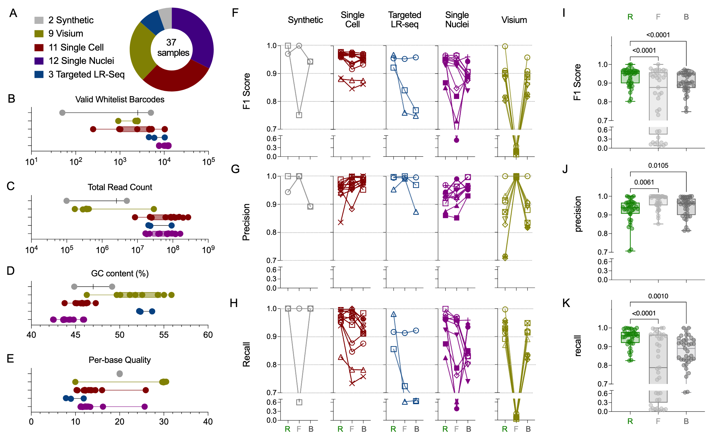

# Figure 4 — barcode discovery across 37 sequencing inputs

Figure 4 compares barcode discovery across 37 sequencing inputs spanning synthetic reads, single-cell and single-nucleus libraries, targeted receptor sequencing, and spatial transcriptomics.

[Tool versions and command flags](../source_data/figure_04/tool_parameters.tsv) · [Input inventory](../source_data/figure_04/sample_inventory.tsv)



## Inputs and barcode references

Each library or flow-cell run is scored separately. P8 denotes the whole-transcriptome library, and P8-enriched denotes the corresponding VDJ-enriched library.

Synthetic inputs use known source barcodes as the reference. Biological inputs use matched filtered short-read barcodes, published cell annotations, or spatial masks. The chemistry catalog defines valid barcode sequences. All three tools are scored against the same reference for each input.

The RAGE-seq cell-line mixture uses a 4,505-barcode reference. The TNBC lymph-node reference uses deposited short-read barcodes annotated as `T_cell*`, `B_cell*`, or `T_B_doublet`, with `in_deposited_shortread_list=True`. This produces 5,978 reference barcodes: 4,255 T-cell, 1,637 B-cell, and 86 T/B-doublet barcodes.

The [input-characteristics table](../source_data/figure_04/input_characteristics.tsv) gives read counts, read lengths, GC content, and quality statistics, including SeqKit’s `AvgQual`.

## Discovery software and settings

RAD 1.0.2 processes each complete input with `scan-wl --max-error 0.3` and high-specificity selection. ScTagger inputs use uniform Q20 scores. Biological inputs retain their original quality scores. [RAD source commit](https://github.com/indianewok/rad/commit/4acbe004ba11b150d6832395452632f367a6e6c1)

Input files, chemistry catalogs, and scoring references are listed in the run records. [Input records](../source_data/figure_04/run_records/) · [RAD commands](../source_data/figure_04/producing_evidence/current_RAD/)

Flexiplex discovery uses flank distances `-f 0` and `-f 8`, followed by filtering against the complete chemistry catalog. When both settings are available, the higher-F1 setting supplies all three plotted metrics. [Flexiplex settings and scores](../source_data/figure_04/plotted_checkpoint/flexiplex_selected_conditions.tsv)

| Displayed flank distance | Inputs | Count |
|---|---|---:|
| `-f 0` | P8 WTA; PromethION iPSC; LongBench SN-ONT, SC-PB, and SN-PB; Isosceles ovarian; nine hippocampal inputs; four MPNST inputs; section17 1T/1B and 4T/1B; ScMixology2 | 22 |
| `-f 8` | ScTagger-S/L; P7 and P8 VDJ-enriched; both RAGE-seq inputs; LongBench SC-ONT; LeBrigand-MOB; Tilgner m1 ONT Run3; the six other tonsil inputs | 15 |

RAD, BLAZE 2.5.1, and Flexiplex 1.02.7 (release v1.02.7.1) process all 25,164,948 ScMixology2 reads. BLAZE uses `--expect-cells 500 --minQ 15 --max-edit-distance 2`. Flexiplex uses `-d 10x3v3 -f 0 -e 2`, followed by `flexiplex-filter` against the complete chemistry catalog. Both comparators use 16 threads. Scoring uses the 248 matched Cell Ranger barcodes. [ScMixology2 commands](../scripts/figure_04/scmixology2/README.md)

## Barcode scoring and panel tables

Scoring matches selected barcodes to the reference by exact sequence. True positives are selected reference barcodes. False positives are selected barcodes outside the reference. False negatives are reference barcodes absent from the selected set.

```text
precision = TP / (TP + FP)
recall    = TP / (TP + FN)
F1        = 2TP / (2TP + FP + FN)
```

The figure uses 111 input–tool observations. The paired and modality tables organize the same 333 metric values. [Plotted metrics](../source_data/figure_04/plotted_checkpoint/plotted_metrics.tsv) · [F1](../source_data/figure_04/plotted_checkpoint/paired_f1.tsv) · [Precision](../source_data/figure_04/plotted_checkpoint/paired_precision.tsv) · [Recall](../source_data/figure_04/plotted_checkpoint/paired_recall.tsv) · [Panel sources](../source_data/figure_04/plotted_checkpoint/panel_bindings.json)

Use the plotted metrics for comparisons across the 37 inputs. RAD has the highest F1 on 25 inputs, and BLAZE and Flexiplex each lead on six. The barcode-count table gives the number of calls, reference size, TP, FP, and FN for the recorded runs. For LongBench SC-ONT, it gives the Flexiplex flank-distance-zero result. The figure uses flank distance eight, which gives Flexiplex the highest F1 on that input. [Barcode counts](../source_data/figure_04/barcode_detection_metrics.tsv) · [Differences between the run and plot tables](../source_data/figure_04/plotted_checkpoint/producer_comparison.tsv) · [LongBench SC-ONT flank-distance-zero run](../source_data/figure_04/producing_evidence/LongBench-SC-ONT_Flexiplex_whitelist_provenance.json)

ERR15095097 is deposited under the MPNST2 sample label. Its raw-read barcode identities match the 4,602-barcode MPNST1 (2020_23) short-read reference used for scoring. ERR15095096 uses the MPNST2 reference. [Deposited sample metadata](https://www.ebi.ac.uk/biostudies/files/E-MTAB-15190/E-MTAB-15190.sdrf.txt) · [ERR15095097 scoring record](../source_data/figure_04/reference_scoring/ERR15095097.json)

To recalculate the ERR15095097 metrics, use the selected barcode files from each run.

```bash
REFERENCE=external_data/figure_04/references/ERR15095094_MPNST1_scNaUMIseq_MinION.reference.txt.gz
RECORD=source_data/figure_04/run_records/ERR15095097.json

python3 scripts/figure_04/rescore_reference.py --dataset-record "$RECORD" \
  --tool RAD --selected "$RAD_SELECTED" --reference "$REFERENCE" \
  --output results/figure_04/ERR15095097/RAD_metrics.tsv
python3 scripts/figure_04/rescore_reference.py --dataset-record "$RECORD" \
  --tool BLAZE --selected "$BLAZE_SELECTED" --reference "$REFERENCE" \
  --output results/figure_04/ERR15095097/BLAZE_metrics.tsv
python3 scripts/figure_04/rescore_reference.py --dataset-record "$RECORD" \
  --tool Flexiplex --selected "$FLEXIPLEX_SELECTED" --reference "$REFERENCE" \
  --output results/figure_04/ERR15095097/Flexiplex_metrics.tsv
```

Set `RAD_SELECTED`, `BLAZE_SELECTED`, and `FLEXIPLEX_SELECTED` to the emitted selected-list files. The script accepts plain or gzipped lists, checks reference identity, and removes a terminal `-1` suffix from short-read reference barcodes.

## Matched statistical comparison

For each metric, a Friedman test compares the three tools across 37 matched sequencing inputs. Two Dunn comparisons follow, RAD versus BLAZE and RAD versus Flexiplex. P values are adjusted for both comparisons within each metric. The implementation follows GraphPad’s Dunn calculation.

The box plots show medians and distributions across the 37 inputs. Whiskers extend to the minimum and maximum. [Friedman results](../source_data/figure_04/plotted_checkpoint/friedman.tsv) · [Dunn results](../source_data/figure_04/plotted_checkpoint/dunn.tsv) · [Statistical implementation](../scripts/figure_04/statistics.py) · [GraphPad’s Dunn calculation](https://www.graphpad.com/guides/prism/latest/statistics/stat_how_the_dunn_method_for_nonpar.htm)

## Run one input from reads to metrics

This example runs RAD on ScTagger-S, which contains 98,873 reads from 50 source barcodes. [Build and run instructions](../scripts/figure_04/README.md) · [ScTagger-S input record](../source_data/figure_04/run_records/ScTagger-S_flatQ20.json)

```bash
mkdir -p results/figure_04/ScTagger-S_flatQ20
external_data/software/rad_build_4acbe00/rad scan-wl \
  --input external_data/figure_04/inputs/ScTagger-S_flatQ20.fastq.gz \
  --output-prefix results/figure_04/ScTagger-S_flatQ20/rad \
  --adapter_seq CTACACGACGCTCTTCCGATCT \
  --barcode-length 16 \
  --max-error 0.3 \
  --whitelist external_data/figure_04/catalogues/3M-february-2018-3v3.txt_bitlist.csv.gz \
  --threads 16 --chunk-size 10000
```

To run discovery and score its selected barcodes in one step, use the [single-input script](../scripts/figure_04/run_scan.py).

## Recalculate barcode-set scores and the plotted comparison

Recalculate scores for ScTagger-S, ScTagger-L, and the RAGE-seq lymph-node input. [Example data](../data/examples/figure_04/three_input_metrics_example.tsv)

```bash
mkdir -p results
python3 scripts/revision/figures_124_steps/recompute_detection_metrics.py \
  data/examples/figure_04/three_input_metrics_example.tsv \
  results/figure4_example.tsv --expected-inputs 3
```

Use `source_data/figure_04/barcode_detection_metrics.tsv` and `--expected-inputs 37` to recalculate scores from the recorded barcode counts. [Expected example output](../data/examples/figure_04/three_input_metrics_recomputed.tsv)

The next commands show how to apply the lymph-node reference annotations and check the plotted metrics. [Lymph-node annotations](../data/examples/figure_04/immune_reference_annotation_example.tsv)

```bash
python3 scripts/revision/figures_124_steps/rescore_immune_reference.py \
  data/examples/figure_04/immune_reference_annotation_example.tsv \
  results/figure4_immune_example.tsv
python3 scripts/figure_04/extract_plotted_prism.py \
  --prism "external_data/prism/Figure 4.prism" \
  --producer-metrics source_data/figure_04/barcode_detection_metrics.tsv \
  --output-dir results/figure_04/plotted_checkpoint
python3 scripts/figure_04/extract_plotted_prism.py --validate-only \
  --output-dir results/figure_04/plotted_checkpoint
```

The extractor checks the 333 plotted values and the Flexiplex flank settings, then recalculates the Friedman and Dunn tests. Use `--validate-only` with `source_data/figure_04/plotted_checkpoint` to check the supplied tables. [Table fields](../source_data/figure_04/schemas.json)
