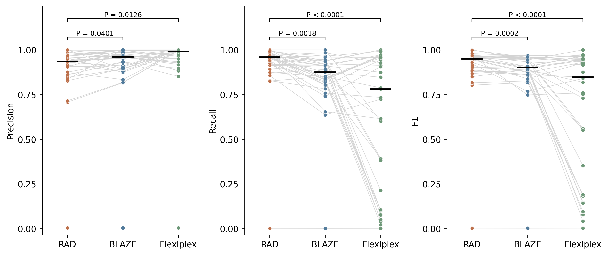
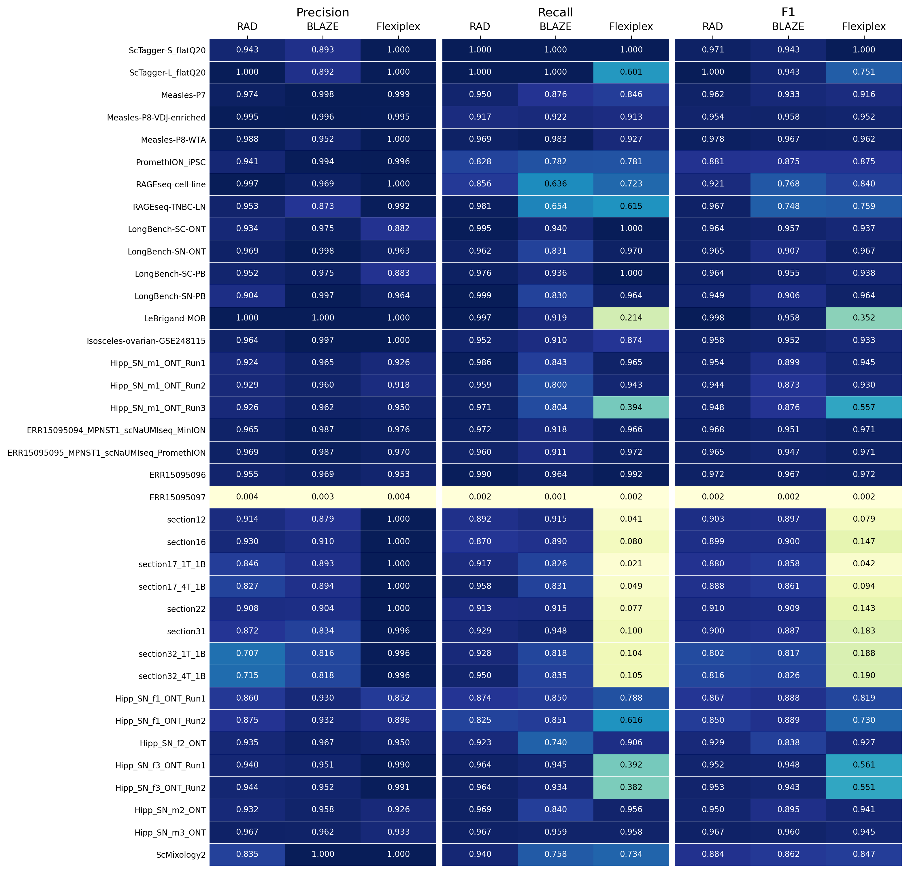

# Figure 4 — barcode discovery across 37 inputs

**RAD 1.0.2, commit [`4acbe004ba11b150d6832395452632f367a6e6c1`](https://github.com/indianewok/rad/commit/4acbe004ba11b150d6832395452632f367a6e6c1), `scan-wl --max-error 0.3`, complete inputs.**

The [per-input tool table](../source_data/figure_04/tool_parameters.tsv) records the RAD, BLAZE and Flexiplex versions, source commits, threads, chemistry and available commands; unrecovered comparator entries are marked explicitly. BLAZE and Flexiplex settings vary by input. The [RAD run records](../source_data/figure_04/run_records/) specify each input, catalogue and matched reference; [execution records](../source_data/figure_04/producing_evidence/current_RAD/) report the selected build and output counts.



Each point is one sequencing input. Lines join the three tools on that input; black bars show medians. Labels show Dunn-adjusted P-values for the two RAD comparisons within each metric. Individual libraries and technical runs retain their own input identifiers.

## Read the results

The [metrics table](../source_data/figure_04/barcode_detection_metrics.tsv) contains 111 observations: 37 inputs × three tools. For each observation it reports called barcodes, reference barcodes, TP, FP, FN, precision, recall and F1. The [sample inventory](../source_data/figure_04/sample_inventory.tsv) identifies the input, donor, library and sequencing-run relationships.



The [paired precision](../source_data/figure_04/paired_precision.tsv), [recall](../source_data/figure_04/paired_recall.tsv) and [F1](../source_data/figure_04/paired_f1.tsv) tables use the same 37 input rows. The [input-characteristics table](../source_data/figure_04/input_characteristics.tsv) contains the saved full-input SeqKit summaries, including read counts, lengths, GC and quality statistics. Its `AvgQual` field follows SeqKit's definition; the original SeqKit version and invocation are unavailable.

The statistical analysis uses the existing Friedman test across the three tools, followed by two Dunn comparisons per metric: RAD versus BLAZE and RAD versus Flexiplex. Adjustment is within each metric's two-comparison family. The [Friedman results](../source_data/figure_04/friedman.tsv) and [Dunn results](../source_data/figure_04/dunn.tsv) give the statistics and P-values. The [calculation script](../scripts/figure_04/statistics.py) implements [GraphPad's documented Dunn calculation](https://www.graphpad.com/guides/prism/latest/statistics/stat_how_the_dunn_method_for_nonpar.htm).

## What the reference means

Synthetic inputs use their known source barcode sets. Biological inputs use matched filtered short-read barcodes or published spatial masks. TP is the intersection between a tool's selected set and its reference; FP is selected barcodes outside that reference; FN is reference barcodes not selected. These metrics measure agreement with the stated reference.

```text
precision = TP / (TP + FP)
recall    = TP / (TP + FN)
F1        = 2TP / (2TP + FP + FN)
```

The RAGE-seq TNBC lymph-node reference includes deposited short-read barcodes annotated as `T_cell*`, `B_cell*` or `T_B_doublet`, with `in_deposited_shortread_list=True`: 5,978 barcodes comprising 4,255 T-cell, 1,637 B-cell and 86 T/B-doublet barcodes. The cell-line input has a separate 4,505-barcode reference.

ScMixology2 uses the same complete 25,164,948-read FASTQ for native RAD, BLAZE 2.5.1 and Flexiplex 1.02.7 (release v1.02.7.1) runs. BLAZE uses `--expect-cells 500 --minQ 15 --max-edit-distance 2`; Flexiplex uses `-d 10x3v3 -f 0 -e 2` followed by `flexiplex-filter` against the complete chemistry catalogue. Both comparators use 16 threads. The matched 248-barcode Cell Ranger reference is used for scoring. [Commands and outputs](../scripts/figure_04/scmixology2/README.md) provide the per-tool steps and pinned software identities.

ERR15095097 is deposited as MPNST2, but its raw FASTQ barcode identities disagree with the deposited MPNST2 processed-cell set. All three tools are scored against the deposited MPNST2 reference. This unresolved sample/reference pairing affects interpretation of that input. The public [library metadata](https://www.ebi.ac.uk/biostudies/files/E-MTAB-15190/E-MTAB-15190.sdrf.txt) and [processed MPNST2 barcodes](https://www.ebi.ac.uk/biostudies/files/E-MTAB-15190/MPNST2_scNaUmiSeq_PromethION_barcodes.tsv.gz) identify the deposited sample.

## Walk through one dataset

Start with [ScTagger-S's run record](../source_data/figure_04/run_records/ScTagger-S_flatQ20.json) and its row in the tool table. Its complete input has 98,873 reads from 50 true barcodes, with uniform Q20 scores. RAD selects 53 barcodes: 50 TP, three FP and zero FN, giving precision 50/53, recall 50/50 and F1 100/103. The [two ScTagger-L FASTQ records](../data/examples/figure_02/L_flatQ20_first2.fastq) show the read format used by the uniform-Q20 simulation: identifier, nucleotide sequence, `+`, and one quality character per base.

Build the pinned source using the [single-dataset instructions](../scripts/figure_04/README.md). The native command for ScTagger-S is:

```bash
mkdir -p results/figure_04/ScTagger-S_flatQ20
external_data/software/rad_build_4acbe00/rad scan-wl \
  --input external_data/figure_04/inputs/ScTagger-S_flatQ20.fastq.gz \
  --output-prefix results/figure_04/ScTagger-S_flatQ20/rad \
  --adapter_seq CTACACGACGCTCTTCCGATCT \
  --barcode-length 16 --left-margin 0 --right-margin 0 \
  --max-error 0.3 \
  --whitelist external_data/figure_04/catalogues/3M-february-2018-3v3.txt_bitlist.csv.gz \
  --threads 16 --chunk-size 10000
```

The chemistry catalogue is the full set of allowed barcode sequences. It is separate from the matched reference used for scoring. All RAD scans use the complete selected input and high-specificity selection, without a read cap. ScTagger's uniform-Q20 input is specified explicitly; biological inputs retain their native qualities.

The [single-dataset runner](../scripts/figure_04/run_scan.py) verifies the build and inputs, saves the native command and output, and writes a metrics CSV plus a barcode-membership CSV. The latter shows which selected barcodes match the reference. Complete barcode lists and external input files are kept outside Git. Controlled-access spatial data require their registered access process.

## Recalculate the deposited tables

The [small example](../data/examples/figure_04/three_input_metrics_example.tsv) contains all three tools for ScTagger-S, ScTagger-L and the RAGE-seq lymph node. Recalculate its metrics from TP, FP and FN:

```bash
mkdir -p results
python3 scripts/revision/figures_124_steps/recompute_detection_metrics.py \
  data/examples/figure_04/three_input_metrics_example.tsv \
  results/figure4_example.tsv --expected-inputs 3
```

Compare this with the [expected output](../data/examples/figure_04/three_input_metrics_recomputed.tsv). Use `source_data/figure_04/barcode_detection_metrics.tsv` and `--expected-inputs 37` to check the complete comparison. The [immune-reference example](../data/examples/figure_04/immune_reference_annotation_example.tsv) shows how annotation labels select the lymph-node reference:

```bash
python3 scripts/revision/figures_124_steps/rescore_immune_reference.py \
  data/examples/figure_04/immune_reference_annotation_example.tsv \
  results/figure4_immune_example.tsv
python3 scripts/figure_04/statistics.py \
  --output-dir results/figure_04/statistics
python3 scripts/figure_04/plot_discovery.py \
  --statistics-dir results/figure_04/statistics \
  --output-dir results/figure_04/plots
```

The plotted points and labelled matrices above are generated directly from the current source table. [Schemas](../source_data/figure_04/schemas.json) define its fields.
