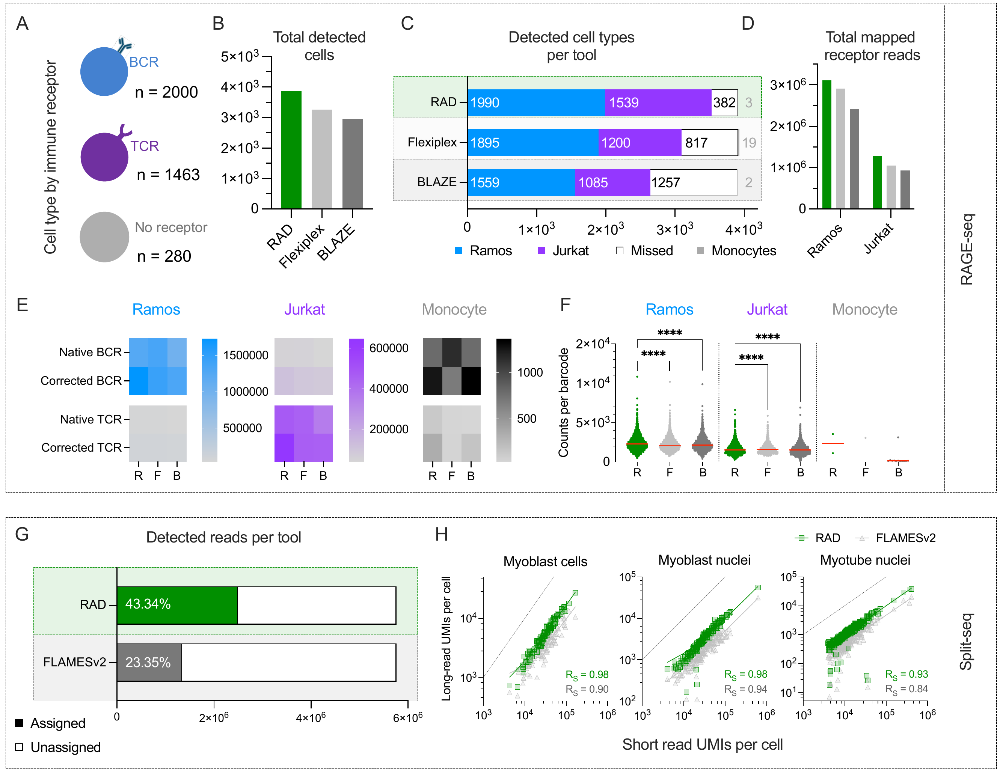

# Figure 5 Receptor recovery and LR-Split-seq

Panels A–F measure B-cell and T-cell receptor read recovery in a RAGE-seq mixture of Ramos B cells, Jurkat T cells and monocytes. Panels G–H compare barcode assignment and per-cell UMI recovery in LR-Split-seq.

[Receptor processing settings](#rage-seq-receptor-recovery) · [LR-Split-seq settings and code](#lr-split-seq-demultiplexing) · [Source-table guide](../source_data/figure_05/README.md)



## RAGE-seq receptor recovery

The receptor analysis uses RAGE-seq library **ERR3268991**. Join barcode assignments to receptor alignments by original read ID and to cell-type annotations by barcode. The annotated population includes 1,993 Ramos cells, 1,572 Jurkat cells and 20 monocytes. The barcode-discovery reference contains 4,505 cells.

Align reads to the TRUST4 human BCR/TCR reference with minimap2 2.26-r1175 using `-x map-ont --secondary=no -t 20`. Assign the receptor class of the selected alignment. The reference SHA-256 is `615152a7481d0a68557ab0a84b735d8f25fc1ee9d5076af3b8d31aa7792dc3df`.

BLAZE 2.6.0a0 used the 10x 3v2 layout, 4,505 expected cells, barcode edit distance two and 32 threads. [BLAZE command](../source_data/figure_05/provenance/BLAZE_receptor_command.txt).

Flexiplex 1.02.6 discovered 3,259 barcodes. Flexiplex 1.02.5 used that list for assignment with the 10x 3v2 layout, flank edit distance eight and 56 threads. The join script excludes reads with ambiguous barcode assignments before counting BCR and TCR alignments by barcode. [Flexiplex command](../source_data/figure_05/provenance/Flexiplex_receptor_producer.sh), [run record](../source_data/figure_05/provenance/Flexiplex_receptor_execution.md), [join script](../source_data/figure_05/provenance/join_flexiplex_bcrtcr.py).

Tabulate native, corrected-only and total assigned reads by tool, barcode and receptor class. The Flexiplex source column `corrected` contains all assigned reads, so subtract the native count to obtain the corrected-only count. RAD and BLAZE supply corrected-only counts directly. For Ramos barcode `AAACCTGAGAATCTCC`, subtracting 713 native Flexiplex BCR reads from 1,413 assigned reads gives 700 corrected-only reads. [Per-cell counts](../source_data/figure_05/receptor_counts.tsv), [totals by tool](../source_data/figure_05/receptor_totals.tsv).

Reproduce this conversion on the supplied example:

```bash
mkdir -p results
python3 scripts/figure_05/exclusive_receptor_counts.py \
  --input data/examples/figure_05/flexiplex_receptor_input.tsv \
  --output results/figure05_receptor_counts.tsv \
  --tool Flexiplex --corrected-column cumulative
```

Use `--corrected-column exclusive` for RAD and BLAZE. Panel F uses paired, two-sided t-tests on barcode-matched cell counts. [Expected output](../data/examples/figure_05/flexiplex_receptor_output.tsv), [worked examples](../data/examples/figure_05/PREVIEW.md).

## LR-Split-seq demultiplexing

The C2C12 LR-Split-seq comparison uses long-read library **SRR13948564**, containing 5,764,421 original reads, and paired short-read library **SRR13948565**. Both demultiplexers receive the complete component catalogs: [96 ligation barcodes](../data/figure_05/bc_8nt_v1.csv) for each ligation round and [96 reverse-transcription barcodes](../data/figure_05/bc_8nt_v2.csv). The two reverse-transcription primers from each well identify one of 48 physical wells. The 568 published cell identities define the cell-level comparison after demultiplexing.

| Workflow | Version and settings | Configuration and execution |
|---|---|---|
| RAD | Version 1.0.2, commit `b6853a3d3d1818130ac364f7937bd0690ae9e385`; strict joint-barcode mode, defensive correction, generated and whitelist edit distances two, minimum read length zero, chunk size 5,000, four threads | [Command](../source_data/figure_05/provenance/splitseq/RAD_time.txt), [pinned read layout](https://github.com/indianewok/rad-manuscript/blob/flames-configs-2026-10-30/data/figure_05/splitseq_reverse_complemented_whitelist_layout.csv) |
| FLAMESv2 component workflow | FLAMES 2.7.1, commit `bf2211a8da1e1c7327370ab12479ae70e1d37cd8`, containing Flexiplex 1.02.6; three 8-nt barcode components, per-component edit distance two and buffer one, flank edit distance three, 10-nt UMI, terminal T8 segment, `reverse_complement=FALSE`, four threads | [Executed ED2 wrapper](https://github.com/indianewok/rad-manuscript/blob/flames-configs-2026-10-30/source_data/figure_05/provenance/flames_paper_snapshot/executed/flexiplex_ed2_native/run_native_ed2.R), [run manifest](../source_data/figure_05/provenance/splitseq/component_ED2_run_manifest.txt) |

The long-read input SHA-256 is `62acb6d466c37ba89632081526410bdc3ef73c0c68d778d40e05f03181f2a4f7`. The FLAMESv2 benchmark used the published component layout and increased each barcode component's edit-distance limit from one to two. [Published layout](https://github.com/indianewok/rad-manuscript/blob/flames-configs-2026-10-30/source_data/figure_05/provenance/flames_paper_snapshot/upstream/ChangqingW_FLAMES_figures/files/config_splitseq.json) · [Pinned configuration release](pinned_flames_configs.md)

## Physical-cell and UMI counting

The [published cell map](../source_data/figure_05/provenance/splitseq/published_568_barcode_map.csv) links all 568 cells to the short-read UMI counts and the sample classes `MB_cells`, `MB_nuclei` and `MT_nuclei`. Cell identity combines the round-3 barcode, round-2 barcode and reverse-transcription well. Published IDs concatenate the first two barcodes and append a zero-based row-major well index: A1 is zero, B11 is 22 and D12 is 47. The [primer map](../data/figure_05/rt_primer_well_map.csv) converts both reverse-transcription primer variants from a well to its T-primer sequence.

| Component output | Normalized field |
|---|---|
| `Read` | Original read ID |
| `BC1`, `BC2`, `BC3` | Assignment barcode `BC3_BC2_BC1` |
| `UB` | Reverse-complemented UMI |
| `FlankEditDist` | Flank edit distance |

Count distinct original read IDs and exact UMI strings within each physical cell. Include records with a nonempty barcode and UMI, regardless of UMI length. The total across cells counts read–cell pairs. Panel G deduplicates original read IDs across the full input. [Component normalization](../scripts/figure_05/normalize_component_stats.py), [cell-level counting](../scripts/figure_05/aggregate_splitseq.py).

Normalize and count the supplied records:

```bash
python3 scripts/figure_05/normalize_component_stats.py \
  --input data/examples/figure_05/splitseq/component_native_stats.tsv \
  --output results/figure05_component_assignments.tsv
python3 scripts/figure_05/aggregate_splitseq.py \
  --assignments results/figure05_component_assignments.tsv \
  --cells data/examples/figure_05/splitseq/cells.tsv \
  --rt-primers data/figure_05/rt_primer_well_map.csv --format component \
  --output results/figure05_component_cells.tsv \
  --report results/figure05_component_cells.json
```

Use `--format rad` for the RAD example. [RAD assignments](../data/examples/figure_05/splitseq/rad_assignments.tsv), [expected component counts](../data/examples/figure_05/splitseq/component_bounded_counts.tsv), [worked example](../data/examples/figure_05/splitseq/PREVIEW.md).

## Panels G and H

Panel G reports the fraction of input reads assigned with three valid barcode components. RAD assigns 2,498,488 distinct original reads, and the FLAMESv2 component workflow assigns 1,346,238, corresponding to 43.34% and 23.35% of the full input.

Panel H plots the published short-read UMI count (`published_sr_umi_cts`) on the x-axis and the long-read UMI count for the same cell on the y-axis. Each workflow retains its read depth. Ordinary least squares uses untransformed counts and a free intercept. Both plot axes use a logarithmic scale. [Per-cell table](../source_data/figure_05/splitseq_umi_panel_ED2_568.tsv), [sample-specific tables](../source_data/figure_05/README.md#lr-split-seq-panels-g-and-h), [regression coefficients](../source_data/figure_05/splitseq_umi_panel_ED2_regressions.tsv).

| Sample | Physical cells | RAD UMIs | FLAMESv2 component UMIs |
|---|---:|---:|---:|
| Myoblast cells | 112 | 695,248 | 449,592 |
| Myoblast nuclei | 158 | 662,758 | 321,852 |
| Myotube nuclei | 298 | 533,698 | 281,300 |
| Total | 568 | 1,891,704 | 1,052,744 |

Restore the files in the [checkpoint manifest](../source_data/figure_05/provenance/splitseq/umi_panel_ED2_checkpoints.tsv) under `checkpoints/figure_05/`, then regenerate the complete per-cell table:

```bash
python3 scripts/figure_05/replay_splitseq_umi_panel.py --output-dir results/figure05_ED2
```

[Assignment files and checksums](../source_data/figure_05/splitseq_umi_panel_ED2_files.tsv), [Prism table and graph mapping](../source_data/figure_05/provenance/splitseq/umi_panel_ED2_validation.json).
