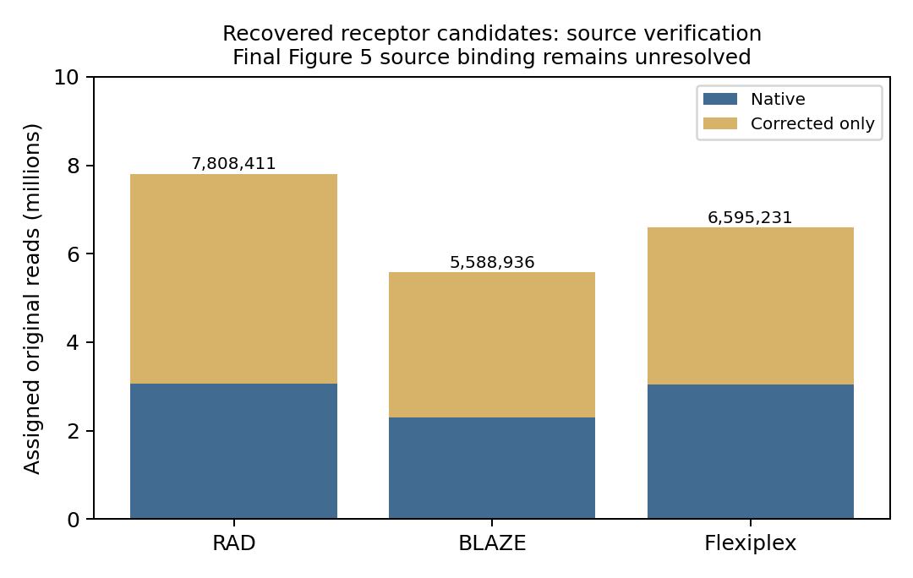
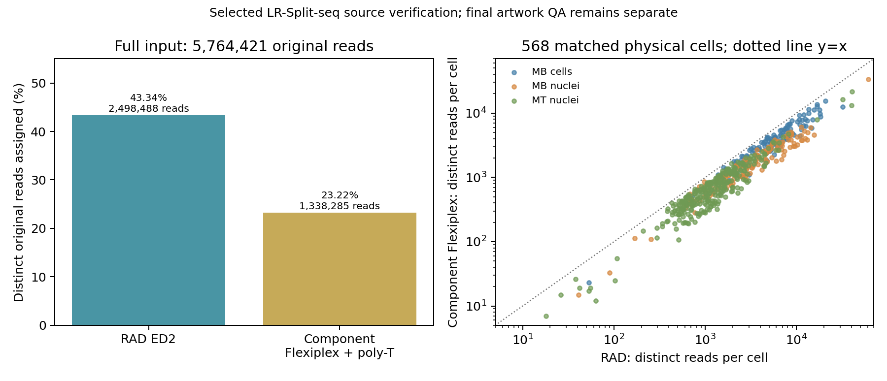

# Figure 5 — follow the receptor and LR-Split-seq data

**Versions and parameters come first.** These are recovered candidate receptor producers; their binding to the selected Figure 5 artwork is still unresolved. The selected LR-Split-seq RAD ED2 and component-polyT producers, all 568 physical-cell pairs and current per-cell UMIs are now recovered. Full flags, evidence paths and explicit unknowns are in the [parameter registry](../manifests/figures_567_tool_parameters.tsv).

| Producer | Version/build used | Parameters and evidence |
|---|---|---|
| RAD receptor candidate | Successful producer version/hash **unrecovered** | Intended `-l three_prime -R offensive -M 2 -m 2 -z 10000 -t 32 -w`; saved [execution failure](../source_data/figure_05/provenance/RAD_candidate_producer_failure.txt) says `offensive: command not found`. Candidate counts do not prove this command succeeded. |
| BLAZE receptor candidate | **2.6.0a0**, executable hash unrecovered | `--expect-cells 4505 --10x-kit-version 3v2 --threads 32 --max-edit-distance 2`; [complete executed command](../source_data/figure_05/provenance/BLAZE_receptor_command.txt). No seed recorded. |
| Flexiplex receptor candidate | **1.02.5 fallback**, executable hash unrecovered | `-d 10x3v2 -f 8 -p 56 -k selected.tsv`; 3,259 selected barcodes. [Executed wrapper](../source_data/figure_05/provenance/Flexiplex_receptor_producer.sh), [successful execution receipt and input hashes](../source_data/figure_05/provenance/Flexiplex_receptor_execution.md). Discovery used 1.02.6; this receptor run used 1.02.5. |
| Receptor alignment | minimap2 **2.26-r1175** | `-x map-ont --secondary=no -t 20`; TRUST4 `hg38_bcrtcr.fa`, SHA-256 `615152a7481d0a68557ab0a84b735d8f25fc1ee9d5076af3b8d31aa7792dc3df`. No seed explicitly passed. |
| Selected LR-Split RAD | **1.0.2**, commit `b6853a3d3d1818130ac364f7937bd0690ae9e385`; executable SHA-256 `a3937d2a11a61a8600b0dc2ef1d2a9eddbafbb8e06289f2fdc2eb04794149079` | `demux --threads 4 --chunk-size 5000 --joint-bc-mode strict --bc-correction-mode defensive --min-read-length 0 --generated-mutation 2 --whitelist-mutation 2`; [executed argv/exit0](../source_data/figure_05/provenance/splitseq/RAD_time.txt), [input/build/layout hashes](../source_data/figure_05/provenance/splitseq/RAD_run_manifest.txt), [layout](../data/figure_05/splitseq_reverse_complemented_whitelist_layout.csv). No seed explicitly passed. |
| Selected LR-Split component Flexiplex + poly-T | **FLAMES2.7.1**, commit `bf2211a8da1e1c7327370ab12479ae70e1d37cd8`, embedded **Flexiplex1.02.6** | Three separately matched8nt components, barcode ED1/buffer1, flank ED3, UMI10 template, terminal fixed8T included, `reverse_complement=FALSE`,4threads. [Exact Rscript argv/exit0](../source_data/figure_05/provenance/splitseq/component_time.txt), [executed wrapper](../source_data/figure_05/provenance/splitseq/component_runner.R), [manifest](../source_data/figure_05/provenance/splitseq/component_run_manifest.txt), [stdout version](../source_data/figure_05/provenance/splitseq/component_stdout.log). No explicit seed; exact R/Rcpp/Rhtslib versions and compiled shared-object hash unrecovered. |
| LR-Split catalogs/reference | [96 ligation sequences](../data/figure_05/bc_8nt_v1.csv), [96 RT sequences](../data/figure_05/bc_8nt_v2.csv), paired into48 physical RT wells | [568 selected cells](../data/figure_05/splitseq_cells.tsv). Long-read input SHA-256 `62acb6d466c37ba89632081526410bdc3ef73c0c68d778d40e05f03181f2a4f7`. No BLAZE arm in this selected comparison. |

The receptor experiment is public **RAGE-seq ERR3268991**, a Ramos/Jurkat/monocyte mixture. It is not a TNBC sample. The separate LR-Split-seq pair is long-read **SRR13948564** and short-read **SRR13948565**. The previews below contain public benchmark identifiers and small real excerpts, not synthetic examples or controlled donor material.

## 1. Inspect the roots before running anything

Open the [GitHub-rendered real-data preview](../data/examples/figure_05/PREVIEW.md), the [six read assignments](../data/examples/figure_05/rad_read_assignments.tsv), [three receptor rows](../data/examples/figure_05/flexiplex_receptor_input.tsv), and [three short-read reference rows](../data/examples/figure_05/splitseq_reference.csv). The [extraction receipt](../data/examples/figure_05/extraction.json) gives each full source path, SHA-256 and selected data-row ordinals. These are bounded excerpts; they do not recreate full read-level receptor assignment.

The first RAD root row is read `51593f7b-d384-41a3-877c-4d27bfc0c279`, assigned barcode `CGTAGGCGTGGCGAAT`, with `native=0`. That flag describes barcode assignment, not receptor identity. The saved [Flexiplex join code](../source_data/figure_05/provenance/join_flexiplex_bcrtcr.py) joins demultiplexer read assignments to receptor hits, removes ambiguous read assignments, applies its BCR/TCR hit rule, and aggregates by barcode. It is retained as executed source evidence; the large original sidecar/alignment streams are not included in Git.

| Root/source columns | Meaning and units | Missing versus zero |
|---|---|---|
| `read_id`, `barcode`, `native` | Original read identity, assigned cell barcode, native-assignment indicator 0/1 | `native=0` means corrected assignment; it does not mean no read. |
| `barcode`, `celltype` | Stable barcode and candidate cell identity | The identity map has 3,585 barcodes: 1,993 Ramos, 1,572 Jurkat, 20 monocytes. It is distinct from the 4,505-cell discovery reference. |
| `native_bcr/tcr/unmapped` | Counts of uniquely assigned original reads in each class | Zero is a measured count. An absent barcode has not been assigned an invented zero row. |
| `corrected_bcr/tcr/unmapped` | Flexiplex: cumulative native + corrected; RAD/BLAZE candidates: corrected-only | The same column label has different source semantics; the transformation must state which applies. |
| `cell_bc`, `sample`, `rnd1/2/3_well` | LR-Split reference ID, sample, combinatorial wells | Cell ID is BC3 + BC2 + `_` + RT well; the two RT barcodes collapse into one well. |
| `fastq_reads`, `bam_reads` | Short-read counts at the named processing stage | Counts are not interchangeable across stages. |
| `fastq_umis_uncorrected`, `bam_umis_corrected`, `published_umi_count/gene_count` | Stage-specific molecule/gene counts | These short-read stages do not establish the missing depth-matched Figure 5H checkpoint. |

## 2. Make native and corrected reads exclusive

Run this small transformation from the repository root; Python standard library is sufficient:

```bash
python3 scripts/figure_05/exclusive_receptor_counts.py \
  --input data/examples/figure_05/flexiplex_receptor_input.tsv \
  --output /tmp/figure05_receptor_counts.tsv \
  --tool Flexiplex --corrected-column cumulative
```

For real Ramos barcode `AAACCTGAGAATCTCC`, the input BCR counts are native **713**, cumulative corrected **1,413**. The output is native **713**, corrected-only **700**, assigned **1,413**. Its TCR values become **10 + 35 = 45**, and unmapped values **340 + 358 = 698**. Compare the [nine expected output rows](../data/examples/figure_05/flexiplex_receptor_output.tsv). Do not add cumulative corrected to native again. RAD/BLAZE candidate tables require `--corrected-column exclusive`.

The complete candidate [per-cell source table](../source_data/figure_05/candidate_receptor_counts.tsv) adds `tool`, `receptor`, `native`, `corrected_only`, `assigned` and the explicit candidate-selection label. Counts conserve to these [totals](../source_data/figure_05/candidate_receptor_totals.tsv): RAD 7,808,411; BLAZE 5,588,936; Flexiplex 6,595,231. The plot below verifies those source counts; it is **not a replacement for selected Figure 5 artwork or its statistics**.



## 3. Follow the selected LR-Split-seq identifiers

Open the [actual native records and cell IDs](../data/examples/figure_05/splitseq/PREVIEW.md), [native component statistics](../data/examples/figure_05/splitseq/component_native_stats.tsv), [normalized assignments](../data/examples/figure_05/splitseq/component_assignments.tsv), [RAD assignments](../data/examples/figure_05/splitseq/rad_assignments.tsv) and [row-lineage receipt](../data/examples/figure_05/splitseq/extraction.json). These are eight actual records per tool for the first two selected physical cells. Their bounded counts are examples, not the full per-cell totals.

| Field | Transformation and units |
|---|---|
| Native `Read`, `BC1`, `BC2`, `BC3`, `UB`, `FlankEditDist` | `read_id=Read`; assignment barcode is `BC3_BC2_BC1`; `umi=reverse_complement(UB)`; flank distance is copied. No new sequence inference is performed. |
| RAD `normalized_barcode`, `umi`, `read_id` | Read the saved normalized assignment fields. Every original read ID belongs to accession SRR13948564. |
| Canonical physical-cell barcode | RT T-primer sequence, round2 ligation, round3 ligation, separated by `_`. Both RT primer variants from one well map to that well's T primer using the [96-to48 map](../data/figure_05/rt_primer_well_map.csv). |
| Published cell ID | Round3 + round2 + `_` + zero-based row-major RT well index: A1=0, B11=22, D12=47. The retained BAM barcode instead joins round3, round2, RT sequence. |
| `prism_row_1based`, `sample` | Original saved row and annotation. All568 explicit cell IDs were checked against the keyed native source; no pairing was inferred from numerical similarity. |
| `rad_reads`, `component_polyt_reads` | Distinct original read IDs **within each physical cell**, requiring nonempty barcode and UMI. Summing cells counts read–cell pairs, so a read assigned to two cells contributes twice. |
| `rad_umis`, `component_polyt_umis` | Distinct exact UMI strings within each physical cell. The executed inclusion rule is nonempty UMI, not necessarily length10; no error correction or depth matching is added. |

First normalize the real component excerpt and compare it with its retained normalized records:

```bash
python3 scripts/figure_05/normalize_component_stats.py \
  --input data/examples/figure_05/splitseq/component_native_stats.tsv \
  --output /tmp/figure05_component_assignments.tsv
cmp /tmp/figure05_component_assignments.tsv data/examples/figure_05/splitseq/component_assignments.tsv
```

Then count the bounded records by physical cell:

```bash
python3 scripts/figure_05/aggregate_splitseq.py \
  --assignments /tmp/figure05_component_assignments.tsv \
  --cells data/examples/figure_05/splitseq/cells.tsv \
  --rt-primers data/figure_05/rt_primer_well_map.csv --format component \
  --output /tmp/figure05_component_cells.tsv --report /tmp/figure05_component_cells.json
```

Compare the [expected bounded counts](../data/examples/figure_05/splitseq/component_bounded_counts.tsv). Use `--format rad` and the excerpt's `rad_assignments.tsv` for RAD; its [bounded result](../data/examples/figure_05/splitseq/rad_bounded_counts.tsv) is also deposited. The full [568-cell table](../source_data/figure_05/splitseq_reads_umis_568.tsv) retains original row identities and only the two selected current arms.

## 4. Recount the complete saved assignments

The three current compressed checkpoints are supplied separately from Git, indexed by [path, bytes and SHA-256](../manifests/figure_05_staged_checkpoints.tsv). Stage the Figure 5 checkpoint archive at the repository root, following the [release guide](release_review.md), then run:

```bash
python3 scripts/figure_05/replay_splitseq.py --root .
```

This calls the same small aggregation script on the complete RAD and component ledgers and verifies every read/UMI count against the selected table. The [2,272-integer validation](../validation/figure_05_splitseq_counts.json), [RAD receipt](../validation/figure_05_rad_aggregation.json) and [component receipt](../validation/figure_05_component_aggregation.json) record all inputs and counts. It is a saved-assignment replay, not a new demultiplexer run.

| Selected quantity | RAD ED2 | Component Flexiplex + poly-T |
|---|---:|---:|
| Full-input assignment rows |2,536,299|1,345,255|
| Distinct original reads across full input |2,498,488|1,338,285|
| Distinct original reads /5,764,421 input reads |43.34%|23.22%|
| Read–cell pairs across568 published cells |2,078,171|1,156,252|
| Globally distinct reads among those568 cells |2,063,573|1,152,260|
| Median reads per published cell |1,979.5|1,102.5|
| Exact cell–UMI pairs |1,891,704|1,050,292|
| Median UMIs per published cell |1,866|1,042|

The [summary table](../source_data/figure_05/splitseq_summary.tsv) gives exact numerators and unrounded percentages. The previously displayed component value23.35% does not follow either recovered numerator: distinct reads give23.22%; assignment rows give23.34%. This discrepancy is recorded for artwork review without silently changing the existing annotation. Per-cell read–cell totals remain the paired comparison and must not be described as globally unique read counts.

The saved native [paired t-test](../source_data/figure_05/splitseq_saved_paired_t_test.json) is explicitly two-sided, with568pairs, t=14.959474687143327, df=567 and P=6.890554214980993e-43. The [independent native archive check](../validation/figure_05_native_stat_review.json) verifies the selected dataset/graph links and recomputes the same statistic within floating-point rounding. This resolves the signed-rank wording for this LR-Split read comparison. It does not establish the test for receptor panels A–F or certify the final exported graph. No new test or inferential annotation was selected.

## 5. Redraw the source proof and retain the Figure 5H boundary

```bash
python3 scripts/figure_05/render_candidate_counts.py \
  --input source_data/figure_05/candidate_receptor_totals.tsv \
  --splitseq-input source_data/figure_05/splitseq_reads_umis_568.tsv \
  --splitseq-summary source_data/figure_05/splitseq_summary.tsv \
  --output-dir /tmp/figure05_proofs
```



This proof uses the selected current count tables and preserves sample annotations; it contains no replacement significance stars. Native panel lettering, final export and annotation appearance still need artwork QA.

Current RAD ED2/component-polyT **per-cell UMI counts are recovered**. Figure 5H additionally needs the exact short-read depth-matched checkpoint or sampling rule/seed and its intended panel binding. The available complete short-read FASTQ/BAM summaries are different stages, and the retained prior UMI intersection used RAD ED1. Neither is substituted. No new sampling rule, UMI intersection or Figure 5H plot is generated.

To re-extract the deposited bounded examples from staged checkpoints, run `python3 scripts/figure_05/extract_splitseq_examples.py`. Original selected source paths and hashes are in the [source manifest](../manifests/figure_05_splitseq_sources.tsv); the [recovery handback](../validation/figure_05_handback.md) records upload provenance, executed commands and remaining dependencies.
