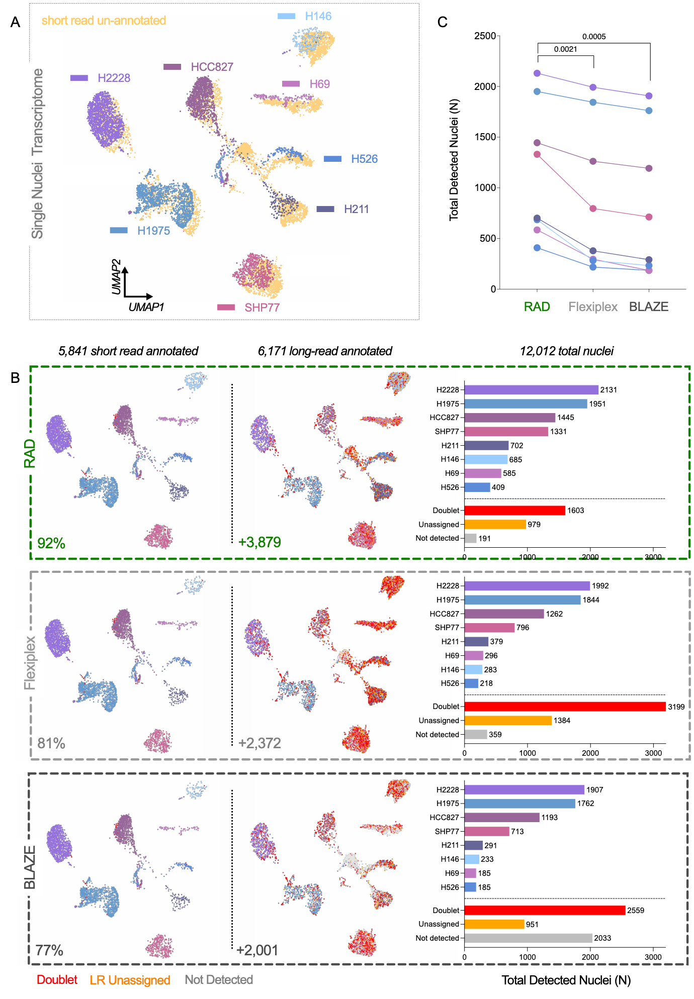

# Figure 6 — cell-line identity in LongBench single nuclei

Figure 6 follows the LongBench single-nucleus ONT library from demultiplexed reads to cell-line assignments. The eight reference lines are H146, H1975, H211, H2228, H526, H69, HCC827 and SHP77.

[Source tables](../source_data/figure_06/) · [Read-to-genotype examples](../data/examples/figure_06/PREVIEW.md) · [Figure legend](current_figure_legends.md#figure-6)



## Software and commands

| Stage | Software and parameters | Command or source |
|---|---|---|
| RAD demultiplexing | RAD 1.0.2, commit `920addacdbf40b815e13a146226e8f4b14a58aaf`; 10x 3v3.1 layout, offensive correction, generated and whitelist edit distances two, chunk size 5,000, 32 threads | [Metadata](../source_data/figure_06/provenance/RAD_run_metadata.txt), [command](../source_data/figure_06/provenance/RAD_demux_command.txt) |
| BLAZE demultiplexing | BLAZE 2.5.0; `--force-cells 10000 --threads 48 --minimal_stdout`, 3v3 default | [Metadata](../source_data/figure_06/provenance/BLAZE_run_metadata.txt), [command](../source_data/figure_06/provenance/BLAZE_demux_command.txt) |
| Flexiplex demultiplexing | Flexiplex 1.02.6; `-d 10x3v3 -f 8 -e 2 -k SELECTED -p 16` | [Execution metadata](../source_data/figure_06/provenance/Flexiplex_run_metadata.txt) |
| Genome alignment | FLAMES 2.0.1, minimap2 2.28-r1209, samtools 1.21; GENCODE v44; `-ax splice -y -t 32 -k14 --secondary=no --seed 2023 --junc-bed … --junc-bonus 1` | [Executed configuration](https://github.com/indianewok/rad-manuscript/blob/flames-configs-2026-10-30/source_data/figure_06/provenance/flames_alignment_snapshot/upstream/LongBench_workflow_37a9506df7bcd92c488c0e4b2a5cbe09fa1fc19d/sub_workflows/lr_sc_sn/config/flames_genome_map.json), [alignment implementation](https://github.com/indianewok/rad-manuscript/blob/flames-configs-2026-10-30/source_data/figure_06/provenance/flames_alignment_snapshot/upstream/FLAMES_4b6058f58c5b19365919990b3f2c1053f2035b01/R/minimap2_align.R#L42-L104) |
| Allele counting | [CellSNP-lite](https://doi.org/10.1093/bioinformatics/btab358) 1.2.3; `--cellTAG CB --UMItag UB --minMAF 0.1 --minCOUNT 10 --gzip --genotype`; 32 threads for RAD/Flexiplex and 16 for BLAZE | [Executed commands](../source_data/figure_06/executed_cellsnp_commands.tsv) |
| Genotype assignment | [Vireo](https://doi.org/10.1186/s13059-019-1865-2) 0.5.8; `-t GT --callAmbientRNAs -p 16` | [Executed commands](../source_data/figure_06/executed_vireo_commands.tsv) |


## 1. Demultiplex and align reads

Align each tool’s demultiplexed reads using the FLAMES genome alignment workflow and annotated splice junctions. The alignments preserve corrected cell barcodes as `CB` and UMIs as `UB`. [Pinned FLAMES configurations](pinned_flames_configs.md), [RAD BAM header](../source_data/figure_06/RAD_alignment_header.sam), [BLAZE BAM header](../source_data/figure_06/BLAZE_alignment_header.sam), [Flexiplex BAM header](../source_data/figure_06/Flexiplex_alignment_header.sam).

## 2. Count alleles and assign cell lines

Separate bulk-Illumina libraries from the eight cell lines supply the reference genotypes. Reads are processed with [fastp](https://doi.org/10.1093/bioinformatics/bty560) 0.23.4 using 16 threads and aligned uniquely to the GENCODE v44 primary assembly with [Rsubread](https://doi.org/10.1093/nar/gkz114) 2.20.0 [subjunc](https://doi.org/10.1093/nar/gkt214). Alignment uses the GTF annotation, `reportAllJunctions=TRUE`, `useAnnotation=TRUE`, `unique=TRUE` and 16 threads. Processing follows the LongBench [genome-index construction](https://github.com/indianewok/rad-manuscript/blob/flames-configs-2026-10-30/source_data/figure_06/provenance/flames_alignment_snapshot/upstream/LongBench_workflow_37a9506df7bcd92c488c0e4b2a5cbe09fa1fc19d/sub_workflows/sr_bulk/scripts/build_index.R#L8-L14), [bulk alignment](https://github.com/indianewok/rad-manuscript/blob/flames-configs-2026-10-30/source_data/figure_06/provenance/flames_alignment_snapshot/upstream/LongBench_workflow_37a9506df7bcd92c488c0e4b2a5cbe09fa1fc19d/sub_workflows/sr_bulk/scripts/align_reads.R#L17-L30) and [donor-genotyping rules](https://github.com/indianewok/rad-manuscript/blob/flames-configs-2026-10-30/source_data/figure_06/provenance/flames_alignment_snapshot/upstream/LongBench_workflow_37a9506df7bcd92c488c0e4b2a5cbe09fa1fc19d/rules/sc_cell_line_anno.smk#L8-L35).

Call bulk genotypes with CellSNP-lite using `--cellTAG None --UMItag None --gzip --genotype` at candidate hg38 SNPs with population allele frequency greater than 5%. The donor VCF contains 360,814 records, including five duplicates, and 360,809 distinct variants by chromosome, position, reference allele and alternate allele. Check the donor panel by comparing Vireo calls on the Illumina nuclei with the published assignments. [1000 Genomes phase 3](https://doi.org/10.1038/nature15393), [bulk commands and references](../source_data/figure_06/bulk_panel_runtime_manifest.tsv), [duplicate records](../source_data/figure_06/donor_panel_duplicate_records.tsv), [Illumina comparison](../source_data/figure_06/donor_panel_validation.tsv).

CellSNP-lite counts alternate-allele molecules (`AD`) and total-depth molecules (`DP`) for each variant and selected barcode. Ordered variant and barcode files identify matrix rows and columns; absent sparse entries count as zero. Vireo uses these matrices, the reference genotypes and ambient-RNA estimation to call a cell-line singlet, doublet or unassigned nucleus.

| Workflow | Variant rows | Selected barcodes |
|---|---:|---:|
| RAD | 115,810 | 12,423 |
| BLAZE | 118,378 | 10,001 |
| Flexiplex | 129,712 | 12,101 |

Restore the donor VCF and allele matrices under `checkpoints/figure_06/`. [Matrix summary](../source_data/figure_06/cellsnp_matrix_summary.tsv), [allele-to-genotype example](../data/examples/figure_06/allele_to_genotype.tsv), [example script](../scripts/figure_06/extract_allele_examples.py).

## 3. Compare each barcode with Illumina

Join calls to the Illumina reference by exact barcode. For each reference singlet, record a matching cell line, a different cell line, a doublet, an unassigned call or absence from the tool’s whitelist. Strict identity recall divides the matching calls by all **5,782** reference singlets. Conditional concordance divides matching calls by the number of reference singlets with any named long-read singlet call. [Per-cell outcomes](../source_data/figure_06/per_cell_genotype.tsv), [genotype summary](../source_data/figure_06/genotype_summary.tsv).

Run the five-cell example:

```bash
mkdir -p results
python3 scripts/figure_06/classify_genotypes.py \
  --input data/examples/figure_06/genotype_input.csv \
  --output results/figure06_outcomes.tsv
python3 scripts/figure_06/summarize_identity.py \
  --input results/figure06_outcomes.tsv \
  --output results/figure06_summary.tsv --expected-reference-singlets 5
```

Compare with the [expected outcomes](../data/examples/figure_06/genotype_outcomes.tsv). Use `--expected-reference-singlets 5782` for the complete reference.

## 4. Count the nuclei in panel C

Panel C counts tool-selected named singlets whose barcodes occur in the Illumina reference. RAD and Flexiplex use calls from the fixed bulk panel described above. BLAZE uses the published LongBench SN-ONT calls for panel C and the matched-panel calls in the per-cell outcomes for panel B. [Panel C counts](../source_data/figure_06/plotted_panel_c_counts.tsv), [per-barcode calls](../source_data/figure_06/plotted_genotype_calls.tsv.gz), [annotation sources](../source_data/figure_06/plotted_panel_c_provenance.json).

```bash
python3 scripts/figure_06/reproduce_panel_c_counts.py
```

Compare the three tools by one-way repeated-measures ANOVA, matching counts by cell line within the single LongBench library. Apply the Geisser–Greenhouse correction and Dunnett comparisons of BLAZE and Flexiplex against RAD. [Analysis specification](../source_data/figure_06/analysis_specification.json), [Prism results](../source_data/figure_06/plotted_panel_c_statistics.json).

The expression analysis in Figure 7 uses all tool-selected named singlets, including barcodes outside the Illumina reference, before filtering for expression depth and cell line. [All-selected counts](../source_data/figure_06/selected_nuclei_by_donor.tsv), [complete genotype table](../source_data/figure_06/union_per_cell_genotype.tsv), [Figure 7](figure_07.md).

## 5. Display calls on the shared Illumina UMAP

The shared embedding uses all **12,012 filtered Illumina barcodes**. Seurat 5.4.0 applies SCTransform v2 with glmGamPoi, calculates 50 principal components, finds neighbors on PCs 1–30 and clusters with Louvain algorithm one at resolution 0.5. UMAP uses PCs 1–30, 30 neighbors, minimum distance 0.3, cosine distance, seed 20260805 and one thread. Join each tool’s genotype outcomes to the same Illumina coordinates by barcode. [Seurat](https://doi.org/10.1038/s41587-023-01767-y), [Seurat commands](../source_data/figure_06/umap_object_commands.txt), [coordinates](../source_data/figure_06/fixed_coordinates.tsv), [overlays](../source_data/figure_06/genotype_overlay.tsv).
