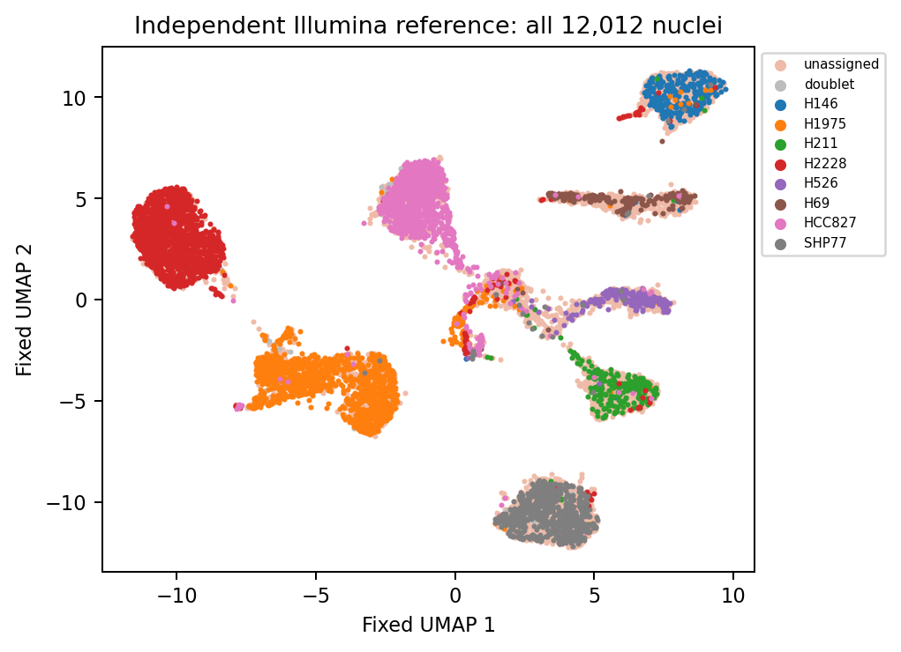
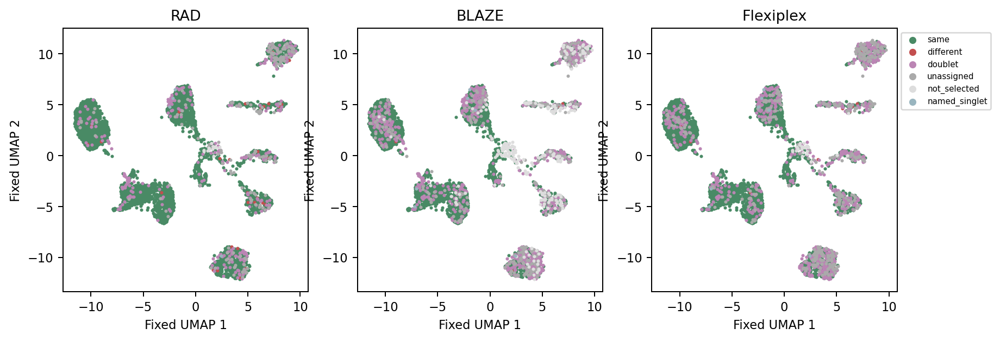
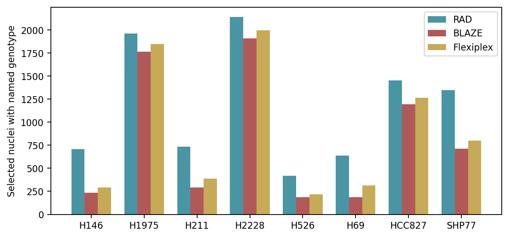

# Figure 6 — from native alignments to genotype outcomes

**Versions and parameters. Figure 6 uses native tool alignments, including RAD 920adda.** Figure 7 uses RAD 4acbe00 and a separate common-raw gene-assignment path. Their provenance must remain distinct. The [machine-readable parameter registry](../manifests/figures_567_tool_parameters.tsv) contains full commands, hashes, references, seeds and unrecovered fields.

| Producer | Exact selected version/build | Parameters and evidence |
|---|---|---|
| RAD | **1.0.2 @ 920addacdbf40b815e13a146226e8f4b14a58aaf**, with empty-stream/edlib-null guards; binary SHA-256 **b2feda73a4ae3acf705b724013665af35dff2534f42a568db3f168ca958a2c9e** | 10x 3v3.1 layout; offensive correction; whitelist/generated mutation 2/2; chunk 5,000; 32 threads; selected 12,423. [Receipt](../source_data/figure_06/provenance/RAD_run_metadata.txt), [exact argv](../source_data/figure_06/provenance/RAD_demux_command.txt). General clean-build pin `490e618c…` is a different executable. |
| BLAZE | **2.5.0**; immutable executable hash unrecovered | `--force-cells 10000 --threads 48 --minimal_stdout`; actual 10,001 selected; kit 3v3 default; `PYTHONHASHSEED=UNSET`. [Receipt](../source_data/figure_06/provenance/BLAZE_run_metadata.txt), [exact argv](../source_data/figure_06/provenance/BLAZE_demux_command.txt). |
| Flexiplex | **1.02.6 + d84c8ae4f3865052f2b5ecec816949b94682f302 audit build**; binary SHA-256 **38dccd37f1747e5105b62eacde572b7e4c5206fb925dc1fdbe8210ffe8b1e8c4** | Native FASTQ run: `-d 10x3v3 -f 8 -e 2 -k SELECTED -p 16`; 12,101 selected, whitelist SHA-256 `8d677717f97fc67446ff57760468c075ac99eb5cc623da9c473f6077f2a4b298`. [Executed receipt](../source_data/figure_06/provenance/Flexiplex_run_metadata.txt). |
| Native alignment | **FLAMES 2.0.1, minimap2 2.28-r1209, samtools 1.21** | `-ax splice -y -t 32 -k14 --secondary=no --seed 2023 --junc-bed … --junc-bonus 1`; GENCODE v44. Original [RAD](../source_data/figure_06/RAD_alignment_header.sam), [BLAZE](../source_data/figure_06/BLAZE_alignment_header.sam), [Flexiplex](../source_data/figure_06/Flexiplex_alignment_header.sam) BAM headers contain full paths and commands. |
| Alleles/genotypes | **CellSNP-lite 1.2.3; Vireo 0.5.8** | `--cellTAG CB --UMItag UB --minMAF 0.1 --minCOUNT 10 --gzip --genotype`; CellSNP threads RAD/Flexiplex **32**, BLAZE **16**. Vireo `-t GT --callAmbientRNAs -p 16`. [CellSNP argv](../source_data/figure_06/executed_cellsnp_commands.tsv), [Vireo argv](../source_data/figure_06/executed_vireo_commands.tsv). Genotype RNG seed and binary hashes unrecovered. |
| Fixed Illumina embedding | **Seurat 5.4.0; SCTransform v2, glmGamPoi** | PCA 50; neighbors PCs 1–30; Louvain algorithm 1, resolution 0.5; UMAP PCs 1–30, 30 neighbors, minimum distance 0.3, cosine, seed **20260805**, one thread. [Stored object commands](../source_data/figure_06/umap_object_commands.txt). |

The sample is public LongBench **SN_ONT**, one eight-cell-line mixture. Cell barcodes and H146/H1975/H211/H2228/H526/H69/HCC827/SHP77 labels in these previews identify experimental cell-line nuclei, not controlled human donors.

## 1. Inspect each root-data level

**C3: alignments and alleles.** Native tool FASTQs receive CB/UB tags and are aligned. CellSNP produces variant-by-cell AD (alternate-allele molecules) and DP (total-depth molecules), with separate ordered variant and barcode lists. A sparse absent matrix entry means count zero; an absent selected barcode or genotype row is a separate missing-data state. BAM/header/index checks and full compressed-byte hashes are in the [BAM evidence](../validation/figures_567_bam_checks.tsv). They do not claim every decoded CB/UB tag was inspected.

The fixed eight-line bulk-Illumina donor VCF has **360,814 records, 360,809 unique CHROM/POS/REF/ALT keys**, including five byte-identical duplicate records. Its SHA-256 is `586b1dd8d8c9fb5df5f12ccf111a5c9fa1c9cdd0019ef3fa70bf97a79f342940`. [Duplicate record identities](../source_data/figure_06/donor_panel_duplicate_records.tsv) and [validation](../source_data/figure_06/donor_panel_validation.tsv) preserve row order; no deduplication was silently applied. RAD/Flexiplex CellSNP each retain two chr4:74446969 A/G rows. All 12,012 reconstructed Illumina hard calls match the released reference.

The [matrix summaries](../source_data/figure_06/cellsnp_matrix_summary.tsv) show RAD 115,810 × 12,423, BLAZE 118,378 × 10,001 and Flexiplex 129,712 × 12,101. Full AD/DP values, coordinate uniqueness, integer counts, row alleles and barcode identities were validated. The donor VCF and index are staged under ignored `checkpoints/figure_06/`; [hashes and sizes](../manifests/figures_567_staged_checkpoints.tsv) describe the review-archive payload.

The [root-data preview](../data/examples/figure_06/PREVIEW.md) also exposes eight real AD entries through exact variant-row and cell-column joins. The first is chr1:14464 A/T, barcode `AAAGTGACAAACGGCA`, one alternate-allele molecule. Its query and reference labels are H69; its fixed coordinates are `(3.4304353354217, 5.11612037766271)`. [All joined rows](../data/examples/figure_06/allele_to_genotype.tsv), [source hashes](../data/examples/figure_06/allele_extraction.json), and the [extraction script](../scripts/figure_06/extract_allele_examples.py) make this C3 → C4 → plotted-coordinate chain inspectable without opening a large matrix.

**C4: per-cell genotype calls.** Open the [five-real-cell preview](../data/examples/figure_06/PREVIEW.md), [wide input CSV](../data/examples/figure_06/genotype_input.csv) and [extraction receipt](../data/examples/figure_06/extraction.json). This is a deliberately bounded selection: the first reference singlet displaying each RAD outcome. It is not a representative sample or an alternate analysis cohort.

| Columns | Meaning | Missing versus zero |
|---|---|---|
| `cell_barcode` | Exact key joining C3 cell order, Vireo, reference and fixed UMAP | Never pair by row position. |
| `illumina_reference_present/state/label` | Reference membership, `named_singlet/doublet/unassigned`, donor label | Reference absence is not an unassigned genotype. |
| `rad`, `blaze_panel_matched`, `flexiplex` + `_query_selected` | Native tool selected the barcode, TRUE/FALSE | FALSE is a selection observation; it is not a zero-confidence named call. |
| Same prefixes + `_vireo_state/_vireo_label` | Tool genotype state and donor label | `NA` for unselected cells remains explicit. A selected missing row is `missing_row`, not `unassigned`. |
| `strict_identity_eligible`, `outcome` | Derived reference named-singlet indicator and outcome | `same/different` require named reference and query labels. |

## 2. Classify outcomes with a small readable script

```bash
python3 scripts/figure_06/classify_genotypes.py \
  --input data/examples/figure_06/genotype_input.csv \
  --output /tmp/figure06_outcomes.tsv
python3 scripts/figure_06/summarize_identity.py \
  --input /tmp/figure06_outcomes.tsv \
  --output /tmp/figure06_summary.tsv --expected-reference-singlets 5
```

Expected: 15 rows (five barcodes × three tools), matching the [saved outcomes](../data/examples/figure_06/genotype_outcomes.tsv). `AAACCCACATCCGAGC` is H2228 in the reference and all tools → `same`. `AAAGGTAAGTGTGTTC` is reference SHP77 and query H69 → `different`. `AATTCCTGTAACGGTG` is unselected by all tools → `not_selected`, retaining its reference H1975 identity. RAD has one of each outcome in this intentionally selected excerpt; use denominator **5** only for this demonstration.

For the complete root CSV, pass that file to the same classifier and use `--expected-reference-singlets 5782`. The reference contains **12,012** nuclei: 5,782 named singlets, 59 doublets and 6,171 unassigned. The complete [portable reference outcomes](../source_data/figure_06/per_cell_genotype.tsv) retain all reference cells; the [union table](../source_data/figure_06/union_per_cell_genotype.tsv) also retains selected cells outside it.

| Tool | Same | Different | Doublet | Unassigned | Not selected | Strict recall |
|---|---:|---:|---:|---:|---:|---:|
| RAD | 5,324 | 32 | 246 | 165 | 15 | 5,324 / 5,782 |
| BLAZE | 4,450 | 12 | 766 | 308 | 246 | 4,450 / 5,782 |
| Flexiplex | 4,674 | 17 | 725 | 340 | 26 | 4,674 / 5,782 |

Conditional concordance instead divides same by same + different. It answers a different question and must not replace strict recall. Figure 6C [selected donor counts](../source_data/figure_06/selected_nuclei_by_donor.tsv) use all native selected named genotypes: totals RAD 9,404, BLAZE 6,478, Flexiplex 7,125. They are not restricted to the reference singlets.

## 3. Join to fixed coordinates and see the proof

`cell_barcode` joins the outcome table to [fixed coordinates](../source_data/figure_06/fixed_coordinates.tsv), producing the [overlay source](../source_data/figure_06/genotype_overlay.tsv). The selected SCT Seurat object was loaded: all 12,012 barcode identities and coordinates match within 1e-12 export precision. The result was not re-embedded and the alternate LogNormalize recipe was not substituted.







These PNGs verify portable source tables. The author instructed preservation of existing selected statistics and annotations on 2026-10-23; these proofs do not replace them. The one-way/two-way ANOVA wording discrepancy remains documented. There is one mixed library; donor strata do not create independent library replicates.

A [native-analysis binding check](../validation/figures_567_native_anova_binding.json) inspected a saved candidate analysis in the source master Prism project. All 24 donor/tool input counts differ from the selected current Figure 6C table. That analysis therefore cannot resolve this table's executed statistical settings; its P values and comparison table are not imported as current results.

The full [validation report](../validation/figures_567_handback.md), [checkpoint content checks](../validation/figures_567_checkpoint_checks.tsv), [selected producer hashes](../manifests/figures_567_selected_provenance.tsv) and [task statuses](../manifests/figures_567_tasks.tsv) state the completed checks and remaining source/artwork limits. Rendering needs only portable source tables; original BAMs are unnecessary for the proofs.

```bash
python3 scripts/figure_06/render_source_proofs.py
```

This writes only Figure 6 PNG/SVG/PDF proofs from its portable source tables, using matplotlib/numpy. It does not require Figure 7 data or rerun genotypes. On the validated HPC host, use `/usr/bin/python3` and `OMP_NUM_THREADS=1 OPENBLAS_NUM_THREADS=1 MKL_NUM_THREADS=1`.
