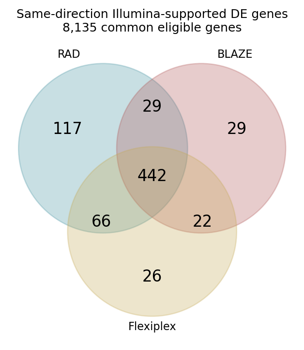
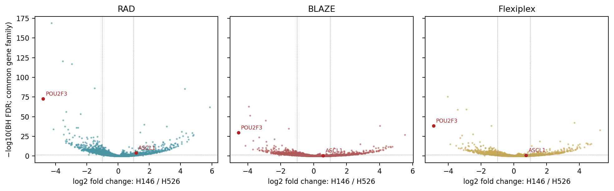
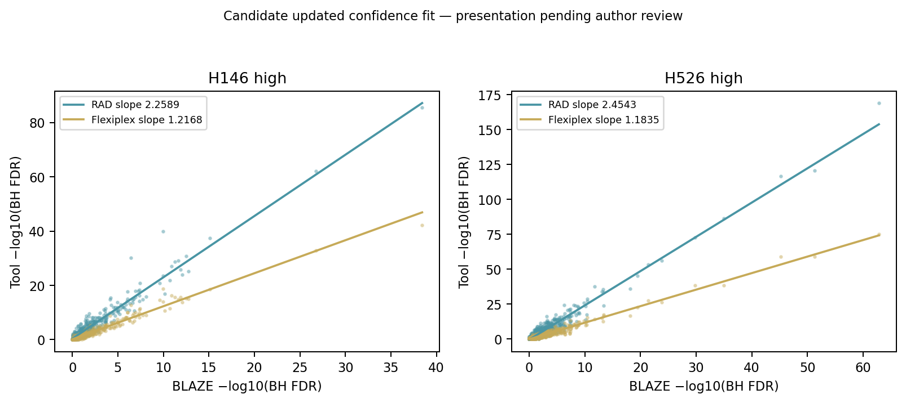
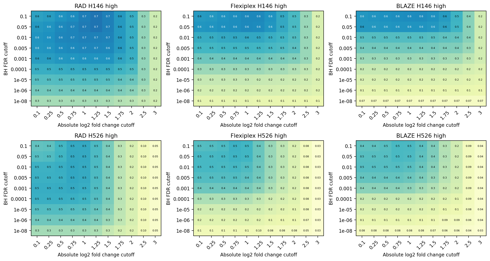

# Figure 7 — emitted segments, molecules, differential expression and recovery

**Versions and parameters. Current Figure 7 contains A–D; panel E was removed by the author on 2026-10-23.** The [parameter registry](../manifests/figures_567_tool_parameters.tsv) records exact full argv, source hashes, references and unknowns.

| Producer | Exact selected version/build | Parameters and evidence |
|---|---|---|
| RAD | **1.0.2 @ 4acbe004ba11b150d6832395452632f367a6e6c1**; binary SHA-256 **01ae4700f329593487e1b0a3528da009d7e47c82bf213a5f53ba98acad6fda0e** | 10x 3v3.1; offensive correction, whitelist/generated mutations 2/2, minimum read length 85, chunk 5,000, 60 RAD + 4 pigz threads; all emitted records including concatemer `-CT` segments. [Receipt/layout/whitelist hashes](../source_data/figure_07/provenance/RAD_run_metadata.txt), [exact argv](../source_data/figure_07/provenance/RAD_demux_command.txt). |
| BLAZE | **2.5.0**, immutable executable hash unrecovered | Same native assignment output as Figure 6: `--force-cells 10000 --threads 48 --minimal_stdout`; actual 10,001 selected; kit 3v3 default, `PYTHONHASHSEED=UNSET`. [Producer](../source_data/figure_06/provenance/BLAZE_run_metadata.txt), [matrix assignment extraction argv](../source_data/figure_07/provenance/extract_BLAZE_command.txt). |
| Flexiplex | **1.02.6 + d84c8ae4f3865052f2b5ecec816949b94682f302 audit build**; binary SHA-256 **38dccd37f1747e5105b62eacde572b7e4c5206fb925dc1fdbe8210ffe8b1e8c4** | `-d 10x3v3 -f 8 -e 2 -k SELECTED -p 16`; 12,101 selected; July 31 diagnostic sidecar, 74,421,076 assignment rows. `RawCellBarcode` added with matching logic unchanged. [Producer](../source_data/figure_07/provenance/Flexiplex_run_metadata.txt), [extraction argv](../source_data/figure_07/provenance/extract_Flexiplex_command.txt). This is a separate execution from Figure 6's native FASTQ run. |
| Common raw alignment | **minimap2 2.30-r1287**, SHA-256 **5ef4a631a6318c66d1184007f87bedc55f712c27472d141da4d35e80df82e3cc**; samtools **1.22.1** | `-ax splice --secondary=no --MD -Y`; GENCODE v44 splice index SHA-256 `c10ef7c90bd53ec6b71baa6e572ffedaeb1afa53c16562e224f1ec3cca1b1c2f`; wrapper defaults to 48 alignment threads, actual invocation argument unrecovered; sort 8 threads. No seed explicitly passed. [Selected wrapper](../source_data/figure_07/provenance/align_common_raw.sh). |
| Direct differential expression | **R 4.5.3, scran 1.34.0, scuttle 1.16.0** | `pairwiseWilcox(direction="any", BPPARAM=SerialParam(...))`; full-cell CP10K, `log2(1+CP10K)`; effect pseudocount 0.1. Native script seed 20260825; common Illumina script no explicit seed. [Native direct producer](../source_data/figure_07/provenance/direct_native_DE_producer.R), [common-universe producer](../source_data/figure_07/provenance/common_gene_DE_producer.R), [session](../source_data/figure_07/provenance/DE_sessionInfo.txt). |

## 1. Begin with real root records and their limitations

The public LongBench SN_ONT cell-line mixture starts with original reads. The selected [assignment extractor](../source_data/figure_07/provenance/extract_assignments.py) interprets native tool outputs. RAD emits multiple records from concatemers: each segment inherits the frozen **original-read** gene assignment, then [matrix assembly](../source_data/figure_07/provenance/build_matrices.py) collapses exact `(cell, gene, UMI)` keys. A record without a UMI counts individually. The common [gene assignment rule](../source_data/figure_07/provenance/assign_genes.py) uses primary alignments, MAPQ ≥1, unstranded summed overlap with unmerged exons, and rejects tied genes.

**C2 emitted assignments have now been recovered.** The selected compressed assignment checkpoint matches its recorded SHA-256 `a5dc369445826fdd36541a301b1b85448438fb52d351ce8883a12ef456457c48`. Its complete stream contains **57,885,606 rows**: 49,555,699 exact-flag rows and 8,329,907 corrected-flag rows, covering all 12,423 selected barcodes; all retained UMIs are 12 bases. Open [ten real rows](../data/examples/figure_07/RAD_emitted_assignment_rows.tsv), their [source/extraction receipt](../data/examples/figure_07/assignment_extraction.json), and the [full per-barcode row counts](../source_data/figure_07/RAD_assignment_rows_by_barcode.tsv). The five source columns are original read ID, cell barcode, UMI, raw barcode and corrected flag. These are emitted assignment rows, not unique physical-read counts or molecules.

The extractor had already removed the orientation and `-CT` suffixes, and this table contains no gene IDs or segment coordinates. It therefore restores barcode/UMI assignments keyed to original reads, **not a complete gene/segment-boundary ledger**. The emitted FASTQ and frozen original-read-to-gene table remain missing at the [bounded searched paths](../validation/figures_567_upstream_path_search.json); their expected hashes are in the [source manifest](../source_data/figure_07/RAD_emitted_segment_source_manifest.tsv). The [assignment validation](../validation/figures_567_assignment_recovery.json) checks all compressed bytes, gzip integrity, row schema, counts and barcode membership. The 2.36 GB file remains at its preserved source path in the [access manifest](../manifests/figures_567_assignment_access.tsv), outside Git and the default archive. No raw demultiplexing or alignment was restarted.

**C3 native MEX checkpoint.** Open the [real MEX/DE preview](../data/examples/figure_07/PREVIEW.md), [eight real matrix entries](../data/examples/figure_07/RAD_matrix_entries.tsv), and [extraction receipt](../data/examples/figure_07/extraction.json). Matrix Market stores 1-based gene index, cell index and positive integer molecule count. Ordered feature and barcode files resolve those indices. A sparse absent entry means zero observed molecules; a missing barcode, gene or genotype assignment is not an invented zero.

| Tool | Genes × selected cells | Nonzero coordinates | Molecules |
|---|---:|---:|---:|
| RAD, all emitted segments | 45,224 × 12,423 | 15,772,545 | 22,875,174 |
| BLAZE | 44,807 × 10,001 | 17,301,003 | 27,350,119 |
| Flexiplex | 45,939 × 12,101 | 21,582,352 | 35,106,495 |

Complete matrix content, labels, integer counts, unique coordinates, sealed hashes and positive-depth named cohorts were validated. Native matrices/labels are staged under ignored `checkpoints/figure_07/`; [file hashes and sizes](../manifests/figures_567_staged_checkpoints.tsv) describe that review-archive payload. They are not giant Git blobs.

## 2. Follow one real molecule count through normalization

The first retained RAD matrix entry is `(gene 25054, cell 3611, count 2)`. Its labels are **PTPRJ / ENSG00000149177.15**, barcode **CATACCCAGCGTGAGT**. That cell has **2,400** molecules across its complete unfiltered library, so:

```text
CP10K = 10,000 × 2 / 2,400 = 8.333333333333334
log2(1 + CP10K) = 3.222392421336448
```

The excerpt script reads the complete source matrix to obtain each displayed cell's denominator; the denominator is not the sum of the eight displayed entries. These entries illustrate the calculation, not a full DE cohort. The [native cohort table](../source_data/figure_07/native_positive_depth_cohorts.tsv) retains exact cell IDs, named genotype and full-library depth for 9,404 RAD, 6,478 BLAZE and 7,125 Flexiplex cells.

```bash
python3 scripts/figure_07/extract_examples.py \
  --matrix-dir checkpoints/figure_07/native/RAD/all \
  --de-table source_data/figure_07/direct_H146_vs_H526_plot_data.tsv.gz
```

Expected: eight real matrix entries and nine real DE rows for DPM1, ASCL1 and POU2F3, with original row indices and full input hashes. These public cell-line excerpts contain no synthetic rows.

## 3. Define the direct H146-versus-H526 analysis

Only named, positive-depth H146/H526 cells enter the direct contrast: RAD **709/419**, BLAZE **234/185**, Flexiplex **290/219**, Illumina **263/195**. Within each pair-only cohort, a gene needs ≥10 molecules and detection in ≥1% of cells. Other cell lines do not affect this eligibility rule. Intersect the three native eligible gene sets and the Illumina pair-eligible set to obtain **8,135 common genes**.

Library normalization uses every gene's molecule contribution before gene filtering. The two-sided Wilcoxon test acts on `log2(1+CP10K)`. The effect is `log2((mean H146 CP10K + 0.1)/(mean H526 CP10K + 0.1))`; positive means H146-high. Each tool and the Illumina reference receives a separate BH adjustment over the same 8,135-gene family. No 10% detection display gate from other analyses is added to the current Figure 7 threshold rules.

The portable [24,405-row C5 table](../source_data/figure_07/direct_H146_vs_H526_plot_data.tsv.gz) has exactly three rows per common gene. Its columns are:

| Columns | Meaning/units |
|---|---|
| `gene_id`, `gene_symbol`, `tool` | Versioned gene key, readable symbol, native tool |
| `tool_log2FC`, `Illumina_log2FC` | Dimensionless log2 mean-CP10K ratios defined above |
| `tool_p_value`, `Illumina_p_value` | Retained direct Wilcoxon P values |
| `tool_BH_FDR_common`, `Illumina_BH_FDR_common` | Separate 8,135-gene BH-adjusted P values |
| `tool_confidence`, `Illumina_confidence` | Uncapped `-log10(BH FDR)` |
| `*_confidence_cap50` | Optional display values capped at 50; not the uncapped confidence-fit inputs |

Recompute the complete BH families, then the calls, without a master runner:

```bash
python3 scripts/figure_07/adjust_common_gene_pvalues.py \
  --input source_data/figure_07/direct_H146_vs_H526_plot_data.tsv.gz \
  --output /tmp/figure07_adjusted.tsv
python3 scripts/figure_07/score_directional_calls.py \
  --input /tmp/figure07_adjusted.tsv --output /tmp/figure07_thresholds.tsv
```

Expected: 24,405 adjusted rows, 594 directional threshold rows, exact integer agreement and metric agreement within 1e-12 with the [deposited grid](../source_data/figure_07/threshold_grid.tsv). The raw Wilcoxon P values are retained in this resume; the tests are not rerun. Using the nine-row preview for BH would change the family and is rejected by the script.

The [direct-test lineage check](../validation/figures_567_direct_test_lineage.json) also confirms that every one of these 24,405 rows retains exactly the P value and effect from the selected 36,590-row native direct-test table. The [small comparison script](../scripts/figure_07/check_direct_test_provenance.py) records both complete source hashes.

## 4. Trace calls into panels A–D

Fixed Illumina truth is BH FDR **<0.05** and absolute log2FC **>1**, giving **412 H146-high** and **769 H526-high** genes. A supported tool call must also pass these strict cutoffs and agree in direction. [Gene-by-gene membership](../source_data/figure_07/directional_membership.tsv) produces RAD **654**, BLAZE **522**, Flexiplex **556** recoveries and the exact seven [intersection regions](../source_data/figure_07/venn_regions.tsv). Circle areas below are schematic; counts are authoritative.





Panel C's [source points](../source_data/figure_07/confidence_fit_points.tsv) use uncapped confidence. The computed **candidate** is OLS with an estimated intercept over all directional Illumina-truth genes. Its [coefficients](../source_data/figure_07/confidence_fit_candidates.tsv) remain explicitly subject to final artwork fit confirmation. A [bounded search of primary scripts and native-project filenames](../validation/figures_567_fit_definition_search.json) did not recover the executed directional BLAZE-axis fit definition. Available regression scripts use different reference axes or contrasts and cannot establish this panel's model. No coefficient was chosen by closeness to an existing label.



Panel D evaluates 9 FDR cutoffs × 11 absolute-fold-change cutoffs × 2 directions × 3 tools. F1 is `2TP/(2TP+FP+FN)`, with zero for a zero denominator. Truth is fixed throughout. The [grid](../source_data/figure_07/threshold_grid.tsv) includes all TP/FP/FN/TN, precision, recall, F1 and display labels. Display uses decimal half-up rounding to one significant digit, checked against all 594 selected artwork labels.



These PNGs verify selected updated source data; final Figure 7C fit/annotation selection remains explicit. Panel E is removed, not pending a substitute analysis. See [current panel status](../source_data/figure_07/panel_status.json), [validation](../validation/figures_567_handback.md), [checkpoint checks](../validation/figures_567_checkpoint_checks.tsv) and [task status](../manifests/figures_567_tasks.tsv).

```bash
python3 scripts/figure_07/render_source_proofs.py
```

This writes only Figure 7A–D PNG/SVG/PDF proofs from its portable source tables, using matplotlib/numpy. It does not require Figure 6 inputs. On the validated HPC host, use `/usr/bin/python3` and `OMP_NUM_THREADS=1 OPENBLAS_NUM_THREADS=1 MKL_NUM_THREADS=1`.
