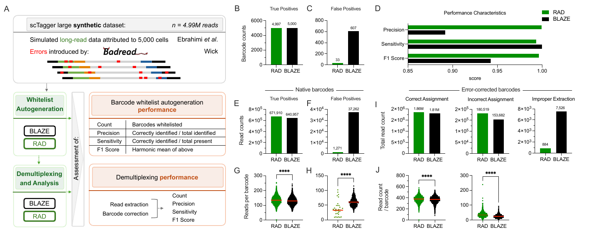

# Figure 2 — Benchmarking RAD on Synthetic (ScTagger) Data



> Reference render — full resolution: [`figure_2.pdf`](figure_2.pdf)

## Panels

| Panel | What it shows |
|-------|---------------|
| 2B | True-positive barcodes (RAD vs BLAZE) |
| 2C | False-positive barcodes |
| 2D | Precision / sensitivity / F1 summary |
| 2E–2F | Read counts for TP / FP barcodes (native, uncorrected) |
| 2G–2H | Per-barcode read-count distributions (native) |
| 2I–2J | Error-corrected barcode assignment + edit-distance to ground truth |
| Suppl. | ScTagger S/M/L downsampling (100K, 250K, 500K subsets) + edit-distance distributions + Venn overlap |
| Suppl. | ROC + PR curves comparing RAD vs BLAZE |

## Inputs

- **Workspace:** `figure_2_workspace.RData` — see [`../data/README.md`](../data/README.md)
- **Demultiplexed FASTQs (full pipeline):** `${RESULTS_BASE}/synthetic_data/` (where `RESULTS_BASE` is set in `config.local.sh`)
- **Raw simulations:** ScTagger simulator output (`shuffled_{S,M,L}_lr_synth.fq.gz`, plus 100K/250K/500K downsamples)
- **Whitelist:** auto-generated by `generate_whitelist` per simulation (10x_3v3)

## Scripts in this directory

| File | Purpose |
|------|---------|
| `figure_2_analysis.Rmd` | Master notebook — loads workspace, produces every panel |
| `plot_pr_curves.R` | Standalone ROC/PR plot generator (`pr_curve_sctagger_L.{pdf,png}`) |
| `generate_sctagger_ids.R` | Map ScTagger simulated read IDs back to ground-truth barcodes |
| `process_extracted_headers.R` | Parse RAD/BLAZE FASTQ headers into a tidy `data.table` |
| `verify_fig2.R` | Sanity check: workspace + Rmd objects match expected schema |
| `whitelist_detection_results.csv` | Per-dataset whitelist-detection summary table |

## How to regenerate

```bash
# from repo root — analysis only (workspace already on disk)
./scripts/run_figure_2.sh analysis

# full pipeline (regenerates whitelists + reruns rad demux + renders)
./scripts/run_figure_2.sh
```

Output: `figure_2_analysis.html` (gitignored — produced fresh by each render).

## Key workspace objects

`sctagger_bcs`, `rad_sctagger_raw_counts`, `blaze_sctagger_raw_counts`, `true_true_sctagger`, `false_false_sctagger`, `false_true_sctagger`, `compiled_precision_statistics`, `barcode_sctagger_dist`, `stored_sctagger_edit_distances`, `plotting_sctagger_ed_dists`, `venn_overlap`, `auc_pr`, `auc_roc`.
