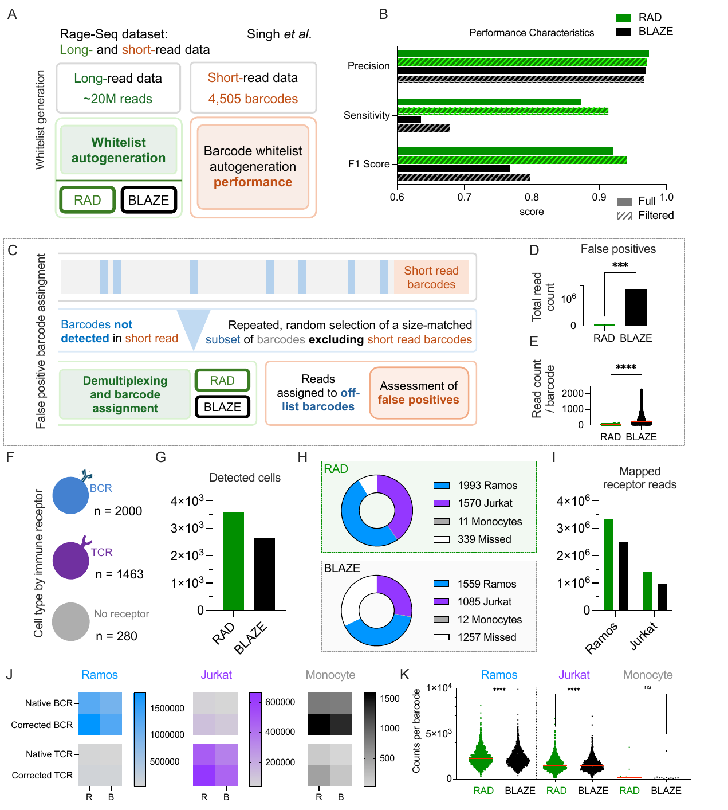

# Figure 3 — Benchmarking RAD on Real Immune Receptor Data (RAGEseq)



> Reference render — full resolution: [`figure_3.pdf`](figure_3.pdf)

## Panels

| Panel | What it shows |
|-------|---------------|
| 3A | Schematic — long-read demux benchmarked against paired short-read ground truth |
| 3B | Precision / sensitivity over full and filtered short-read barcode lists |
| 3C | Schematic — "off-list" stress test (dummy whitelist) |
| 3D | Total reads assigned to off-list barcodes (lower is better) |
| 3E | Reads per off-list barcode |
| 3F | Composition of input cell mix (Jurkat / Ramos / Monocytes) |
| 3G | Total cells recovered by each tool |
| 3H | Cell-type identity of recovered barcodes |
| 3I | Total BCR + TCR reads mapped |
| 3J | Reads with native vs corrected barcodes per cell population |
| 3K | Per-barcode read count by tool |

## Inputs

- **Workspace:** `figure_3_workspace.RData` — see [`../data/README.md`](../data/README.md)
- **Demultiplexed FASTQs (full pipeline)** — paths relative to `${RESULTS_BASE}` (see `config.local.sh`):
  - `rageseq/*_rsq_tot_and_analysis/`
  - `rageseq/*_rsq_global_wl/`
  - `false_positive_wl/*_rad_fp{1,2,3}/`
- **Raw FASTQ:** `rageseq.fq.gz`
- **Whitelist:** auto-generated by RAD (`rad_autogenerated_bcs.txt`); off-list test uses `rageseq_dummy_bcs_v1.csv`

## Scripts in this directory

| File | Purpose |
|------|---------|
| `figure_3_analysis.Rmd` | Master notebook |
| `graphing_barcode_entropy.R` | Shannon / Gini per-final-barcode entropy plots |
| `graphing_bcr_rad_blaze_counts.R` | RAD vs BLAZE per-cell count scatter plots |
| `hs_fp_interpretation.R` | False-positive read-set interpretation helpers |
| `process_extracted_headers.R` | Parse RAD/BLAZE FASTQ headers into a tidy `data.table` |
| `verify_fig3.R` | Sanity check: workspace + Rmd objects match expected schema |

## How to regenerate

```bash
./scripts/run_figure_3.sh analysis     # workspace-only
./scripts/run_figure_3.sh              # full pipeline (rad demux + render)
```

Output: `figure_3_analysis.html`.

## Key workspace objects

`tablated_rsq_data_prec_sens`, `total_rageseq_comparison_data`, `rad_incorrect`, `blaze_incorrect`, `false_positive_wrong_cts`, `total_data_wrong_cts`, `mapping_results`, `rad_rageseq_headers`, `blaze_rageseq_headers`, `rageseq_true`, `shared_bcs`, `subset_bcs`, `umi_barcode_counts`, `umi_dat`, `decode_umis`, `umi_matched_cts_rsq_{corr,native,tot}`, `rad_rsq`, `rad_rsq_counts`, `blaze_rsq_counts`, `rad_rsq_full`, `rad_matching_umis`, `blaze_correct_umis`.
