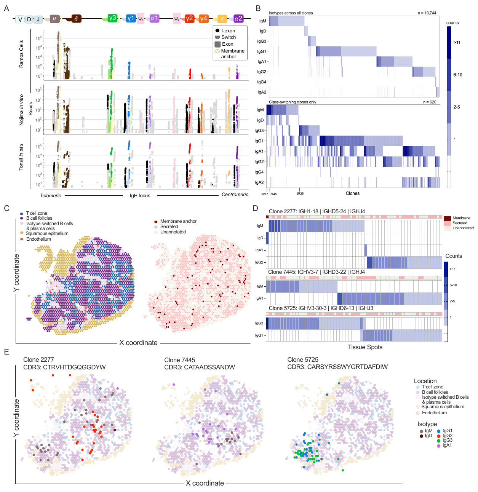

# Figure 5 — Isotype-Resolved B-cell Clonotype Analysis



> Reference render — full resolution: [`figure_5.pdf`](figure_5.pdf)

## Panels

| Panel | What it shows |
|-------|---------------|
| 5A | Per-locus read-depth histograms across the IGH locus (chr14: 99,839,968–100,127,783) for Visium tonsil, NBC, and RAGEseq |
| 5B | NBC per-barcode read-count distributions by isotype |
| 5C | Ramos cell line read distributions (IgM-dominated) |
| 5D | Hierarchically clustered isotype heatmaps — all clones (left) vs class-switching clones (right) |
| 5E | Spatial tonsil section: tissue regions (left) + RAD-recovered barcodes (right) |
| 5F | Per-clone isotype heatmaps for four representative clones (2277, 86, 5725, 7445) |
| 5G | Spatial maps of the same four clones overlaid on Visium coordinates |

## Inputs

- **Workspace:** `figure_5_workspace.RData` — see [`../data/README.md`](../data/README.md)
- **Demultiplexed FASTQs (full pipeline):** reuses Figure 4 NBC + Visium output at `${RESULTS_BASE}/sans_wl/nbc_wl/` and `${RESULTS_BASE}/visium_data/`
- **IgBLAST clonotyping:** driven by `project_specific_scripts/rnabloom_to_igblast.sh` and `generate_ig_mappings.sh`
- **Reference:** T2T chr14 BAM depth files (`nbc_chr14_t2t_mapont.depth.csv`, `rsq_chr14_t2t_mapont.depth.csv`)

## Scripts in this directory

| File | Purpose |
|------|---------|
| `figure_5_analysis.Rmd` | Master notebook — depth histograms, clone heatmaps, spatial plots |
| `consensus_ig_generator.R` | Build per-clone consensus IG sequences |
| `reformat_igblast_genes.R` | Normalize IgBLAST V/D/J gene names to IMGT canonical form |
| `verify_fig5.R` | Sanity check: workspace + Rmd objects match expected schema |

## How to regenerate

```bash
./scripts/run_figure_5.sh analysis     # Rmd only (default)
./scripts/run_figure_5.sh igblast      # rerun IgBLAST clonotyping then render
./scripts/run_figure_5.sh full         # rerun NBC demux + IgBLAST + render
```

Output: `figure_5_analysis.html`.

Per-panel raw data is also exported to `heatmap_raw_data/`, `histogram_raw_data/`, `scatterplot_raw_data/` (created at render time) for downstream Prism / PowerPoint figure assembly.

## Key workspace objects

`ig_locus_res`, `chr14_depth`, `nbc_depth`, `rsq_depth`, `rsq_ig`, `plot_dt`, `plot_dt_ordered`, `plot_mat`, `constant_clones`, `multiple_clones`, `mult_iso_mat`, `clone_2277_data`, `clone_5725`, `clone_7445`, `clone_86`, `clones_to_plot_dedup`, `bg`, `bg_plot`, `int_tonsil`, `int_tonsil_meta`, `per_clone_id_spots`.

## Isotype color palette (5G)

```
IGHM  #8B7A7A    IGHD  #6A1F00    IGHG3 #19A83E    IGHG1 #2B7DC6
IGHG2 #FF2D0F    IGHG4 #F06A1A    IGHE  #F1B44C    IGHA1 #A873C8
IGHA2 #7B2DAF
```

(Full membrane / secreted variants and tissue-region palette are in [`../manuscript_colors.txt`](../manuscript_colors.txt).)
