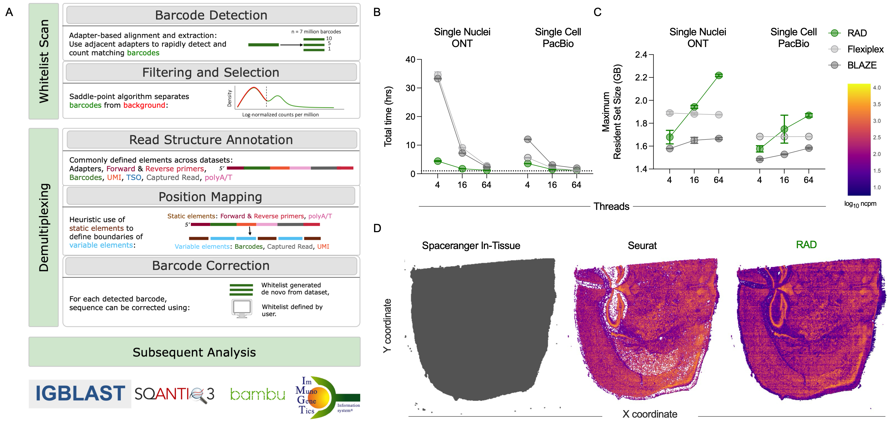
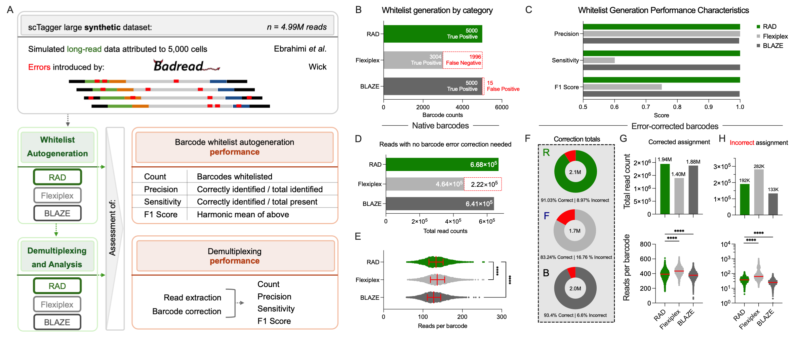
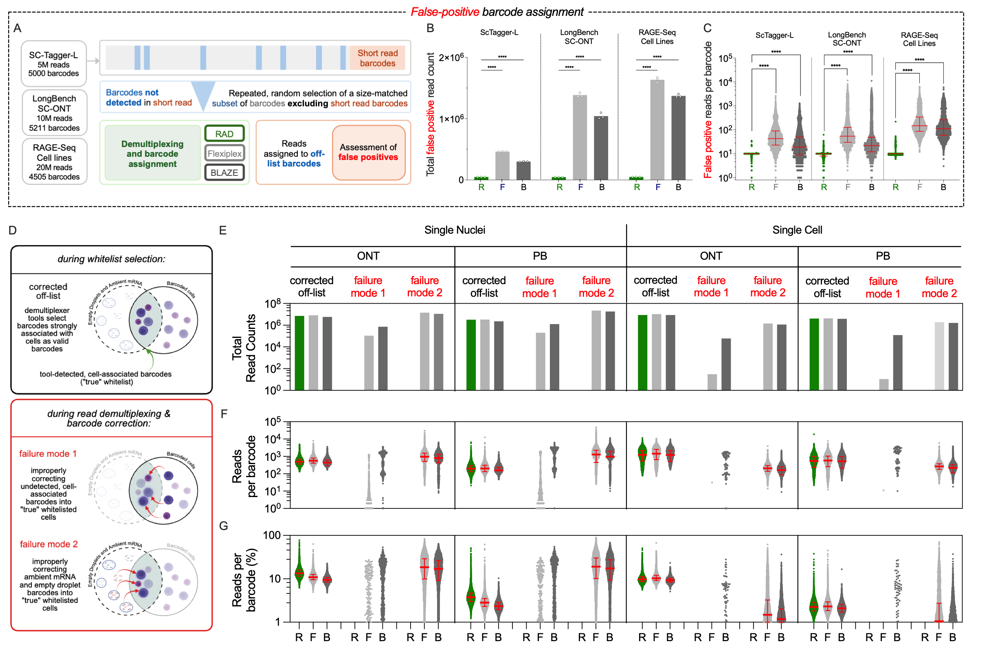
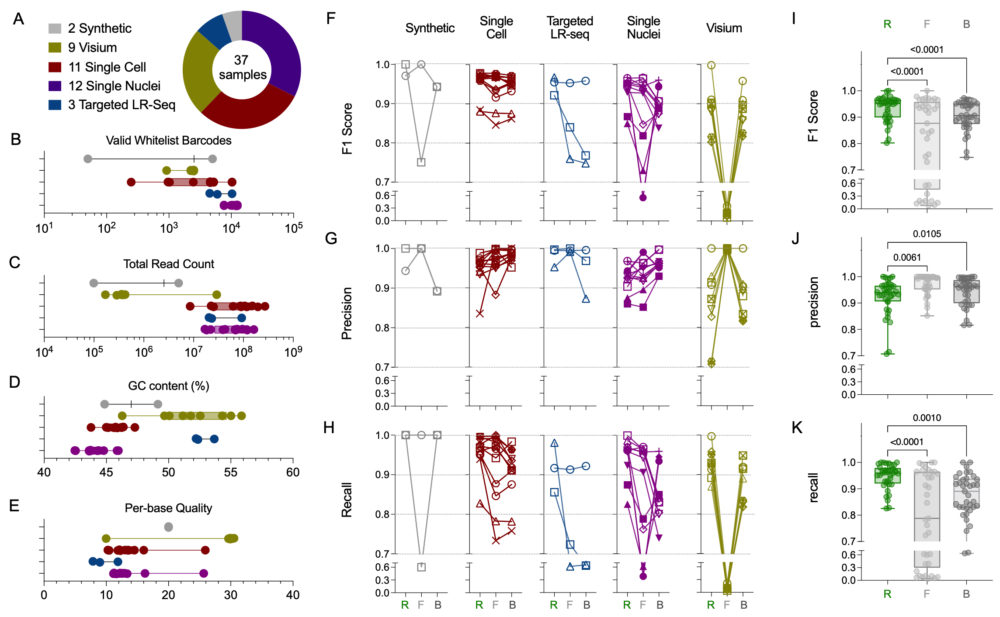
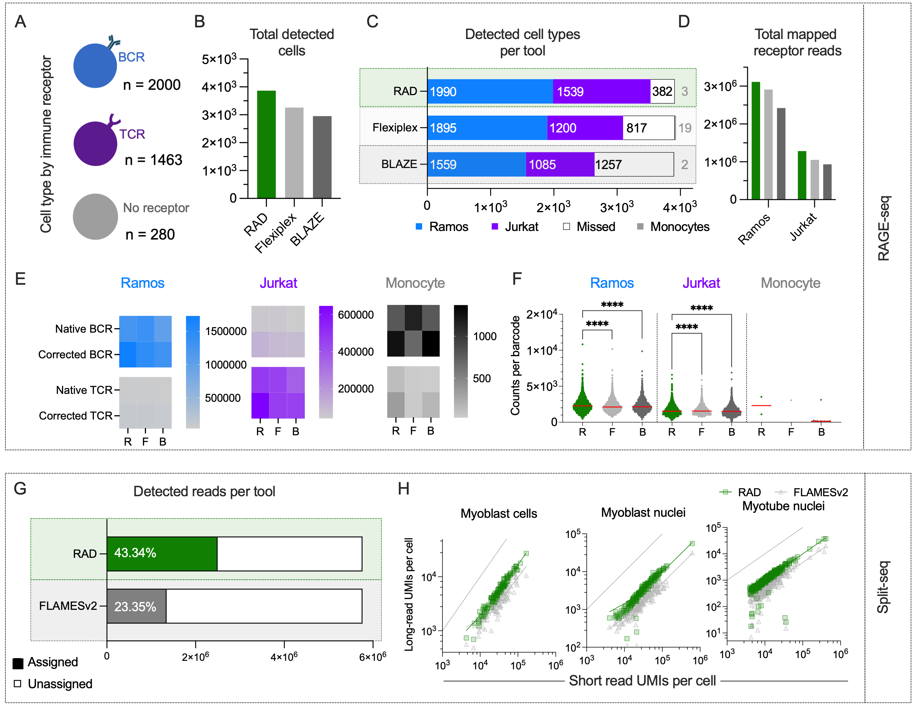
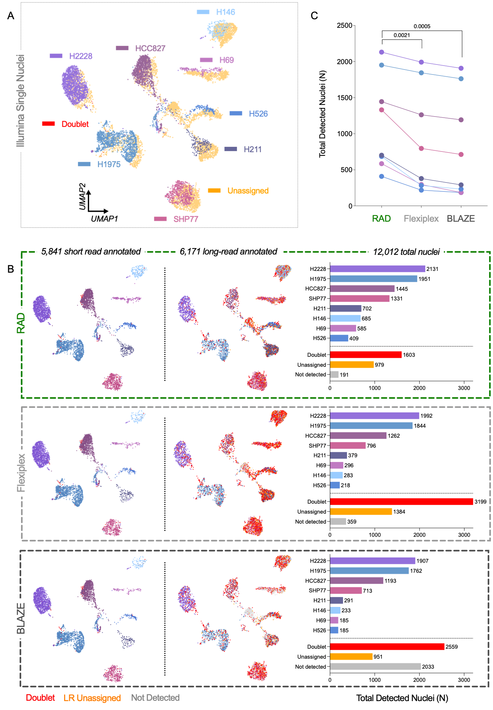
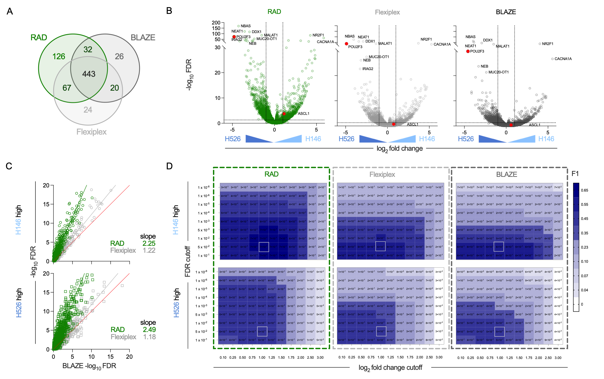
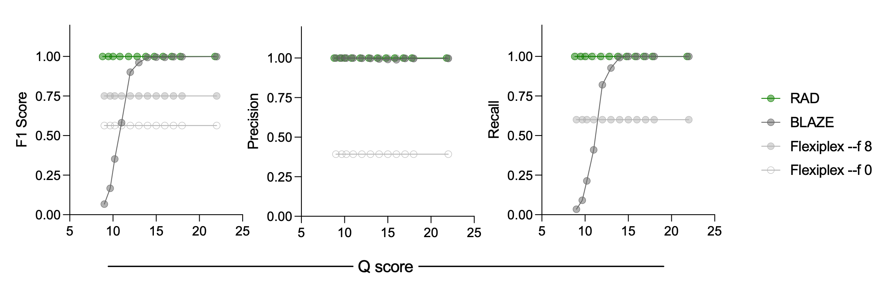
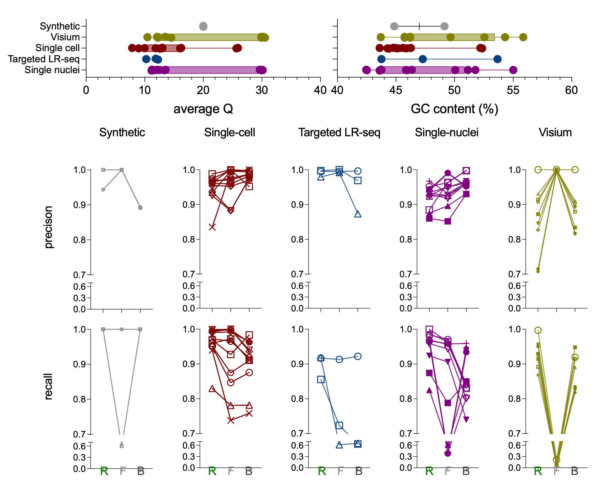

# Figures

The figures below are the manuscript exports. The [legends](../docs/current_figure_legends.md) describe the panels; each analysis guide links the deposited source tables, processing steps and plotting commands. The [export record](../source_data/prism_exports.json) identifies the source hashes and layouts.

## Figure 1 RAD workflow and computational performance

[Analysis guide](../docs/figure_01.md) · [Legends](../docs/current_figure_legends.md)

## Figure 2 Synthetic barcode discovery and read assignment

[Analysis guide](../docs/figure_02.md) · [Legends](../docs/current_figure_legends.md)

## Figure 3 Off-list assignments and barcode correction

[Analysis guide](../docs/figure_03.md) · [Legends](../docs/current_figure_legends.md)

## Figure 4 Barcode discovery across sequencing modalities

[Analysis guide](../docs/figure_04.md) · [Legends](../docs/current_figure_legends.md)

## Figure 5 Receptor recovery and LR-Split-seq

[Analysis guide](../docs/figure_05.md) · [Legends](../docs/current_figure_legends.md)

## Figure 6 Genotype-based cell-line assignment

[Analysis guide](../docs/figure_06.md) · [Legends](../docs/current_figure_legends.md)

## Figure 7 Differential cell-line expression

[Analysis guide](../docs/figure_07.md) · [Legends](../docs/current_figure_legends.md)

## Supplementary figures

### ScTagger quality sweep

[Analysis guide](../docs/figure_02.md) · [Legends](../docs/current_figure_legends.md#supplementary-figures)

### Barcode discovery across individual inputs

[Analysis guide](../docs/figure_04.md) · [Legends](../docs/current_figure_legends.md#supplementary-figures)

