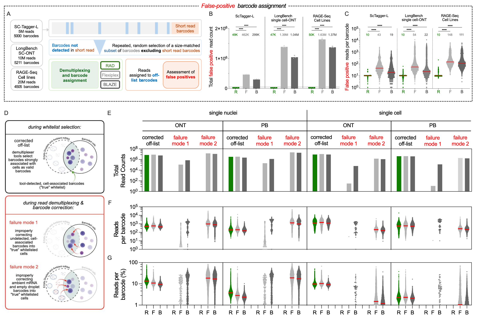

# Figure 3 — off-list assignments and barcode correction

[Methods and commands](../../docs/figure_03.md) · [Figure legend](../../docs/current_figure_legends.md#figure-3) · [Source data](../../source_data/figure_03/README.md)

## Off-list experiments

The deposited totals cover all three target lists for each dataset. The November artwork uses different RAGE-seq values in panels B–C and different counts in several LongBench series in panels E–G. The per-target distribution uses replicate 1. [Totals](../../source_data/figure_03/offlist_totals.tsv) · [Per-target counts](../../source_data/figure_03/offlist_per_target.tsv.gz)

## LongBench correction outcomes

[Category definitions](../../docs/figure_03.md#longbench-correction-categories) · [Totals](../../source_data/figure_03/correction_totals.tsv) · [Per-target counts and percentages](../../source_data/figure_03/correction_per_target.tsv.gz)
