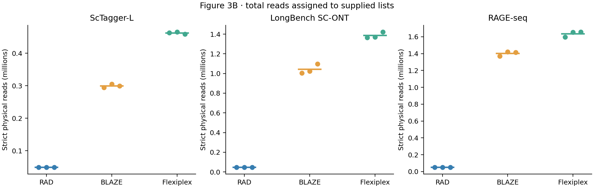
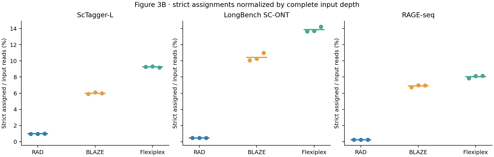
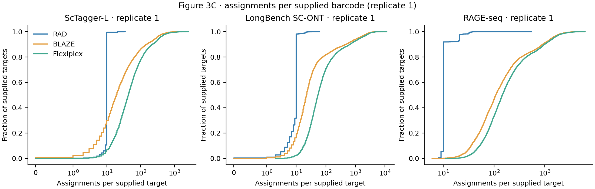
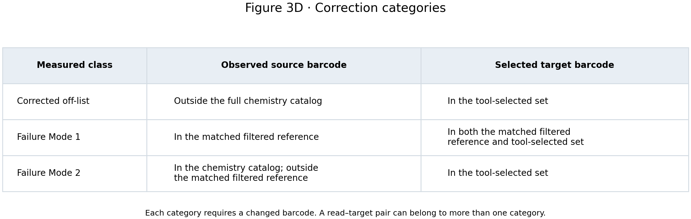
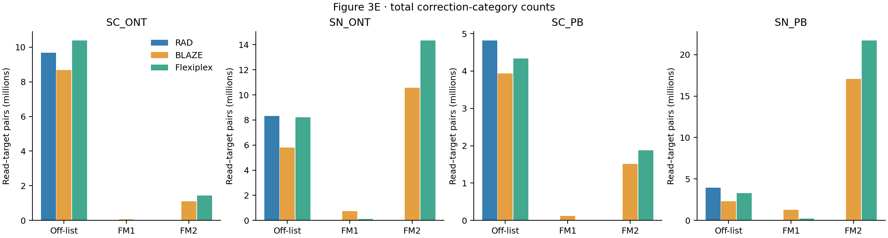
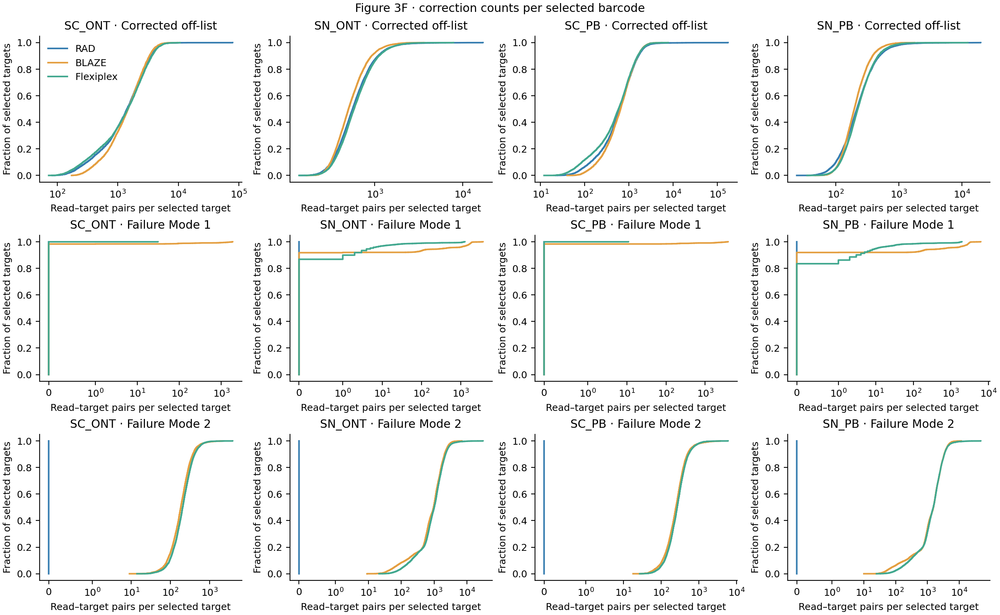
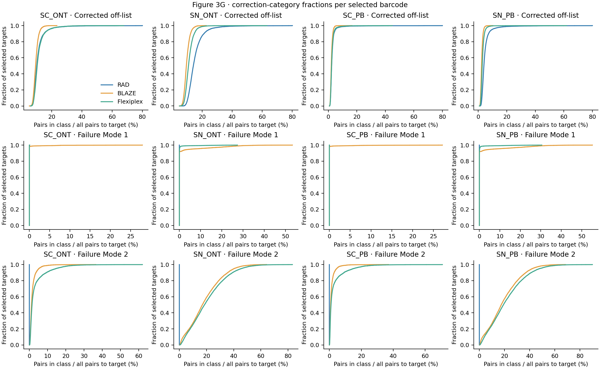

# Figure 3 — off-list assignments and barcode correction

[Methods and commands](../../docs/figure_03.md) · [Source data](../../source_data/figure_03/README.md)

## Off-list experiments

The same procedure was used for ScTagger-L, LongBench SC-ONT and RAGE-seq: three reference-excluded lists, identical input and list bytes across tools within each replicate, and strict original-read counting.







## LongBench correction outcomes

FM1 is reassignment between cell-associated reference barcodes. FM2 is reassignment from a catalog-valid barcode outside the cell reference into a selected barcode.









Each plot can be downloaded as PNG, PDF or SVG. Regenerate all plots from the deposited tables:

```bash
python3 scripts/revision/figure_3.py validate
python3 scripts/revision/figure_3.py render
```

The plots show the observed counts and percentages. They do not recalculate the manuscript's ANOVA tests or significance annotations.
