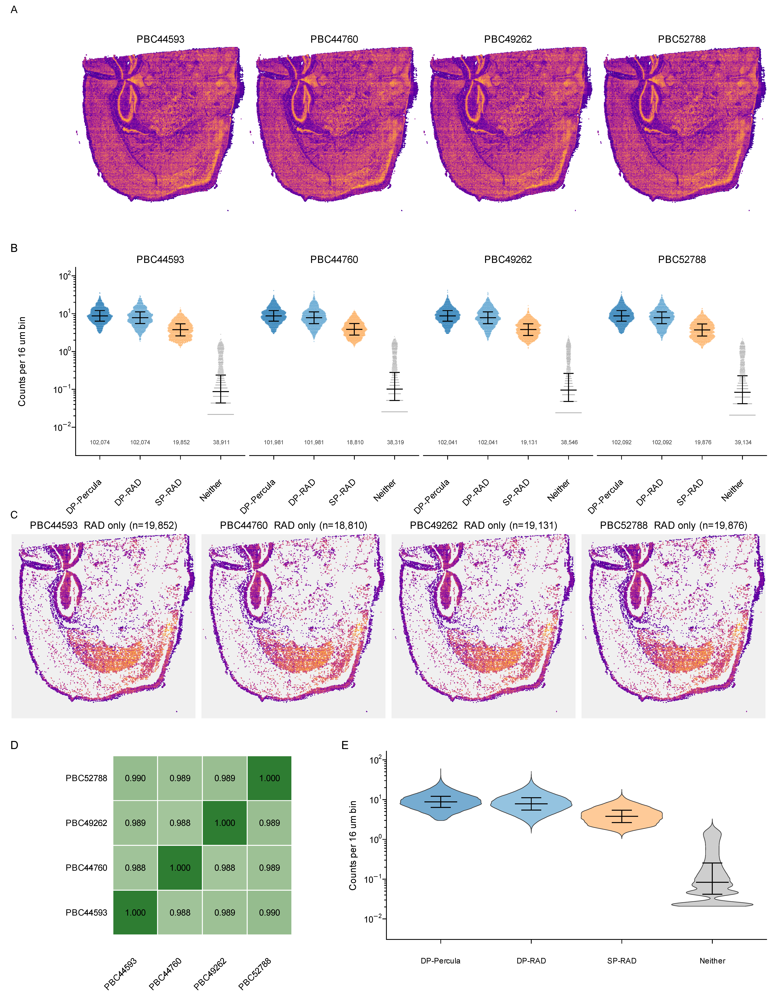

# Supplementary Figure 1 — RAD on 10X Visium HD Mouse Brain



> Reference render — full resolution: [`supp_figure_1.pdf`](supp_figure_1.pdf)

RAD applied to a public 10X Visium HD dataset of murine brain parenchyma. Four replicate sections (PBC44593, PBC44760, PBC49262, PBC52788) at 16 µm bin resolution. Each bin is classified per sample against SpaceRanger's / Percula's `in_tissue` annotation as **Both**, **RAD only**, **Seurat only** (Percula not RAD), or **Neither**.

> *Note on naming:* this figure was originally drafted as "supplementary figure 4" during development, and many of the source files retain that nomenclature (`supp_fig4.R`, `build_supp_fig4_prism*.py`, `supp_fig4_*.csv`). The rendered figure and caption files use the canonical `supp_figure_1` naming.

## Panels

| Panel | What it shows |
|-------|---------------|
| **A** | Per-sample spatial maps of `log1p(ncpm)` for RAD-valid bins (Both + RAD only). Shared plasma scale across the four samples. |
| **B** | Per-sample faceted violins of the four bin classes on a log-scaled "Counts per 16 µm bin" y-axis: DP-Percula (Both bins, Percula counts), DP-RAD (Both bins, RAD counts), SP-RAD (RAD only, RAD counts), Neither. Quasirandom dots subsampled to 1,500 per (sample × group). Black crossbar = median, errorbars = IQR. |
| **C** | Per-sample spatial maps of single-positive-RAD bins (plasma) over a grey background of all bins. Shared color scale. |
| **D** | 4×4 pairwise Pearson correlation heatmap of RAD `log1p(ncpm)` across the four samples, computed over Percula's `in_tissue` bin set. Off-diagonal r = 0.988–0.990. |
| **E** | Pooled kernel-density violins of the same four groups as Panel B across all four samples. |

## Class + metric definitions

| Code | Meaning |
| ---- | ------- |
| TP / Both / Double-positive | RAD calls the bin in-tissue AND Percula includes the bin |
| FP / RAD only / Single-positive RAD | RAD calls the bin in-tissue, Percula does not |
| FN / Seurat only | Percula includes the bin, RAD does not |
| TN / Neither | Neither pipeline includes the bin |

| Term | Formula |
| ---- | ------- |
| `count` | raw UMI count per bin |
| `ncpm` | `count × 1e6 / total_count_for_that_pipeline_for_that_sample` |
| `log1p(ncpm)` | `log(1 + ncpm)` |

For Percula, the total is `sum(nCount_Spatial)` across all bins in the 16 µm Seurat object (single reference, shared across the four samples). For RAD, the total is the per-sample sum of RAD-derived counts.

## Inputs

The bundled `raw_data/` directory contains every CSV the source scripts need:

| File | Used by | Purpose |
|------|---------|---------|
| `tissue_positions_16um.csv` | `supp_fig4.R`, `export_panel_E_*.R` | Grid layout (sr16 → array_row, array_col), Panels A, C |
| `sample_bin_matrix_16um.csv.gz` | `supp_fig4.R`, `export_panel_E_*.R` | Per-sample RAD counts + valid flags at 16 µm bins (Panels A, B, C) |
| `sample_correlations_16um.csv` | `supp_fig4.R` | Pairwise Pearson r between samples (Panel D heatmap) |
| `panel_E_four_groups_wide.csv` | `build_supp_fig4_prism.py`, `build_supp_fig4_prism_subsampled.py` | Panel E `log1p(ncpm)` values, 4 columns |
| `panel_E_four_groups_stats.csv` | provenance | Per-group n, mean, median, sd, q25, q75 on `log1p(ncpm)` |
| `panel_E_four_groups_raw_counts.csv` | `build_panel_E_prism.py` | Panel E raw UMI counts, 4 columns |
| `panel_E_four_groups_ncpm.csv` | `build_panel_E_prism.py` | Panel E ncpm (non-log), 4 columns |
| `panel_E_four_groups_raw_stats.csv` | provenance | Per-group n, mean, median, q25, q75 on raw + ncpm |
| `violin_prism_long.csv.gz` | `supp_fig4_paragraph_stats.R`, prism builders | Long-format per (sample, bin) with class — covers Panels B, C |
| `supp_fig4_counts.csv` | `supp_fig4_paragraph_stats.R` | Per-sample TP/FP/FN/TN counts + recovery % |
| `supp_fig4_class_logncpm_summary.csv` | provenance | Per (sample, class) summary stats |
| `supp_fig4_overlap_per_sample.csv` | provenance | Per-sample fraction of single-positive RAD inside double-positive range |
| `supp_fig4_paragraph_stats.csv` | provenance | Numbers cited in the manuscript paragraph |

One input is **too large to vendor in the repo** and is read via env var instead:

| Source | Env var | Size | Where to obtain |
|--------|---------|------|-----------------|
| `tissue_positions_16um.csv` (full grid) + `visium_hd_mouse_brain_016um_seurat.rds` | `HD_MAPPING_DIR` | 384 MB (Seurat) + 11 MB (positions) | See `data/README.md` (Zenodo upload of the Visium HD mapping bundle, TODO). |

`HD_MAPPING_DIR` is documented alongside the other env vars in the top-level [`../../README.md`](../../README.md) → Setup.

## How to regenerate

Run from this directory (`figures/supp_figure_1/`):

```bash
export HD_MAPPING_DIR=/path/to/visium_hd_mapping     # Seurat RDS + tissue_positions

Rscript supp_fig4.R                                   # → supp_figure_1.{pdf,png}
Rscript export_panel_E_data.R                         # → raw_data/panel_E_four_groups_{wide,stats}.csv
Rscript export_panel_E_raw.R                          # → raw_data/panel_E_four_groups_{raw_counts,ncpm,raw_stats}.csv
Rscript supp_fig4_paragraph_stats.R                   # → raw_data/supp_fig4_{counts,overlap_per_sample,paragraph_stats}.csv

python3 build_supp_fig4_prism.py                      # → supp_figure_1_violins_and_heatmap.pzfx
python3 build_supp_fig4_prism_subsampled.py           # → supp_figure_1_violins_and_heatmap_subsampled.pzfx
python3 build_panel_E_prism.py                        # → supp_figure_1_panelE_raw.prism
```

The `.pzfx` / `.prism` outputs (~130 MB across the three) are not committed to the repo — re-derive them locally as needed.

## Manuscript caption

Final caption + paragraph text live in [`supp_figure_1_caption.md`](supp_figure_1_caption.md) (Markdown) and [`supp_figure_1_caption.docx`](supp_figure_1_caption.docx) (Word). The older [`CAPTION_AND_PARAGRAPH.md`](CAPTION_AND_PARAGRAPH.md) has the longer working draft with all per-sample numbers.
